# Plotting energyRt objects

`energyRt` ships
[`autoplot()`](https://ggplot2.tidyverse.org/reference/autoplot.html)
methods (and, where natural, matching
[`plot()`](https://energyRt.org/reference/draw.md) methods) for most of
its building-block classes. They turn an object into a `ggplot`, so the
result can be themed and extended with `+` layers like any other ggplot.

| Class | What the plot shows |
|----|----|
| `calendar` | the sub-annual time structure (stacked timeframe rows) |
| `horizon` | the planning intervals / milestone years |
| `commodity` | emission factors (`@emis`) — one or several commodities |
| `supply`, `demand`, `import`, `export` | level parameters over years (given data + interpolation) |
| `weather` | a sub-annual capacity/availability factor (heatmap, line or area) |

``` r

library(energyRt)
library(ggplot2)   # provides the autoplot() generic
```

## Calendars

The example `calendars` dataset holds a few ready-made `calendar`
objects.

``` r

data("calendars", package = "energyRt")
names(calendars)
#>  [1] "annual"            "m12"               "m12a"             
#>  [4] "q4"                "s4"                "s4_h24"           
#>  [7] "m12_h24"           "wd7_h24"           "w52_h24"          
#> [10] "d365"              "d365_h24"          "s4_hp3"           
#> [13] "m12_subset_q1"     "d365_h24_1dps"     "d365_h24_1dpm"    
#> [16] "m12_d365_h24"      "m12_d365_h24_1dpm"
```

[`autoplot()`](https://ggplot2.tidyverse.org/reference/autoplot.html)
returns each timeframe as a row of rectangles sized by each timeslice’s
share of the year; [`plot()`](https://energyRt.org/reference/draw.md)
draws the same figure:

``` r

autoplot(calendars$s4_hp3)
```

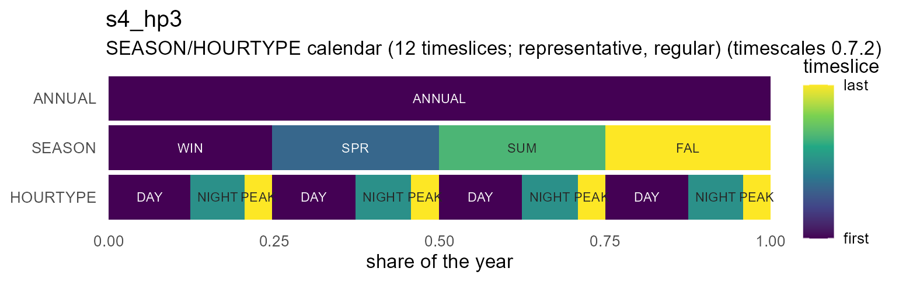

### Coloring

For `fill = "order"` (the default) the `color_pattern` controls the
gradient. `"within"` (default) colours each level over **its own**
timeslices — so an hourly row shows a full `h00`→`h23` cycle repeating
every day, while `"global"` colours by absolute chronology across the
whole year.

``` r

autoplot(calendars$d365_h24)                          # within (default)
```

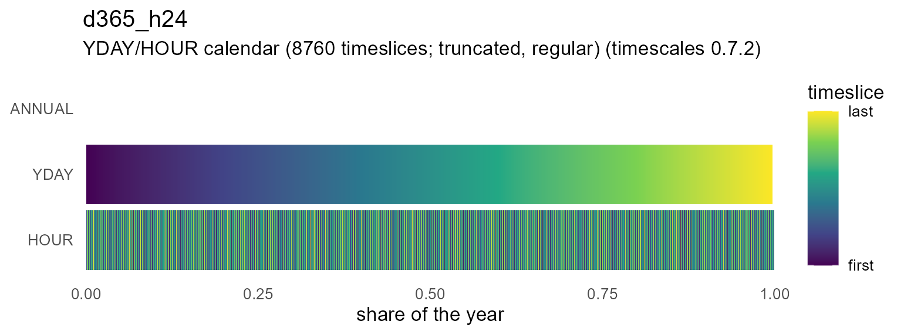

``` r

autoplot(calendars$d365_h24, color_pattern = "global")
```

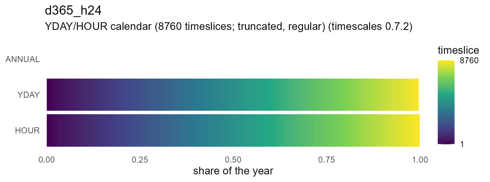

Other fill metrics are the timeslice `"share"` and `"weight"`:

``` r

autoplot(calendars$s4_hp3, fill = "share")
```

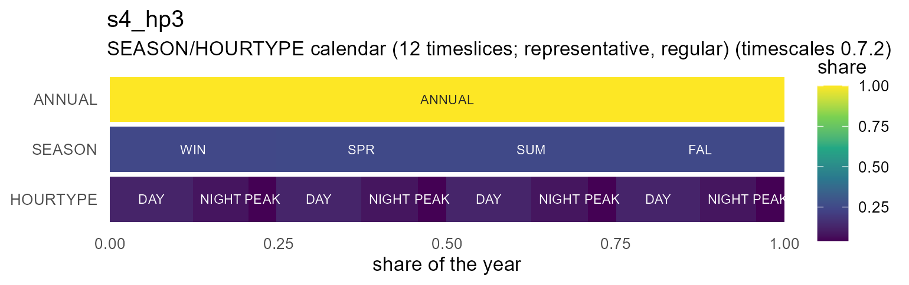

### Labels

Each cell is labelled by its member name (`labels = "name"`, the
default, e.g. `h00`…`h23`) or by the full timeslice path
(`labels = "timeslice"`, e.g. `d001_h00`); `labels = FALSE` draws none.
Label text contrasts with the fill automatically, and rows with more
cells than `max_labels` stay unlabelled.

``` r

autoplot(calendars$s4_hp3, labels = "timeslice")
```

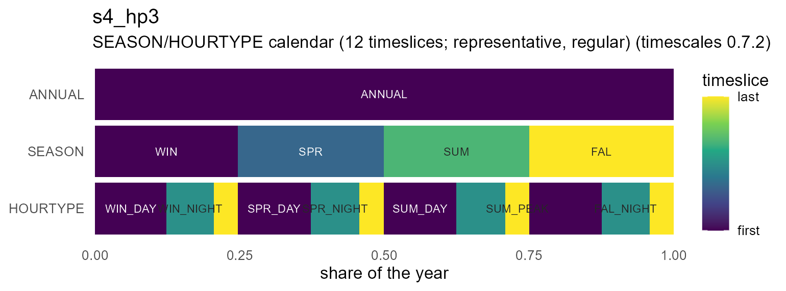

### Subset view

A reduced calendar can be shown against a full reference calendar: pass
the full one as `reference`. The timeslices present in the subset are
filled; the rest are left empty.

``` r

autoplot(calendars$d365_h24_1dpm,
         reference = calendars$d365_h24)
```

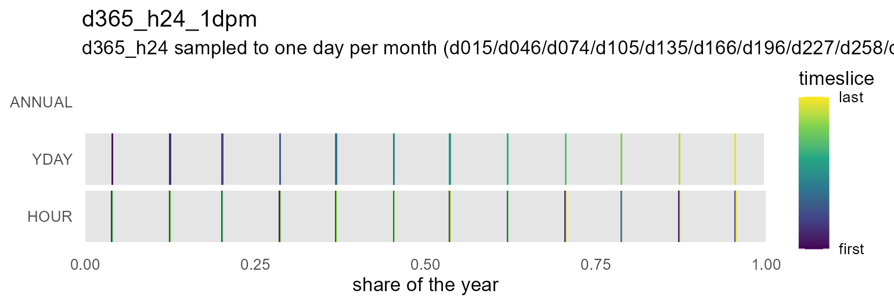

### Styling

`border` outlines the rectangles (off by default so dense rows read as a
smooth gradient) and `palette` picks the viridis option; and because the
result is a ggplot you can keep customizing it:

``` r

autoplot(calendars$s4_hp3, palette = "magma", border = "grey40") +
  labs(title = "Four seasons, day/night") +
  theme_minimal()
```

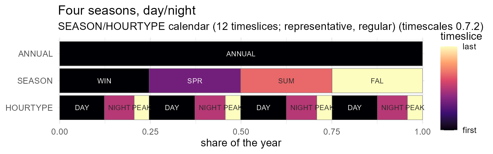

## Heatmaps

[`autoplot()`](https://ggplot2.tidyverse.org/reference/autoplot.html)
lays every timeslice out in one row per timeframe. When a value is
indexed by a *two-dimensional* calendar — day-of-year × hour, month ×
hour — a **heatmap** reads more naturally:
[`gg_heatmap()`](https://energyRt.org/reference/gg_heatmap.md) puts the
finest timeframe on `y`, the next on `x`, and any coarser levels into
facets. The layout is taken from the calendar, which you pass as
`calendar =` – either a calendar object or the name of one, such as
`"d365_h24"`.

Here is a synthetic hourly load profile on the `d365_h24` calendar (a
daily cycle plus a seasonal swing). The diurnal band and the
winter/summer contrast are immediately visible:

``` r

calendar_d365h24 <- calendars$d365_h24
timetable <- calendar_d365h24@timetable
hour <- timescales::tsl2hour(timetable$timeslice, calendar_d365h24@name)
yday <- timescales::tsl2yday(timetable$timeslice, calendar_d365h24@name)
prof <- data.frame(
  timeslice = timetable$timeslice,
  load = 50 + 30 * sin(2 * pi * (hour - 6) / 24) +
              15 * cos(2 * pi * yday / 365))

# x = YDAY, y = HOUR
gg_heatmap(prof, calendar = calendar_d365h24, value = "load")
```

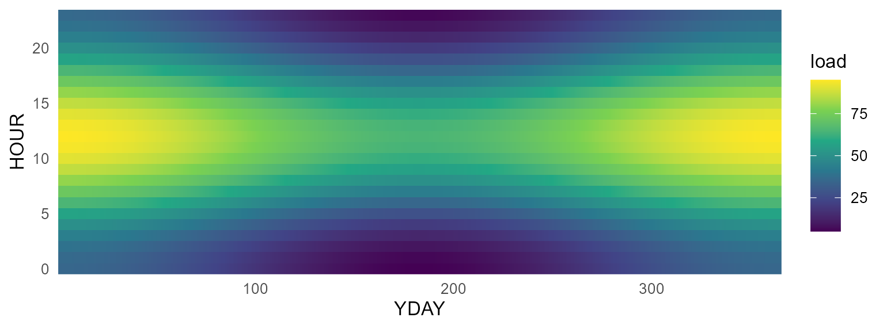

Facet a day-of-year format by `"month"` to get one day-of-month × hour
panel per month:

``` r

# 12 panels
gg_heatmap(prof, calendar = calendar_d365h24, value = "load",
             facet = "month")
```

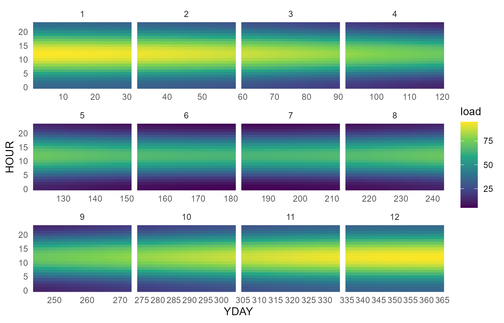

`palette` selects the viridis option and `name` labels the colour bar,
exactly as for
[`autoplot()`](https://ggplot2.tidyverse.org/reference/autoplot.html).

### From model objects

Any timeslice-indexed model data lays out the same way. Here
**electricity demand** and a **solar capacity factor** from the packaged
TOPIA kit, on its hourly calendar (`d365_h24`): pull the object with
[`getObject()`](https://energyRt.org/reference/getObject.md), take one
region (and, for demand, one year), and pass the `timeslice` + value
columns to
[`gg_heatmap()`](https://energyRt.org/reference/gg_heatmap.md). The
`name` argument carries the value’s unit onto the colour bar. A graded
resource ships one series per grade, so the solar object is cut to one
mounting as well as one region – two series on one timeslice have
nothing to lay out.

``` r

repo <- topia$modules$electricity$repo

DEM <- getObject(repo, name = "DEM_ELC", drop = TRUE)
dem <- subset(as.data.frame(DEM@demand), region == "R02" & year == 2025)
gg_heatmap(dem[, c("timeslice", "demand")], calendar = calendar_d365h24,
             value = "demand", name = "GWh", facet = "month")
```

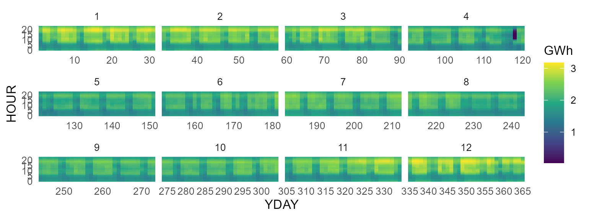

``` r

WSOL <- getObject(repo, name = "WSOL", drop = TRUE)
wsol <- subset(as.data.frame(WSOL@weather), region == "R02" & cluster == "FL")
gg_heatmap(wsol[, c("timeslice", "wval")], calendar = calendar_d365h24,
             value = "wval", name = "capacity factor", facet = "month")
```

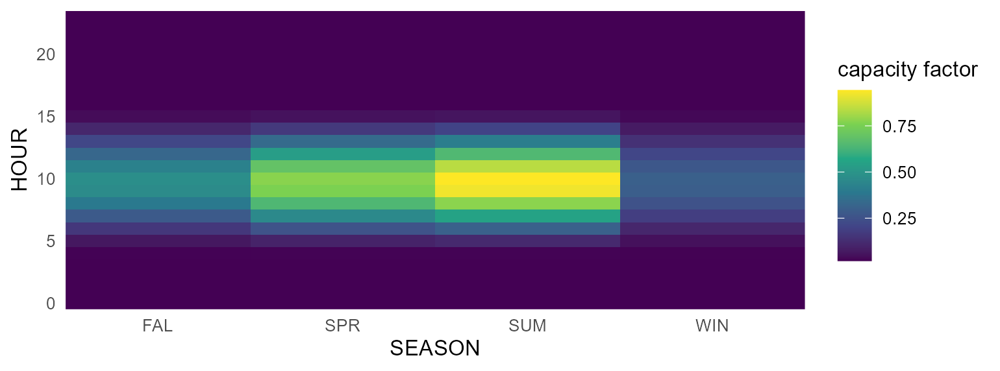

The weather heatmap is exactly what
[`autoplot()`](https://ggplot2.tidyverse.org/reference/autoplot.html)
draws for a `weather` object directly — with line and area variants too
(see *Weather* below).

## Horizons

`horizon` objects draw the modelled intervals over milestone years:

``` r

data("horizons", package = "energyRt")
autoplot(horizons$Y2020_2060_by_5)
```

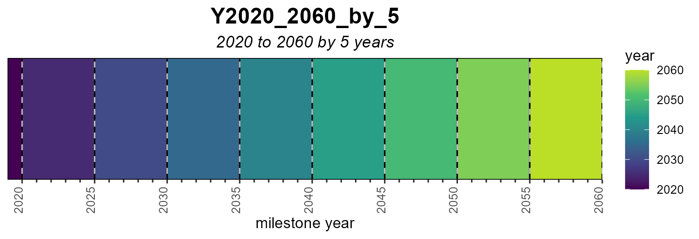

## Commodities

For a `commodity`,
[`autoplot()`](https://ggplot2.tidyverse.org/reference/autoplot.html)
shows its emission factors (`@emis`). Passing several commodities
compares their emission intensities side by side.

``` r

COA <- newCommodity("COA", desc = "Coal",
                    emis = data.frame(comm = "CO2", unit = "kt/GWh", emis = 0.33))
OIL <- newCommodity("OIL", emis = data.frame(comm = "CO2", unit = "kt/GWh", emis = 0.25))
GAS <- newCommodity("GAS", emis = data.frame(comm = "CO2", unit = "kt/GWh", emis = 0.18))

autoplot(COA)                 # a single commodity
```

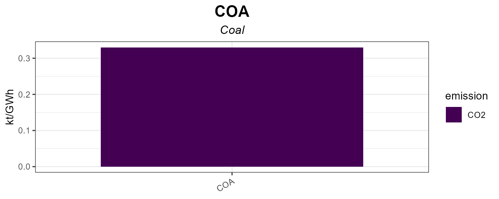

``` r

autoplot(COA, OIL, GAS)       # comparison
```

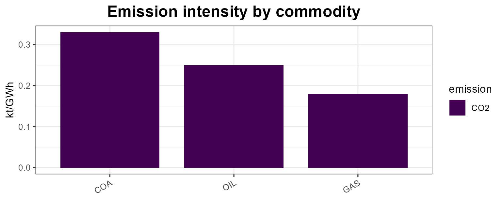

## Supply, demand, import, export

These process objects are plotted by year: the **points** are the given
data and the **lines** are the interpolation (both extracted with
[`getData()`](https://energyRt.org/reference/getData.md)). Level
parameters are faceted by their base name so bounds and prices/costs
keep separate y-scales.

``` r

SUP_COA <- newSupply(
  name = "SUP_COA", commodity = "COA", unit = "PJ", region = "R1",
  supply = data.frame(
    region = "R1", timeslice = "ANNUAL",
    year   = c(2020, 2040, 2020, 2020),
    ava.up = c(100,  200,  NA,   NA),
    ava.lo = c(NA,   NA,   10,   NA),
    cost   = c(NA,   NA,   NA,   30)))
autoplot(SUP_COA)
```


A single given value (or none) is drawn as a flat dashed line showing
the interpolation direction. Pass `year` to interpolate over a specific
horizon (constant extrapolation beyond the given years),
`interpolate = FALSE` to show only the given data, and
`show_defaults = TRUE` to also draw the model’s default values for
parameters the object leaves unset:

``` r

autoplot(SUP_COA, year = 2020:2050)
```

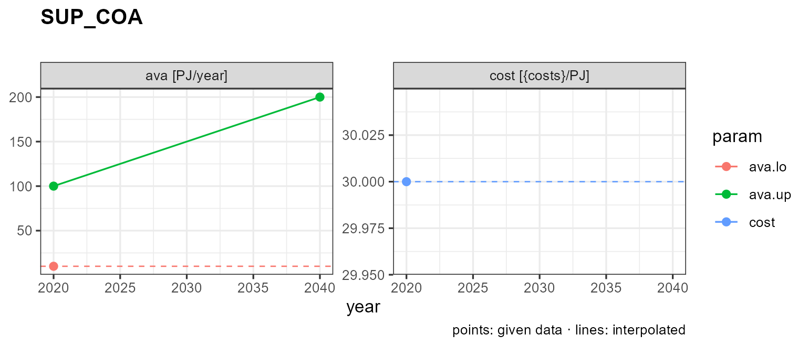

``` r

autoplot(SUP_COA, show_defaults = TRUE)
```


Demand, import and export follow the same pattern:

``` r

DEM_ELC <- newDemand(
  name = "DEM_ELC", commodity = "ELC", unit = "GWh",
  demand = data.frame(region = "R1", timeslice = "ANNUAL",
                   year = c(2020, 2030, 2050), demand = c(100, 150, 300)))
autoplot(DEM_ELC)
```

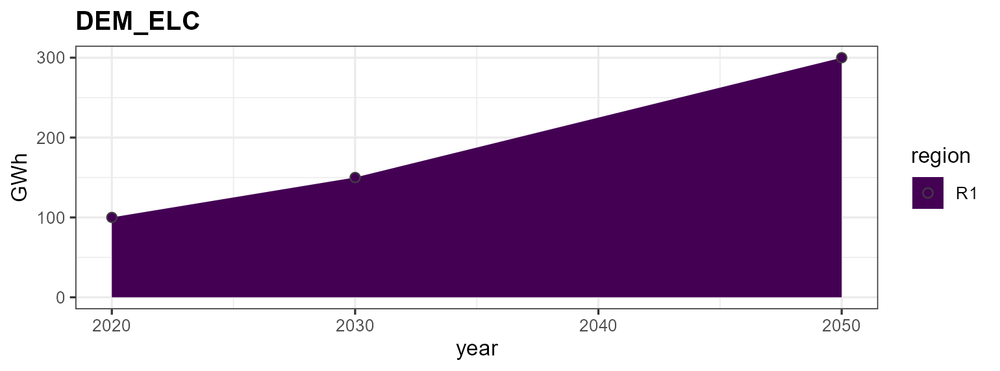

``` r

IMP_GAS <- newImport(
  name = "IMP_GAS", commodity = "GAS",
  import = data.frame(region = "R1", timeslice = "ANNUAL",
                   year = c(2020, 2050), imp.up = c(50, 80), price = c(5, 9)))
autoplot(IMP_GAS)
```

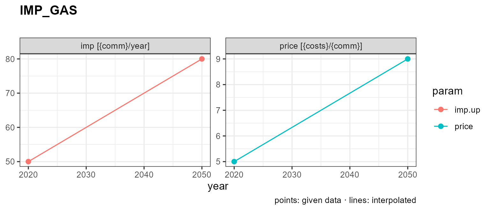

## Weather

`weather` objects hold a sub-annual factor — a capacity / availability
factor — per region and timeslice.
[`autoplot()`](https://ggplot2.tidyverse.org/reference/autoplot.html)
offers three views via `type =`: a calendar **heatmap** (the default),
and diurnal **line** / **area** charts. Because the timeslice layout
(here season × hour) can’t be inferred from the timeslice names alone,
pass the model’s `calendar`; the value’s unit
([`getUnit()`](https://energyRt.org/reference/getUnit.md), or
`"capacity factor"` when unset) labels the value axis — the fill legend
for the heatmap, the y-axis for line/area.

``` r

WSOL <- getObject(topia$modules$electricity$repo,
                  name = "WSOL", drop = TRUE)

# heatmap (default), faceted by region
autoplot(WSOL, calendar = calendar_d365h24)
```

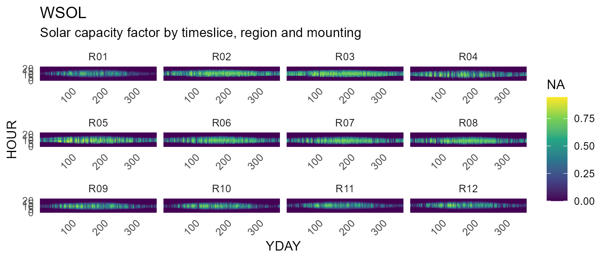

The **line** view reads the diurnal shape directly — one line per
season, the capacity factor on the y-axis:

``` r

autoplot(WSOL, style = "line", calendar = calendar_d365h24)
```

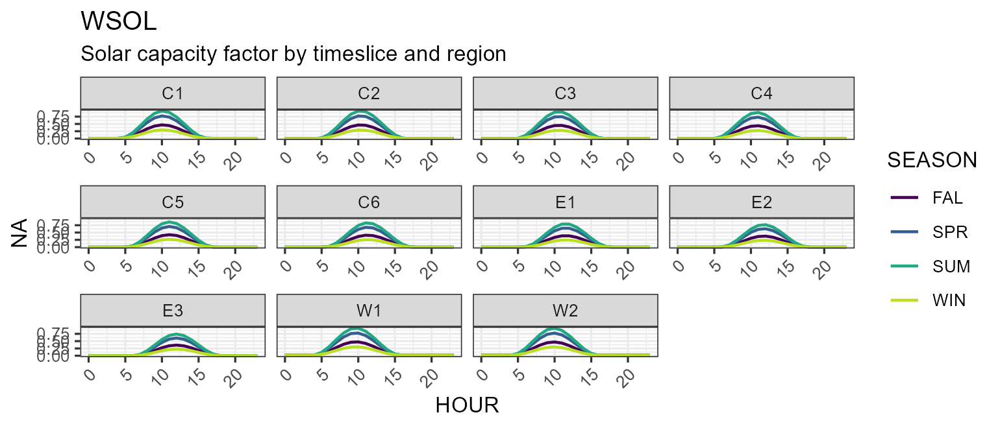

``` r

autoplot(WSOL, style = "area", calendar = calendar_d365h24)   # or filled areas
```

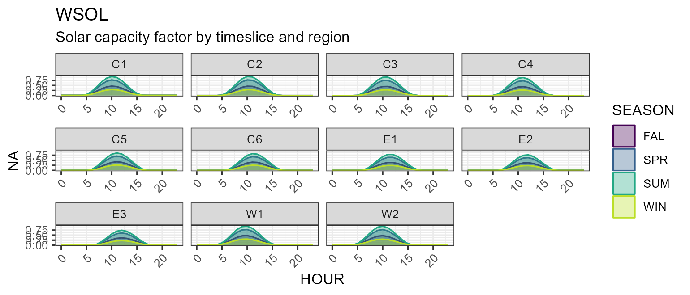

## Notes

- Every method returns a `ggplot`, so `+ theme_*()`, `+ labs()`,
  `+ scale_*()` etc. all work.
- [`plot()`](https://energyRt.org/reference/draw.md) is available for
  `calendar` and `horizon`: it draws the
  [`autoplot()`](https://ggplot2.tidyverse.org/reference/autoplot.html)
  figure and returns it invisibly.
- [`autoplot()`](https://ggplot2.tidyverse.org/reference/autoplot.html)
  also works on the result of
  [`levcost()`](https://energyRt.org/reference/levcost.md) (levelized
  cost) — see [`?levcost`](https://energyRt.org/reference/levcost.md) —
  but that requires solving a small model, so it is not shown here.
- See
  [`?autoplot.calendar`](https://energyRt.org/reference/plot_calendar_method.md),
  [`?autoplot.commodity`](https://energyRt.org/reference/autoplot.commodity.md),
  [`?autoplot.supply`](https://energyRt.org/reference/autoplot.process.md),
  and [`?plot_weather`](https://energyRt.org/reference/plot_weather.md)
  for the full list of arguments.
