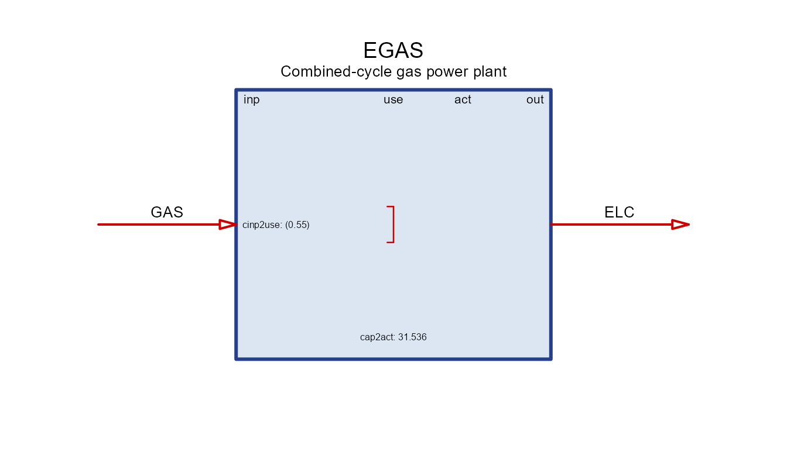
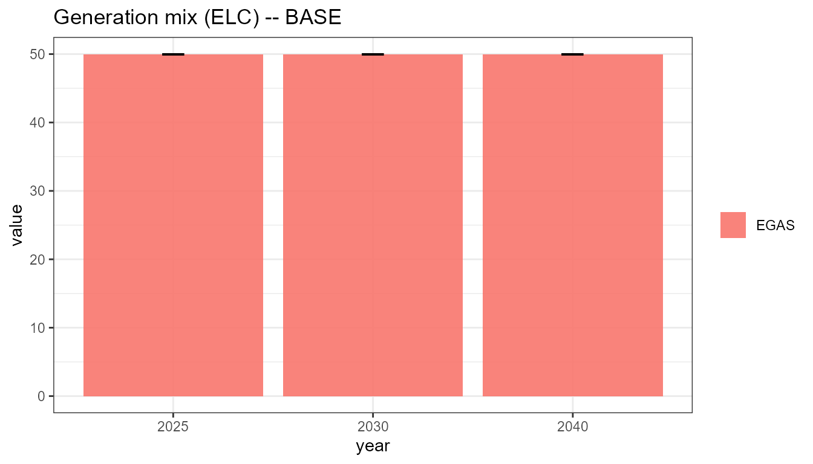
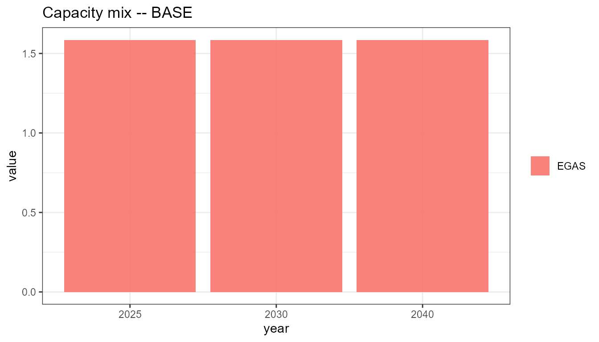

# Get started with energyRt

## Describe the energy system with reusable components

> **A comprehensive, modular energy system modeling framework with an R
> interface.**

An energy system is a network of flows. Resources are extracted or
harvested, converted by technologies, moved, stored, and consumed as
useful energy. Planning that system means deciding what to build, when
to build it, and how to operate it while meeting demand and respecting
physical and policy constraints.

**energyRt** is a framework and macro-language for stating that problem
in R. Modelers describe commodities, technologies, supply, demand,
storage, and trade as reusable objects. energyRt uses those objects to
generate the sets, mappings, equations, and solver inputs required by
its implementations, then reads the solution back into R.

The package provides **modeling machinery rather than a fixed model,
dataset, or scenario**. The same components can support a small teaching
example, a national planning model, or a detailed multi-sector study.

## How it works: bricks, time, and space

An energyRt model combines reusable bricks with explicit time and space
structures:

- **Bricks** describe commodities and processes. They are inspectable R
  objects that can be drawn, updated, reused, and combined in
  repositories.
- **Time** comes from a modeler-defined nested
  [timescales](https://github.com/optimal2050/timescales) calendar.
  Annual, seasonal, hourly, representative, and sampled resolutions are
  choices, not package limits. A full 8,760-hour year is one possible
  calendar; it is not a fixed requirement or ceiling.
- **Space** comes from a nested
  [geoscales](https://github.com/optimal2050/geoscales) hierarchy.
  National, zonal, and nodal balances can coexist, with each commodity
  and process placed where its data belongs. Time, space, and the
  planning horizon belong to the model configuration rather than to
  every process definition. A technology can therefore be reused with a
  different calendar or geographical hierarchy when its data support
  that change. Solver backends are discussed separately below: they are
  maintained implementations of the energyRt formulation, not another
  structural axis.

The central object types are:

| Brick | Constructor | Role |
|----|----|----|
| commodity | [`newCommodity()`](https://energyRt.org/reference/newCommodity.md) | an energy carrier or accounting flow |
| technology | [`newTechnology()`](https://energyRt.org/reference/technology.md) | converts inputs into outputs |
| supply | [`newSupply()`](https://energyRt.org/reference/newSupply.md) | provides a resource at an availability and cost |
| demand | [`newDemand()`](https://energyRt.org/reference/newDemand.md) | defines consumption that must be met |
| storage | [`newStorage()`](https://energyRt.org/reference/storage.md) | moves a commodity between timeslices |
| trade | [`newTrade()`](https://energyRt.org/reference/newTrade.md) | moves a commodity between regions or the rest of the world |
| weather | [`newWeather()`](https://energyRt.org/reference/newWeather.md) | supplies exogenous profiles such as capacity factors |
| repository | [`newRepository()`](https://energyRt.org/reference/newRepository.md) | collects reusable bricks |
| model | [`newModel()`](https://energyRt.org/reference/newModel.md) | binds a repository to time, space, and a horizon |
| scenario | [`interpolate()`](https://energyRt.org/reference/interpolate_model.md) / [`solve()`](https://rdrr.io/r/base/solve.html) | materializes and solves one model configuration |

A technology connects `input -> use -> activity -> output`; costs,
capacity, availability, emissions, and auxiliary flows attach to that
chain. The [model bricks
article](https://energyrt.org/articles/model-bricks.html) develops the
complete object system.

## A five-minute model

The first model has one fuel, one power plant, and one electricity
demand. The units and timeframe are explicit: annual energy is measured
in PJ, capacity in GW, and costs in MEUR.

``` r

GAS <- newCommodity(
  name = "GAS",
  desc = "Natural gas",
  timeframe = "ANNUAL",
  unit = "PJ"
)
ELC <- newCommodity(
  name = "ELC",
  desc = "Electricity",
  timeframe = "ANNUAL",
  unit = "PJ"
)

gas_supply <- data.frame(
  cost = 6.0
)
SUP_GAS <- newSupply(
  name = "SUP_GAS",
  desc = "Natural gas supply",
  commodity = "GAS",
  unit = "PJ",
  supply = gas_supply
)

gas_efficiency <- data.frame(
  comm = "GAS",
  cinp2use = 0.55
)
gas_investment <- data.frame(
  invcost = 900
)
EGAS <- newTechnology(
  name = "EGAS",
  desc = "Combined-cycle gas power plant",
  input = list(comm = "GAS"),
  output = list(comm = "ELC"),
  ceff = gas_efficiency,
  invcost = gas_investment,
  fixom = 25,
  cap2act = 31.536,
  olife = 25L
)

electricity_demand <- data.frame(
  demand = 50
)
DEM_ELC <- newDemand(
  name = "DEM_ELC",
  desc = "Annual electricity demand",
  commodity = "ELC",
  unit = "PJ",
  demand = electricity_demand
)

draw(object = EGAS)
```



Collect the bricks, define a planning horizon, bind the model to one
region, and solve it with the bundled GLPK solver:

``` r

HELLO_REPOSITORY <- newRepository(
  name = "HELLO_REPOSITORY",
  GAS,
  ELC,
  SUP_GAS,
  EGAS,
  DEM_ELC,
  desc = "Components of the introductory electricity model"
)

HELLO_HORIZON <- newHorizon(
  name = "HELLO_HORIZON",
  desc = "Planning horizon from 2025 through 2040",
  period = 2025:2040,
  intervals = c(1, 5, 10),
  mid_is_end = TRUE
)

HELLO <- newModel(
  name = "HELLO",
  desc = "Single-region gas-to-electricity model",
  data = HELLO_REPOSITORY,
  region = "R1",
  discount = 0.05,
  horizon = HELLO_HORIZON
)

BASE <- solve_model(
  object = HELLO,
  name = "BASE",
  solver = solver_options$glpk,
  echo = FALSE
)
```

[`solve_model()`](https://energyRt.org/reference/solve_model.md)
interpolates and solves in one call. The composable form exposes the
intermediate scenario when it needs to be inspected or modified:

``` r

BASE_STAGED <- HELLO |>
  interpolate(name = "BASE_STAGED") |>
  solve()
```

Results return as tables at the same level of detail as the model:

``` r

base_objective <- getData(
  object = BASE,
  name = "vObjective",
  merge = TRUE
)
base_capacity <- getData(
  object = BASE,
  name = "vTechCap",
  merge = TRUE
)

base_objective
#> # A tibble: 1 × 3
#>   scenario name       value
#>   <chr>    <chr>      <dbl>
#> 1 BASE     vObjective 6677.
base_capacity
#> # A tibble: 3 × 6
#>   scenario name     tech  region  year value
#>   <chr>    <chr>    <chr> <chr>  <int> <dbl>
#> 1 BASE     vTechCap EGAS  R1      2025  1.59
#> 2 BASE     vTechCap EGAS  R1      2030  1.59
#> 3 BASE     vTechCap EGAS  R1      2040  1.59
```

The model built 1.59 GW of gas capacity—enough to supply 50 PJ per year
under the declared conversion efficiency. The solved scenario also
contains every underlying flow, cost, and balance.

## Plot solved results

[`autoplot()`](https://ggplot2.tidyverse.org/reference/autoplot.html)
uses the same result tables returned by
[`getData()`](https://energyRt.org/reference/getData.md). On a solved
scenario it can show annual generation, capacity, new capacity, fuel
use, or storage operation. The annual electricity balance from `BASE`
is:

``` r

generation_plot <- autoplot(
  object = BASE,
  type = "generation",
  comm = "ELC"
)
generation_plot
```



The capacity view reads the same scenario without another solve:

``` r

capacity_plot <- autoplot(
  object = BASE,
  type = "capacity"
)
capacity_plot
```



Sub-annual models add a dispatch view by selecting timeslices, for
example
`autoplot(object = scenario, type = "generation", timeslice = "^SUM_")`.

## Save, find, and reload scenarios

An energyRt project stores scenarios, their runs, and references to
their model inputs.
[`save_scenario()`](https://energyRt.org/reference/save_scenario.md)
writes the scenario and adds it to the project registry. The name can
then be used instead of a path:

``` r

BASE <- save_scenario(
  object = BASE,
  verbose = FALSE
)
#> Scenario 'BASE' saved in 'C:/Users/admin/AppData/Local/Temp/RtmpkxaKv6/energyRt-intro/BASE-HELLO-HELLO_HORIZON'
#> Directory size: 0.24 MB

project_registry <- load_registry()
project_registry[, c("type", "name", "parent")]
#> # A tibble: 19 × 3
#>    type     name  parent
#>    <chr>    <chr> <chr> 
#>  1 model    HELLO ""    
#>  2 scenario BASE  ""    
#>  3 run      glpk  "BASE"
#>  4 scenario BASE  ""    
#>  5 run      glpk  "BASE"
#>  6 scenario BASE  ""    
#>  7 run      glpk  "BASE"
#>  8 scenario BASE  ""    
#>  9 run      glpk  "BASE"
#> 10 scenario BASE  ""    
#> 11 run      glpk  "BASE"
#> 12 scenario BASE  ""    
#> 13 run      glpk  "BASE"
#> 14 scenario BASE  ""    
#> 15 run      glpk  "BASE"
#> 16 scenario BASE  ""    
#> 17 run      glpk  "BASE"
#> 18 scenario BASE  ""    
#> 19 run      glpk  "BASE"

BASE <- load_scenario(
  path = "BASE",
  env = NULL,
  verbose = FALSE
)

registered_objective <- getData(
  object = "BASE",
  name = "vObjective",
  merge = TRUE
)
registered_objective
#> # A tibble: 1 × 3
#>   scenario name       value
#>   <chr>    <chr>      <dbl>
#> 1 BASE     vObjective 6677.
```

[`load_scenarios()`](https://energyRt.org/reference/load_scenario.md)
loads several registered scenarios as a named list, while
[`scenario_runs()`](https://energyRt.org/reference/scenario_runs.md)
lists the solves recorded inside one scenario. Arrow-backed storage
allows result tables to remain on disk until they are queried. See
[Scenario
management](https://energyrt.org/articles/scenario-management.html) for
the registry, object stores, variants, and portable project bundles.

## Sample a calendar

Sampling changes the temporal representation of a scenario. It is useful
for rapid exploration, but it is an approximation unless the chosen
slices are representative. A sample must retain complete members of a
calendar level;
[`calendar_samples()`](https://energyRt.org/reference/calendar_samples.md)
builds valid sample specifications and records how much of the year each
one covers.

``` r

data(
  list = "topia",
  package = "energyRt"
)
s4_h24 <- topia$modules$calendars$s4_h24

SEASON_SAMPLES <- calendar_samples(
  calendar = s4_h24,
  level = "SEASON",
  sample_size = 2,
  n = 2,
  method = "random",
  seed = 2050
)
SEASON_SAMPLES
#> calendar_samples: 2 sample(s), method = random
#>   slices per sample: 48-48 | distinct slices used: 96
```

[`solve_by_sample()`](https://energyRt.org/reference/solve_by_sample.md)
interpolates and solves each sample, preserving the sample definition
and its runs. This larger TOPIA example is not executed while the
introductory vignette builds:

``` r

TOPIA_KIT <- topia$modules$electricity$R1
TOPIA_SAMPLING <- newModel(
  name = "TOPIA_SAMPLING",
  desc = "TOPIA model used to demonstrate calendar sampling",
  data = TOPIA_KIT$repo,
  calendar = s4_h24,
  region = TOPIA_KIT$regions,
  horizon = topia$modules$horizons$base,
  discount = 0.05
)
TOPIA_SAMPLING <- setGeoscale(
  obj = TOPIA_SAMPLING,
  geoscale = TOPIA_KIT$geoscale
)

TOPIA_SAMPLES <- solve_by_sample(
  object = TOPIA_SAMPLING,
  name = "TOPIA_SAMPLES",
  samples = SEASON_SAMPLES,
  solver = solver_options$glpk,
  echo = FALSE,
  verbose = FALSE
)
sample_summary(
  x = TOPIA_SAMPLES,
  name = "vTechCap",
  by = "tech"
)
```

See [Time
resolution](https://energyrt.org/articles/time-resolution.html) and
[Workflow](https://energyrt.org/articles/workflow.html) for manual
calendar subsets, weighting, repeated samples, and comparisons with a
full solve.

## One formulation, several maintained backends

energyRt contains implementations of its formulation in several modeling
languages. A model object can be compiled through any implementation
available in the local environment, but this is concrete package support
rather than backend independence in the abstract: each route works
because energyRt ships and maintains code for it.

| Route | What the energyRt implementation does | Good fit |
|----|----|----|
| GLPK / MathProg | writes MathProg and solves with bundled `glpsol` | first models, teaching, reproducible local runs |
| Julia / JuMP | writes JuMP for HiGHS, CBC, GLPK, CPLEX, or cuOpt | larger local models and Julia solver environments |
| Python / Pyomo | writes Pyomo for HiGHS, CBC, GLPK, or CPLEX | Python-based solver environments |
| GAMS | writes the formulation in GAMS | established institutional GAMS workflows |
| [multimod](https://github.com/optimal2050/multimod) *(experimental)* | constructs an in-memory model in multimod’s R DSL/AST, then assembles an LP/MPS matrix, solves with HiGHS, or renders equations as LaTeX; it is not a separate text modeling language | matrix workflows, inspection, and mathematical documentation |
| [mmcloud](https://github.com/optimal2050/mmcloud) *(experimental)* | submits large matrix problems to cloud infrastructure and solves them with GPU-capable backends | models that exceed local memory or compute capacity |

Check the toolchains before selecting an optional route.
[`en_check_dependencies()`](https://energyRt.org/reference/en_check.md)
is read-only; `solve = TRUE` additionally verifies configured backends
by solving a small test model.

``` r

backend_status <- en_check_dependencies(
  solver_pkgs = TRUE,
  solve = FALSE
)

julia_components <- c("Julia", "Julia packages")
julia_rows <- backend_status$component %in% julia_components
julia_found <- backend_status$found[julia_rows]
julia_ready <- length(julia_found) == length(julia_components)
julia_ready <- julia_ready && all(julia_found)

if (julia_ready) {
  BASE_JULIA <- solve_model(
    object = HELLO,
    name = "BASE_JULIA",
    solver = solver_options$julia_highs,
    echo = FALSE
  )
}

pyomo_rows <- backend_status$component == "Pyomo"
pyomo_ready <- isTRUE(backend_status$found[pyomo_rows])

if (pyomo_ready) {
  BASE_PYOMO <- solve_model(
    object = HELLO,
    name = "BASE_PYOMO",
    solver = solver_options$pyomo_cbc,
    echo = FALSE
  )
}
```

[NEOS](https://neos-server.org/) provides another remote route for
supported solvers without a local license. The [solver backends
article](https://energyrt.org/articles/backends.html) covers
installation, presets, dependency checks, and operational limits.

## Generate reports

[`report()`](https://energyRt.org/reference/report.md) renders object
datasheets and model or scenario reports. A scenario report includes
solve status, generation and capacity charts, costs, and other available
results; a process report documents its declared parameters and diagram.
HTML reports require Pandoc, so these calls are shown but not executed
during the vignette build:

``` r

base_report <- report(
  object = BASE,
  format = "html",
  open = FALSE
)

gas_plant_report <- report(
  object = HELLO,
  name = "EGAS",
  format = "html",
  open = FALSE
)
```

Reports are cached against the object, template, and arguments;
unchanged inputs do not trigger another render. The
[Reports](https://energyrt.org/articles/reports.html) article covers
full scenario reports, process groups, levelized costs, and
HTML/PDF/Word output.

## From one solve to a study

The first solve uses only a fraction of the framework:

- **Build and reuse.**
  [`update()`](https://energyRt.org/reference/update.md) derives
  variants without duplicating complete formulations; repositories
  organize components into model libraries.
- **Represent detail where it matters.** Nested timeframes and
  geographies let different commodities and processes balance at
  different levels.
- **Scale the formulation.** Sparse interpolation materializes only the
  tuples used by a scenario; vintages, clusters, graded resources, and
  custom constraints extend the model without changing its workflow.
- **Manage many runs.** Named projects and Arrow-backed scenario folders
  keep results addressable and allow larger-than-memory analysis.
- **Inspect and validate.**
  [`draw()`](https://energyRt.org/reference/draw.md),
  [`autoplot()`](https://ggplot2.tidyverse.org/reference/autoplot.html),
  [`report()`](https://energyRt.org/reference/report.md), and
  [`verify_solution()`](https://energyRt.org/reference/verify_solution.md)
  expose both declared objects and solved behavior.
- **Analyze in R.** Results flow directly into `dplyr`, `ggplot2`, and
  the rest of the R ecosystem without a separate export-import step.

TOPIA, the teaching model shipped with energyRt, connects these ideas in
a multi-region electricity system with nested geography and time,
storage, trade, capacity expansion, dispatch, and policy scenarios.

## Where next

1.  [Model bricks](https://energyrt.org/articles/model-bricks.html)
    explains the object system in depth.
2.  [TOPIA I](https://energyrt.org/articles/topia-build.html) builds a
    complete multi-region electricity model brick by brick.
3.  [TOPIA II](https://energyrt.org/articles/topia-use.html) solves it
    and adds policy scenarios.
4.  [Time
    resolution](https://energyrt.org/articles/time-resolution.html) and
    [Space
    resolution](https://energyrt.org/articles/space-resolution.html)
    develop the two structural axes.
5.  [Solver backends](https://energyrt.org/articles/backends.html)
    covers local, direct-matrix, GPU, and cloud routes.
6.  [Workflow](https://energyrt.org/articles/workflow.html) moves from
    one solve to reproducible scenario studies.
7.  [Scenario
    management](https://energyrt.org/articles/scenario-management.html)
    and [Reports](https://energyrt.org/articles/reports.html) cover
    persistent projects and automated outputs.
8.  [Features](https://energyrt.org/articles/features.html) is the full
    capability inventory.
