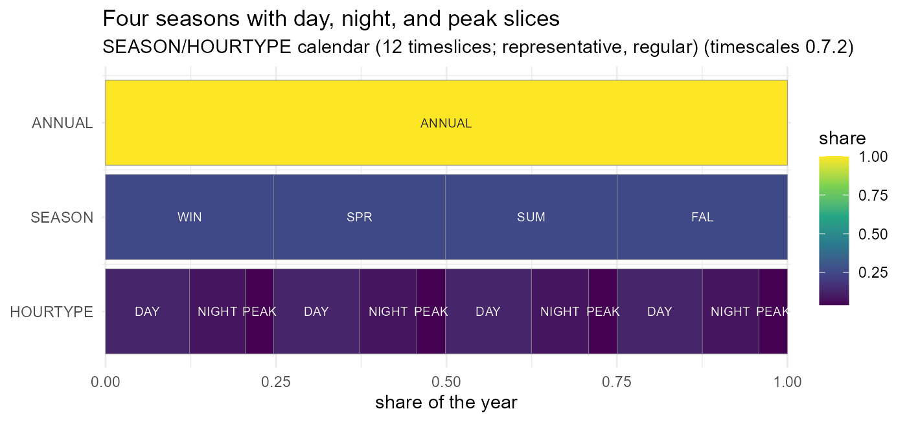

# Results and reporting

**Key functions**

- Query and plot:
  [`getData()`](https://energyRt.org/reference/getData.md),
  [`autoplot()`](https://ggplot2.tidyverse.org/reference/autoplot.html),
  [`gg_heatmap()`](https://energyRt.org/reference/gg_heatmap.md).
- Compare:
  [`compare_scenarios()`](https://energyRt.org/reference/compare_scenarios.md),
  [`compare_models()`](https://energyRt.org/reference/compare_models.md),
  [`compare_inputs()`](https://energyRt.org/reference/compare_inputs.md).
- Publish: [`levcost()`](https://energyRt.org/reference/levcost.md),
  [`report()`](https://energyRt.org/reference/report.md),
  [`report_templates()`](https://energyRt.org/reference/report_templates.md).

energyRt renders **reports** — self-contained HTML/PDF/Word datasheets —
for technologies and storages, whole models and repositories, solved
scenarios, and scenario comparisons. Reports and the **levelized costs**
([`levcost()`](https://energyRt.org/reference/levcost.md)) that feed
them are *derived artifacts*: both are cached on disk and re-computed
only when their inputs change. This article tours the layer — what
renders where, how the caching works, and how to compare scenarios.

``` r

library(energyRt)
library(ggplot2)
```

## Read the solution, then ask a question

A solved `scenario` stores decoded variables in `modOut`. If several
solver runs exist, make the run choice explicit before querying:

``` r

scenario_runs(scen)
scen <- read_solution(scen, run = "julia-highs")
```

[`getData()`](https://energyRt.org/reference/getData.md) is the common
query interface for model declarations, interpolated parameters, and
solution variables. Name the variable first, then filter on its
dimensions:

``` r

cap <- getData(scen, "vTechCap", year = 2030, merge = TRUE)
gen <- getData(scen, "vTechAct", comm = "ELC", merge = TRUE)
ems <- getData(scen, "vEmsFuelTot", comm = "CO2", merge = TRUE)
```

`merge = TRUE` joins useful labels and mappings into the returned table.
Leave it off when you need only the native variable keys. Keep the query
in code and save a derived table only when it is a deliverable; `modOut`
remains the source of truth.

## Plot while you explore

[`autoplot()`](https://ggplot2.tidyverse.org/reference/autoplot.html)
methods cover model objects, dimensions, comparisons, and several result
objects. They return `ggplot` objects, so normal layers and themes work:

``` r

autoplot(calendars$s4_hp3, fill = "share", border = "grey50") +
  labs(title = "Four seasons with day, night, and peak slices") +
  theme_minimal()
```



Choose the view that matches the data rather than forcing everything
into one chart.
[`gg_heatmap()`](https://energyRt.org/reference/gg_heatmap.md) suits
values indexed by two calendar dimensions;
`autoplot(weather, calendar = ...)` offers heatmap, line, and area
styles; `autoplot(supply)` and related methods show declared points and
interpolated paths. For solved scenarios, query a focused table with
[`getData()`](https://energyRt.org/reference/getData.md) and build a
custom `ggplot` when the reporting question is specific.

``` r

ggplot(gen, aes(year, value, fill = tech)) +
  geom_col() +
  facet_wrap(vars(region)) +
  labs(x = NULL, y = "Electricity generation")
```

## Compare while exploring

For an ad-hoc variable comparison, pass several scenario names or
objects to [`getData()`](https://energyRt.org/reference/getData.md).
This is the fastest way to check one hypothesis before building a
structured comparison or report.

``` r

getData(c("BASE", "CO2CAP"), "vEmsFuelTot", comm = "CO2", merge = TRUE)
```

Everything lands under a throwaway project here;
[`open_project()`](https://energyRt.org/reference/accessors.md) anchors
the registry, the object stores, and the two derived-artifact folders
(`reports/`, `levcosts/`) in one call:

``` r

proj <- file.path(tempdir(), "rep-demo")
dir.create(proj, showWarnings = FALSE)
open_project(proj)
#> energyRt project: C:/Users/admin/AppData/Local/Temp/RtmpmmGelk/rep-demo (0 registered scenarios)
```

A technology to price and report on:

``` r

PP <- newTechnology(
  "PP", desc = "Gas power plant",
  input  = list(comm = "GAS", unit = "GWh"),
  output = list(comm = "ELC", unit = "GWh"),
  ceff   = data.frame(comm = "GAS", cinp2use = 0.55),
  invcost = data.frame(invcost = 800),
  fixom = data.frame(fixom = 20), varom = data.frame(varom = 2),
  af = data.frame(af.up = 0.85),
  vintage = data.frame(olife = 25L), cap2act = 8.76)
```

## Levelized costs, cached

[`levcost()`](https://energyRt.org/reference/levcost.md) prices a
technology (LCOE), storage (LCOS), or trade route (LCOT).
`method = "auto"` uses a closed-form engine when the process qualifies
and falls back to a small solver run otherwise:

``` r

lc <- levcost(PP, fuel_costs = c(GAS = 25), discount = 0.06,
              base_year = 2025, verbose = FALSE)
round(as.numeric(lc$levcost_npv), 2)
#> [1] 58.55
```

The result was also written to the on-disk cache, keyed by the
technology’s *content hash* plus the assumptions. Re-pricing the
identical question returns instantly from disk:

``` r

lc2 <- levcost(PP, fuel_costs = c(GAS = 25), discount = 0.06,
               base_year = 2025)
#> levcost: cached result is current: C:/Users/admin/AppData/Local/Temp/RtmpmmGelk/rep-demo/levcosts/PP@8099a340.rds (force = TRUE to recompute)
list.files(get_levcost_cache_path())
#> [1] "PP@8099a340.rds" "PP@8099a340.yml"
```

Anything that changes the answer — the technology’s data, `discount`,
fuel prices, the method — is part of the cache key, so a stale hit is
impossible; `force = TRUE` recomputes regardless, and `cache = FALSE`
skips the cache entirely. For objects *saved* in a store the cache moves
into the owning folder (`<scenario>/levcost/`, a model store entry’s
`levcost/`); the project-level `levcosts/` above is the tier for
in-memory objects.

## Rendering a datasheet

[`report()`](https://energyRt.org/reference/report.md) renders a
technology datasheet — parameters, the
[`draw()`](https://energyRt.org/reference/draw.md) diagram, and (with
`levcost =`) the levelized-cost section. The same rule places the
output: saved objects render inside their own folder’s `reports/`,
in-memory objects into the project-level `reports/` tier:

``` r

f <- report(PP, levcost = lc, format = "html", open = FALSE)
#> Report written to C:\Users\admin\AppData\Local\Temp\RtmpmmGelk\rep-demo\reports\report_PP.html
basename(f)
#> [1] "report_PP.html"
```

A report is **skip-if-current**: the rendered file carries a sidecar
(`*.report.yml`) keying the object content, the template content, the
arguments, and the levcost identity. Repeating the call re-renders
nothing:

``` r

f <- report(PP, levcost = lc, format = "html", open = FALSE)
#> Report up to date: C:\Users\admin\AppData\Local\Temp\RtmpmmGelk\rep-demo\reports\report_PP.html (force = TRUE to re-render)
```

Editing the technology, the template, or any argument invalidates the
key; `force = TRUE` re-renders unconditionally. Formats: `format =`
takes any of `"html"`, `"pdf"`, `"tex"`, `"docx"` (PDF needs a LaTeX
toolchain).

## Model and scenario reports

Container reports split by role: `report(model)` documents the
**assumptions** (configuration, inventories, per-process sheets), while
`report(scenario)` documents the **results** of a solved scenario —
status, generation/capacity charts, costs, emissions; `run =` renders
any recorded run, and `template = "full"` switches to the comprehensive
page-broken layout with maps and branding. Reporting a single process
from a container injects its container-priced levelized cost:

``` r

report(scen)                       # results overview -> <scenario>/reports/
report(scen, run = "julia_highs")  # another recorded run
report(scen, template = "full")    # comprehensive, page-broken layout
report(scen, name = "PP")          # one process, priced in this scenario
```

The process sections follow *your* groups: a named list of process names
or regular expressions, passed as `groups =` or stored once in
`mod@misc$report_groups` (a scenario inherits its model’s). Without
groups the report shows a representative sample of up to 12 processes;
`groups = "topology"` groups automatically by structure.
`levcost = TRUE` adds a levelized-cost comparison — an overall chart,
one chart per group, and the ranked table — ex-ante on a model, ex-post
on a solved scenario; a process datasheet requested from a container
also compares the process with its structural peers:

``` r

mod@misc$report_groups <- list(Coal = "_coal_", Wind = c("^R._win", "WOFF"))
report(mod)                        # one section per group + "Ungrouped"
report(mod, groups = FALSE)        # ignore the stored groups: sample of 12
report(mod, levcost = TRUE)        # ex-ante LCOE comparison, per group
report(scen, levcost = TRUE)       # ex-post, from the solved scenario
report(mod, name = "PP")           # datasheet + "vs peers" chart
```

Figures in reports carry captions rather than in-plot titles, and
faceted charts cap at 16 panels with their height following the layout.
Custom templates get the same behaviour from
`report_fig(p, width, caption = )`.

The shipped templates are listed by
[`report_templates()`](https://energyRt.org/reference/report_templates.md);
custom `.Rmd` templates build on the exported `report_*` helper family
and are passed via `template = "<path>"`.

## Element datasheets

Every model component has a
[`report()`](https://energyRt.org/reference/report.md) method —
commodities, supply, demand, trade, import/export, weather, taxes and
subsidies, user constraints, calendars, horizons, configurations, and
user costs each render a one-object datasheet from their own shipped
template. A supply datasheet charts availability and cost by region
(`autoplot(sup, style = "bar")` / `style = "regions"` draw the same
views directly; an unlimited availability shows as a translucent
full-height bar):

``` r

report(COA)                          # a commodity datasheet
report(SUP_COA)                      # a supply datasheet
report(mod, name = "SUP_COA")        # the same, found inside a model
report(mod, name = "X", class = "demand")   # narrow a name lookup
```

An object can carry its own default template in `misc$report` (also the
techspec `report:` key) — a template name or a file path; an explicit
`template =` argument always wins:

``` r

SUP_COA@misc$report <- "my_supply_sheet.Rmd"
report(SUP_COA)                      # renders my_supply_sheet.Rmd
```

## Comparing scenarios

[`compare_scenarios()`](https://energyRt.org/reference/compare_scenarios.md)
takes a named list of solved scenarios (or one scenario plus `runs =` to
compare its recorded runs) and returns a classed comparison — overview,
per-variable deltas against the base, and the largest movers;
[`autoplot()`](https://ggplot2.tidyverse.org/reference/autoplot.html)
charts it and [`report()`](https://energyRt.org/reference/report.md)
renders the comparative report:

``` r

cmp <- compare_scenarios(list(BASE = base, CO2CAP = capped))
cmp                                # printed overview + top deltas
autoplot(cmp)                      # faceted comparison charts
report(cmp, open = FALSE)          # the comparative report (report_scenarios)
```

[`compare_models()`](https://energyRt.org/reference/compare_models.md)
diffs two models’ declarations (inventory by content hash, config, then
per-slot drill-down), and
[`compare_inputs()`](https://energyRt.org/reference/compare_inputs.md)
diffs two interpolated scenarios’ parameter stores — the tool for “same
model, different numbers?” questions. For quick ad-hoc comparisons,
plain [`getData()`](https://energyRt.org/reference/getData.md) across
scenarios remains the one-liner (see [Solving
models](https://energyRt.org/articles/workflow.md)):

``` r

getData(c("BASE", "CO2CAP"), name = "vEmsFuelTot", comm = "CO2",
        merge = TRUE)
```

## Where everything lands

    <project>/
    ├── reports/              # reports of in-memory objects (temporary tier)
    ├── levcosts/             # levcost cache of in-memory objects
    ├── scenarios/<scen>/
    │   ├── reports/          # this scenario's reports
    │   └── levcost/          # its levcost cache
    └── models/<name>/
        ├── reports/          # a stored model's reports
        └── levcost/          # its levcost cache

Both tiers are *caches of derived artifacts*: safe to delete at any
time, rebuilt on demand, and never consulted for anything but skipping
work.
