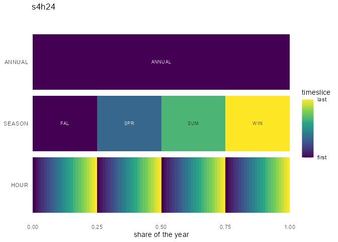
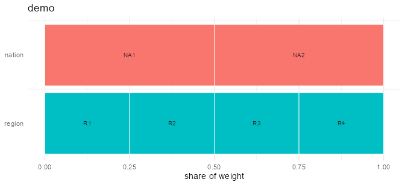

# Model dimensions: time and space


The model’s independent spatial and temporal dimensions: nested
geographies, a nested calendar, and the planning horizon.

## Time: calendars and horizons

Time and space are the two dimensions on which energyRt balances
commodities. Their design is deliberately parallel: a commodity’s
`timeframe` chooses a calendar level, while its `geoframe` chooses a
geographic level. Start with the finest resolution needed for the
question; coarser balances are modelling assumptions, not merely
performance settings.

### Why sub-annual time matters

Annual averages hide what makes energy systems hard: the sun sets, wind
stalls, demand peaks in the evening. A model that balances electricity
once a year sees none of it — storage is pointless, solar looks
dispatchable, peak capacity is free. A **calendar** gives the model
sub-annual **time timeslices**, and the timeslice count is the main dial
between realism and model size:

| calendar   | structure                  | timeslices |
|------------|----------------------------|-----------:|
| `annual`   | one annual timeslice       |          1 |
| `s4_hp3`   | 4 seasons × day/night/peak |         12 |
| `s4_h24`   | 4 seasons × 24 hours       |         96 |
| `m12_h24`  | 12 months × 24 hours       |        288 |
| `d365`     | 365 days                   |        365 |
| `d365_h24` | 365 days × 24 hours        |      8,760 |

Model variables scale roughly linearly with timeslices — the
96-timeslice TOPIA base case solves in seconds on GLPK, the
288-timeslice variant is noticeably heavier.

### The `make_timetable()` grammar

A calendar’s structure is a **nested named list**: each element is a
*level* (e.g. `SEASON`, `HOUR`), holding its *timeslices*. Timeslice
names must be alphanumeric (they become set elements in the solver
files). The simplest form lists timeslice names — the year is divided
equally:

``` r

tt <- make_timetable(list(
  SEASON = c("WIN", "SPR", "SUM", "FAL"),
  HOUR   = paste0("h", formatC(0:23, width = 2, flag = "0"))
))
head(tt)          # 4 x 24 = 96 leaf timeslices, equal shares
#>    ANNUAL SEASON   HOUR timeslice      share weight
#>    <char> <char> <char>    <char>      <num>  <num>
#> 1: ANNUAL    FAL    h00   FAL_h00 0.01041667      1
#> 2: ANNUAL    FAL    h01   FAL_h01 0.01041667      1
#> 3: ANNUAL    FAL    h02   FAL_h02 0.01041667      1
#> 4: ANNUAL    FAL    h03   FAL_h03 0.01041667      1
#> 5: ANNUAL    FAL    h04   FAL_h04 0.01041667      1
#> 6: ANNUAL    FAL    h05   FAL_h05 0.01041667      1
```

Unequal **shares** are given per timeslice; a nested
`list(<share>, <LEVEL> = ...)` attaches child levels. TOPIA’s
12-timeslice calendar makes peak hours short and winter nights long:

``` r

tt12 <- make_timetable(list(
  SEASON = list(
    WIN = list(1 / 4, HOUR = list(DAY =  9 / 24, NGT = 12 / 24, PK = 3 / 24)),
    SPR = list(1 / 4, HOUR = list(DAY = 11 / 24, NGT = 11 / 24, PK = 2 / 24)),
    SUM = list(1 / 4, HOUR = list(DAY = 12 / 24, NGT =  9 / 24, PK = 3 / 24)),
    FAL = list(1 / 4, HOUR = list(DAY = 11 / 24, NGT = 11 / 24, PK = 2 / 24))
  )
))
head(tt12)
#>    ANNUAL SEASON   HOUR timeslice      share weight
#>    <char> <char> <char>    <char>      <num>  <num>
#> 1: ANNUAL    FAL    DAY   FAL_DAY 0.11458333      1
#> 2: ANNUAL    FAL    NGT   FAL_NGT 0.11458333      1
#> 3: ANNUAL    FAL     PK    FAL_PK 0.02083333      1
#> 4: ANNUAL    SPR    DAY   SPR_DAY 0.11458333      1
#> 5: ANNUAL    SPR    NGT   SPR_NGT 0.11458333      1
#> 6: ANNUAL    SPR     PK    SPR_PK 0.02083333      1
```

### From timetable to calendar

[`newCalendar()`](https://energyRt.org/reference/newCalendar.md) turns a
timetable into a `calendar` object. Note that `name` is the *first*
argument — always pass the timetable by name (`timetable =`), or name
`name`/`desc` so the timetable lands in the right slot:

``` r

cal <- newCalendar(timetable = tt, name = "s4h24")
cal@name
#> [1] "s4h24"
nrow(cal@timeslice_share)          # timeslices with their share of the year
#> [1] 101
head(as.data.frame(cal@timeslice_share), 3)
#>   timeslice share weight
#> 1    ANNUAL  1.00      1
#> 2       FAL  0.25      1
#> 3       SPR  0.25      1
cal@timeframe_rank             # levels, coarsest (ANNUAL) to finest
#> ANNUAL SEASON   HOUR 
#>      1      2      3
```

The derived slots do the bookkeeping the model needs:

- **`@timeslice_share`** — each timeslice’s share of the year (the
  weight used whenever timeslice values are aggregated);
- **`@timeframes`** — the timeslice sets at every level (`ANNUAL`,
  `SEASON`, …);
- **`@timeframe_rank`** — the level hierarchy; a commodity’s `timeframe`
  picks the level it is balanced on.

`autoplot()` draws the nested structure:

``` r

autoplot(cal)
```



### Ready-made calendars

The package ships a `calendars` list, built by `data-raw/calendars.R`. A
few small designs use exactly the grammar above; the mainstream family
(`m12`, `m12a`, `q4`, `s4`, `s4_h24`, `m12_h24`, `wd7_h24`, `w52_h24`)
is generated from the
[timescales](https://github.com/optimal2050/timescales) catalog at
data-build time — timescales is **not** a runtime dependency — with
day-proportional shares (a month’s share is its day count over 365;
seasons are `WIN/SPR/SUM/FAL` in calendar order):

``` r

names(calendars)
#>  [1] "annual"            "m12"               "m12a"             
#>  [4] "q4"                "s4"                "s4_h24"           
#>  [7] "m12_h24"           "wd7_h24"           "w52_h24"          
#> [10] "d365"              "d365_h24"          "s4_hp3"           
#> [13] "m12_subset_q1"     "d365_h24_1dps"     "d365_h24_1dpm"    
#> [16] "m12_d365_h24"      "m12_d365_h24_1dpm"
topia$modules$calendars$d365_h24@desc
#> [1] "YDAY/HOUR calendar (8760 timeslices; truncated, regular) (timescales 0.7.2)"
s4 <- as.data.frame(calendars$s4@timetable)[, c("SEASON", "share")]
s4$share <- round(s4$share, 4)
s4
#>   SEASON  share
#> 1    WIN 0.2466
#> 2    SPR 0.2521
#> 3    SUM 0.2521
#> 4    FAL 0.2493
```

Four entries are **sampled** calendars: row subsets of a parent design
whose `year_fraction < 1` is the surviving share of the year. They solve
partial years natively — declared timeslices, weights, and storage
cycles all follow the sample:

``` r

calendars$d365_h24_1dpm@year_fraction   # one day per month
#> [1] 0.03287671
```

Pick one and pass it to `newModel(calendar = ...)`. A calendar has to
hold the timeslices the model’s own data is declared at: the TOPIA kit’s
profiles are measured on `d365_h24`, so its vignettes use that calendar
or a sampled subset of it such as `d365_h24_1dpm`. A design whose labels
the data never mentions is refused at interpolation, not quietly
ignored.

### Fiscal and non-calendar years

A milestone in energyRt is an **integer** year — `horizon@intervals$mid`
— and that stays true whatever the reporting convention. What changes
for a fiscal year is where the year *begins*, which is a property of the
calendar:

``` r

cal_fy <- newCalendar(
  timetable  = make_timetable(list(SEASON = c("WINTER", "SUMMER"))),
  year_start = list(month = 4L, day = 1L)   # April-start, e.g. India, Japan
)
cal_fy@year_start
#> $month
#> [1] 4
#> 
#> $day
#> [1] 1
```

This follows the convention `timescales` uses: model year `y` spans
`[year_start(y), year_start(y + 1))`, and `y` is the **starting**
Gregorian year, so “FY 2021-22” is model year 2021.

A non-January anchor changes how milestones are *displayed*.
[`year_label()`](https://energyRt.org/reference/year_label.md) gives one
label per milestone:

``` r

hor <- newHorizon(2025:2034, c(1, 4, 5))
mod <- newModel("fy_demo", region = "R1", calendar = cal_fy, horizon = hor)

year_label(mod)
#>        2025        2027        2032 
#> "FY2025-26" "FY2027-28" "FY2032-33"
```

The label is presentation only. It never reaches the solver: the sets,
the parameter tables, the backend files and the decoded solution all
keep the integer year. Ask for labels explicitly when you want them:

``` r

getData(scen, "vTechCap", yearsAsFactors = TRUE)   # year as labelled factor
getData(scen, "vTechCap")                          # year as integer (default)
```

To name periods yourself — whether or not a fiscal calendar is involved
— give `intervals` a `label` column. An explicit label always wins over
the derived one, and labels must be unique:

``` r

newHorizon(intervals = data.frame(
  start = c(2025, 2030),
  mid   = c(2025, 2030),
  end   = c(2029, 2034),
  label = c("FY2025-26", "FY2030-31")
))@intervals
#>    start   mid   end     label
#>    <int> <int> <int>    <char>
#> 1:  2025  2025  2025 FY2025-26
#> 2:  2026  2026  2029      2026
#> 3:  2030  2030  2034 FY2030-31
```

One limit worth knowing: because the key is the integer `mid`, two
milestones cannot share a calendar year. Labels rename periods; they do
not add them.

The anchor is currently carried and reported, not acted on — it sets the
default labels and travels with the calendar, but timeslice-to-timestamp
alignment and `year_fraction` still work on the calendar year.

### Reading time off a timeslice

A timeslice name is a label, not a data structure: what `"d100_h20"`
means is decided by the calendar it belongs to, so every conversion
takes that calendar. They live in
[timescales](https://optimal2050.github.io/timescales/), which owns the
calendar vocabulary:

``` r

library(timescales)

# label -> number. The calendar is consulted; the text is never parsed.
tsl2hour(c("d001_h00", "d100_h20"), "d365_h24")    # 0 20
#> [1]  0 20
tsl2yday(c("d001_h00", "d100_h20"), "d365_h24")    # 1 100
#> [1]   1 100

# MONTH is not a timeframe of d365_h24 -- it is derived from the calendar
tsl2month(c("d001_h00", "d100_h20"), "d365_h24")   # 1 4
#> [1] 1 4

# number -> label
hour2HOUR(c(0, 13, 23))                            # "h00" "h13" "h23"
#> [1] "h00" "h13" "h23"
yday2YDAY(c(1, 365))                               # "d001" "d365"
#> [1] "d001" "d365"
```

A timeframe is available when the calendar determines it.
[`tsl2hour()`](https://optimal2050.github.io/timescales/r/reference/timeslice_conversions.html)
works on `"d365_h24"`, where each timeslice is one hour, and is an error
on `"m12"`, where a month spans twenty-four of them – rather than
returning a guess.

[`tsl2dtm()`](https://optimal2050.github.io/timescales/r/reference/timeslice_datetime.html)
/
[`dtm2tsl()`](https://optimal2050.github.io/timescales/r/reference/timeslice_datetime.html)
convert between timeslices and date-times, which is what you want when
joining model output with observed hourly data. Timeslice labels carry
no year, so
[`tsl2dtm()`](https://optimal2050.github.io/timescales/r/reference/timeslice_datetime.html)
asks for one:

``` r

tsl2dtm(c("d001_h00", "d100_h20"), "d365_h24", year = 2021)
#> [1] "2021-01-01 00:00:00 UTC" "2021-04-10 20:00:00 UTC"
dtm2tsl(as.POSIXct("2021-04-10 20:00", tz = "UTC"), "d365_h24")
#> [1] "d100_h20"
```

### Timeframes: commodities and processes

Every commodity carries a `timeframe` — the calendar level it is
**balanced** on. Fuels are typically `ANNUAL`; electricity `HOUR`:

``` r

ELC <- newCommodity("ELC", timeframe = "HOUR")    # balanced every timeslice
COA <- newCommodity("COA", timeframe = "ANNUAL")  # balanced once a year
```

A process operates at the *finest* timeframe among its commodities (a
gas plant producing hourly `ELC` is dispatched hourly), overridable via
`newTechnology(timeframe = ...)` — see the [model bricks
article](https://energyRt.org/articles/model-bricks.md) for details. The
practical consequence: raising the calendar’s resolution refines *only*
the commodities and processes whose timeframes follow it — annual
bookkeeping stays cheap.

## Space: regions and geoscales

A model’s `region` vector is its finest spatial resolution. A `Geoscale`
adds the hierarchy above those regions: for example, region inside zone
inside nation. It is built from a leaf table with one row per finest
region and one column per level:

``` r

gs <- geoscale_from_leaftable(
  data.frame(
    nation = c("NA1", "NA1", "NA2", "NA2"),
    region = c("R1",  "R2",  "R3",  "R4"),
    km2    = rep(1, 4)  # equal illustrative weights for the icicle widths
  ),
  geoframes = c("nation", "region"),
  key = "region",
  weights = "km2",
  default_weight = "km2",
  name = "demo"
)

gg_geoscale(gs, type = "icicle", weight = "km2")
```



Attach the hierarchy when the model is created, or later with
[`setGeoscale()`](https://energyRt.org/reference/setGeoscale.md):

``` r

mod <- newModel("demo", region = c("R1", "R2", "R3", "R4"), geoscale = gs)
mod <- setGeoscale(mod, gs)
```

Attaching a geoscale does not coarsen the model. It makes coarser cells
available. A commodity opts into one with `geoframe`:

``` r

ELC <- newCommodity("ELC", timeframe = "HOUR")
STL <- newCommodity("STL", timeframe = "ANNUAL", geoframe = "nation")
```

`ELC` is balanced separately in R1–R4. `STL` is balanced in NA1 and NA2.
Within each nation, that coarse steel balance is exactly equivalent to
free, unlimited, lossless transport. Use it only when that is an
acceptable physical and economic assumption. Congestion, transport
costs, or losses require an explicit `trade` object at the relevant
level.

Processes may be finer than the commodities they use: a regional mill
can contribute to a national steel balance. A process cannot produce
into a finer balance than its own location, because the destination
would be ambiguous. Supply, demand, storage, import, export, weather,
and trade declarations must likewise resolve to a level compatible with
their commodity.

### Changing spatial resolution

There are three distinct operations; choose by intent:

| intent | operation | what changes |
|----|----|----|
| study a sub-territory in full detail | [`subset_model_regions()`](https://energyRt.org/reference/subset_model_regions.md) | drops regions and routes outside the sample |
| solve the whole territory at a coarser level | [`aggregate_model_regions()`](https://energyRt.org/reference/aggregate_model_regions.md) | replaces fine regions with coarse cells |
| retain several process archetypes per coarse cell | `aggregate_model_regions(..., clusters = ...)` | preserves selected within-cell variation |

Aggregation is lossy. Inspect candidate process families with
[`get_process_groups()`](https://energyRt.org/reference/get_process_groups.md)
and
[`process_cluster_sweep()`](https://energyRt.org/reference/process_cluster_sweep.md),
then compare the reduced model with a fine benchmark. A coarse balance
may introduce a copperplate that did not exist, and a cost declared once
on a coarse cell does not shrink when only some child regions are
sampled. The [scaling
article](https://energyRt.org/articles/model-size.md) develops this
workflow and its diagnostics.

## Choosing a resolution

- Start coarse (`s4_hp3`, 12 timeslices) while the model structure is in
  flux — solves are instant.
- Move to hour-within-season (`s4_h24`, 96) once storage, VRE profiles
  or peak pricing matter — intra-day dynamics need real hours.
- Full-year hourly detail (`m12_h24`, 288, or `d365_h24`, 8,760) is for
  final runs; check tractability with
  [`model_size()`](https://energyRt.org/reference/model_size.md) first,
  and consider a sample of the hourly calendar (`d365_h24_1dpm`, 301)
  while iterating.
- On a **multi-year** horizon, interpolate with `fold = TRUE`. A weather
  series that is the same in every milestone year is stored once instead
  of once per year, which is usually the single largest saving in an
  hourly model — on a 4-region `d365_h24` model over 7 milestones it
  cuts the interpolated data by ~84%. Folding only collapses values that
  are uniform across the whole dimension, so it never changes the
  solution; a model with a genuinely different weather year per
  milestone simply does not fold.

The [TOPIA vignettes](https://energyRt.org/articles/topia-build.md)
build one model and run it on these calendars interchangeably —
resolution is a configuration choice, not a rewrite.
