# TOPIA I: building the model

## Overview

TOPIA is a teaching model for energy-system optimization. Its
**Reference Energy System (RES)** links primary resources, conversion
technologies, storage, trade, and electricity demand across up to twelve
regions.

The complete model is packaged as `topia$modules$electricity`. Smaller
cases are cut from it with
[`subset_model_regions()`](https://energyRt.org/reference/subset_model_regions.md)
rather than kept as separate saved layouts.

## Conventions

TOPIA uses uppercase set elements and typed process names.

- **Set elements are uppercase:** regions, commodities, technologies,
  groups, and user-defined timeslices use names such as `W1`, `COA`, and
  `ECOA`.

- **Process names carry a type prefix:**

  | Prefix | Process family                                           |
  |--------|----------------------------------------------------------|
  | `SUP_` | supply of a fuel / primary energy (`SUP_COA`, `SUP_GAS`) |
  | `RES_` | supply of a renewable resource (`RES_HYD`)               |
  | `STG_` | storage (`STG_ELC`)                                      |
  | `TRD_` | inter-regional trade (uni-directional)                   |
  | `TBD_` | inter-regional trade (bi-directional, `TBD_ELC_W1_W2`)   |
  | `IMP_` | import from the rest of the world                        |
  | `EXP_` | export to the rest of the world                          |

  Electricity generating technologies use an uppercase mnemonic with `E`
  fixed prefix, such as `ECOA` and `ESOL`.

### Units

TOPIA uses the following units:

| quantity | unit | where it is declared |
|----|----|----|
| electricity, and the renewable resources feeding it | **GWh** | `commodity@units$comm` |
| coal, gas, biomass, nuclear fuel | **PJ** | `commodity@units$comm` |
| emissions | kt | `commodity@units$comm` |
| capacity (plants, storage power, corridors) | GW | `cap2act` fixes the link |
| investment cost | MUSD/GW | `invcost` |
| storage reservoir | GWh, priced MUSD/GWh | `duration`, `stg.invcost` |
| fuel cost, import price | MUSD/PJ (= USD/GJ) | `supply@cost`, `import@price` |

Electricity and renewable-resource flows use GWh; fuels use PJ.
`@units$comm` records the unit but does not convert values. Explicit
conversions appear in:

- `cap2act` – GW of capacity to GWh of annual activity.
- `ceff$use2cact` – the PJ-to-GWh bridge on a fuel-burning plant.
- `trade@cap2act` – GW of corridor capacity to GWh of annual flow.

Conversion efficiency is dimensionless in `ceff$cinp2use`.

``` r

convert("PJ", "GWh", 1) # 277.7778 -- the fuel/electricity bridge
#> [1] 277.7778
convert("GW*year", "GWh", 1) # 8760     -- cap2act for electricity
#> [1] 8760
```

## Regions and the map

TOPIA has twelve regions, `R01`–`R12`. The `squares`, `honeycomb`,
`island`, and `continent` layouts in `topia$geoscales` share these
region names: each layout draws them in different places, chosen so that
every zone comes out as one compact group of neighbours, and the model
sees only the codes.

`R01` is the remote region. It is detached on two of the four layouts
and carries no transmission at all, so it has to meet its own demand in
every hour from what it holds locally.

``` r

gs <- topia$geoscales$honeycomb
regions <- geoscale_regions(gs, geoframe = "region")
regions
#>  [1] "R01" "R02" "R03" "R04" "R05" "R06" "R07" "R08" "R09" "R10" "R11" "R12"

# the zones the fossil fuels balance on, and where the rest of the world
# reaches the model
zones <- geoscale_regions(gs, geoframe = "zone")
zones
#> [1] "Z1" "Z2" "Z3" "Z4" "Z5"
```

``` r

plot_geoscale(gs, type = "map")
```

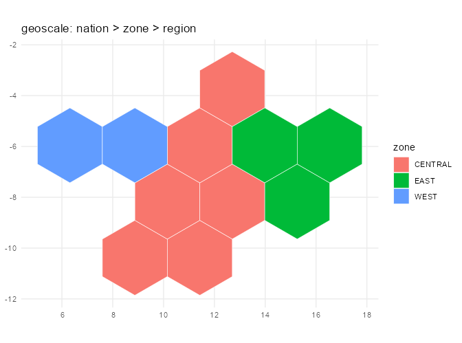

The honeycomb layout.

### Zones: the region hierarchy

The regions nest into five zones of uneven size and one nation.
[`geoscale_leaftable()`](https://optimal2050.github.io/geoscales/r/reference/geoscale_leaftable.html)
returns this hierarchy.

``` r

geo <- as.data.frame(geoscale_leaftable(gs))

knitr::kable(geo, caption = "Regional hierarchy")
```

| nation | zone | region | name      |     area |
|:-------|:-----|:-------|:----------|---------:|
| TOPIA  | Z1   | R01    | Region 01 | 5.657862 |
| TOPIA  | Z2   | R02    | Region 02 | 5.657862 |
| TOPIA  | Z2   | R03    | Region 03 | 5.657862 |
| TOPIA  | Z3   | R04    | Region 04 | 5.657862 |
| TOPIA  | Z3   | R05    | Region 05 | 5.657862 |
| TOPIA  | Z3   | R06    | Region 06 | 5.657862 |
| TOPIA  | Z4   | R07    | Region 07 | 5.657862 |
| TOPIA  | Z4   | R08    | Region 08 | 5.657862 |
| TOPIA  | Z4   | R09    | Region 09 | 5.657862 |
| TOPIA  | Z4   | R10    | Region 10 | 5.657862 |
| TOPIA  | Z5   | R11    | Region 11 | 5.657862 |
| TOPIA  | Z5   | R12    | Region 12 | 5.657862 |

Regional hierarchy {.table}

The zones are deliberately uneven – 1, 2, 3, 4 and 2 regions. A zone is
where the fossil fuels balance, so its size decides how large a pool a
region can draw on, and an even grouping would have made that uniform
and uninteresting.

| zone | regions | resource | load |
|----|----|----|----|
| `Z1` | `R01` | the island: the best wind in the model and the least sun, alone and with no wire | small, winter-peaking |
| `Z2` | `R02`–`R03` | the sun: the highest solar yield, little wind, the domestic gas | moderate, evening peak |
| `Z3` | `R04`–`R06` | the firm interior: the nuclear station, the mountain reservoir, the calmest air in the model | large and flat, industrial |
| `Z4` | `R07`–`R10` | the belt: run-of-river, the lignite basin, forestry, and the north-coast wind at its eastern end | mixed |
| `Z5` | `R11`–`R12` | the windy coast: exposed sites at both regions, poor sun | small, dense at the load centre |

Each region is endowed differently, and the endowment is what the model
is about: `R01` an island with no wire and no fuel of its own, `R02` and
`R03` the solar potential with `R03` holding the domestic gas, `R04` the
nuclear incumbent, `R05` the reservoir, `R06` industry, `R07`
run-of-river, `R08` the lignite basin, `R09` forestry and the first
exposed coast, `R10` the wind peak, `R11` the load centre, `R12` the
second wind peak.

Solar and wind are available everywhere – what differs is which *grades*
of each a region can offer, and the capacity factor its own weather
delivers. The grades are measured rather than assigned: see “Input
profiles” below.

``` r

gg_geoscale(gs,
  type = "stack", view = "pyramid", direction = "up",
  outline = c("zone"), outline_colour = "black",
  frame = TRUE, frame_fill = alpha("grey60", 0.10)
)
```


The spatial hierarchy in a 3D stack.

## Time resolution

The base calendar is the full hourly year: 365 days of 24 hours, 8,760
timeslices. The measured resource grades below are hourly series, and
the things this model is about – a multi-day lull, a storage cycle, a
corridor that saturates in one hour and idles in the next – only exist
at that resolution. Smaller calendars are cut from it when a case needs
to be quick: `d365_h24_1dpm` keeps one day a month and weights it, which
is the same year seen through 288 timeslices.

``` r

calendar <- topia$modules$calendars$d365_h24
autoplot(calendar)
```

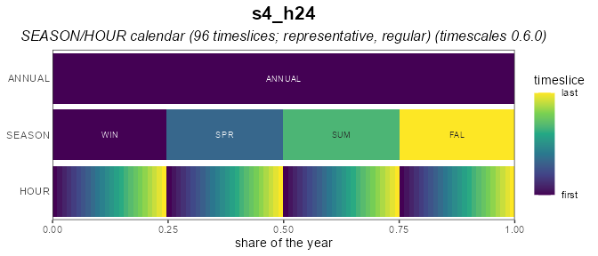

## Horizon

The horizon contains four milestone years: 2025, 2030, 2040, and 2050.
The first of them is one year wide and the rest stand for ten, with the
milestone in the MIDDLE of its period – so costs are discounted from the
middle of the decade they represent rather than from its end.

2025 is the **base year**, declared with `base_year =`. A base year is
given rather than decided: it is solved on its own by
[`solve_base_year()`](https://energyRt.org/reference/solve_base_year.md),
and what it holds crosses into the projection as stock. The projection
then optimises 2030, 2040 and 2050. *TOPIA II: running scenarios* runs
both halves.

Marking it also disciplines the input data. Everything standing in 2025
has to be stated as capacity, because the base-year solve will otherwise
build whatever the fleet is short of – and any capacity it builds, or
leaves idle, is a statement about the assumptions rather than about the
system.

``` r

horizon <- topia$modules$horizons$BY2025_50_by10
horizon@base_year
#> [1] 2025
horizon@intervals
#>    start   mid   end  label
#>    <num> <num> <num> <char>
#> 1:  2025  2025  2025   2025
#> 2:  2026  2030  2035   2030
#> 3:  2036  2040  2045   2040
#> 4:  2046  2050  2055   2050
autoplot(horizon)
```

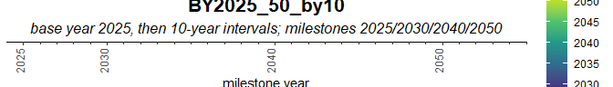

## Input profiles

[`topia_profiles()`](https://energyRt.org/reference/topia_profiles.md)
returns weather, demand, and base-year stock profiles for a selected
region set and calendar.

``` r

# `d365_h24` selects the MEASURED dataset: hourly 2025 series, with wind in
# three site grades and solar in two mountings. The smaller calendars carry a
# simulated stand-in instead, which has no grades.
prof <- topia_profiles(regions = regions, calendar = "d365_h24")
head(prof$weather, 3)
#>   resource cluster region timeslice wval
#> 1     WHYD    <NA>    R01  d001_h00    1
#> 2     WHYD    <NA>    R01  d001_h01    1
#> 3     WHYD    <NA>    R01  d001_h02    1
head(prof$demand, 3)
#>   region timeslice   load
#> 1    R01  d001_h00 1.1518
#> 2    R01  d001_h01 1.1474
#> 3    R01  d001_h02 1.1385
# head(prof$stock, 3) # !!! should not be here, stock is not a profile
```

## Commodities

The model has ten commodities. `COA` and `GAS` are annual zone-level
commodities; `BIO`, `NUC`, `LANDS`, `LANDW`, and `CO2` are annual; and
`HYD`, `H2`, and `ELC` are hourly. Electricity is balanced by region.
Solar and wind carry no fuel: their technologies are driven by a weather
profile and consume nothing but land. The two land commodities are
separate pools, so solar siting and wind siting do not compete for the
same hectares.

``` r

COA <- newCommodity(
  name = "COA",
  desc = "Steam coal",
  unit = "PJ",
  timeframe = "ANNUAL", # no sub-annual balances
  geoframe = "zone", # balancing on zone-level makes it moving freely
  # between all regions in each zone
  emis = data.frame(
    comm = "CO2",
    unit = "kt/PJ",
    emis = 95
  )
)

GAS <- newCommodity(
  name = "GAS",
  desc = "Natural gas",
  unit = "PJ",
  timeframe = "ANNUAL",
  geoframe = "zone",
  emis = data.frame(
    comm = "CO2",
    unit = "kt/PJ",
    emis = 56
  )
)

BIO <- newCommodity(
  name = "BIO",
  desc = "Biomass residues, carbon-neutral",
  unit = "PJ",
  timeframe = "ANNUAL",
  geoframe = "region" # the lower level in Topia is named "region"
)

NUC <- newCommodity(
  name = "NUC",
  desc = "Nuclear fuel assemblies",
  unit = "PJ",
  timeframe = "ANNUAL"
)

HYD <- newCommodity(
  name = "HYD",
  desc = "River inflow",
  unit = "GWh",
  timeframe = "HOUR"
)

LANDS <- newCommodity(
  name = "LANDS",
  desc = "Land suitable for solar siting",
  unit = "km2",
  timeframe = "ANNUAL",
  geoframe = "region"
)

LANDW <- newCommodity(
  name = "LANDW",
  desc = "Land suitable for wind siting",
  unit = "km2",
  timeframe = "ANNUAL",
  geoframe = "region",
  # tiers, not labels: exposed coast, open country and inland terrain must not
  # pool, so the commodity becomes one balance per tier and a clustered wind
  # farm draws on the tier its own cluster names. The three tiers match the
  # measured wind grades -- a region holds land in a tier only where its own
  # cells reach that grade.
  cluster = data.frame(
    cluster = c("HI", "MD", "LO"),
    desc = c("exposed coast and ridge", "open country", "inland terrain"),
    order = 1:3
  )
)

H2 <- newCommodity(
  name = "H2",
  desc = "Hydrogen, lower heating value",
  unit = "GWh",
  timeframe = "HOUR",
  geoframe = "region"
)

ELC <- newCommodity(
  name = "ELC",
  desc = "Electricity",
  unit = "GWh",
  timeframe = "HOUR"
)

CO2 <- newCommodity(
  name = "CO2",
  desc = "Carbon dioxide",
  unit = "kt",
  timeframe = "ANNUAL"
)

repo_commodities <- newRepository(
  name = "topia_commodities",
  COA, GAS, BIO, NUC, LANDS, LANDW, HYD, H2, ELC, CO2
)
```

## Supply and resources

Each fossil fuel comes from one zone and one only: coal from `Z4`, where
the lignite basin is, gas from `Z2`, where the shale is. The other zones
have neither, so everything they burn arrives over a corridor or from
the rest of the world – which is what gives the map a direction and the
corridors something to carry. `R01` is the exception twice over: it is
alone in `Z1`, so it is in neither fuel’s zone and no wire reaches it
either. It burns the biomass available in every region, runs on its own
weather, and buys the rest from the rest of the world. Nuclear fuel is
supplied in `R04`. For zone-pooled fuels, `ava.up` applies to the entire
zone.

None of the three is a single price. A resource gets dearer as it is
used up – the accessible seam first, then the deep one – and that is a
**supply curve**: the quantity split into steps, each dearer than the
last, declared as `cluster`s of one supply object. The model buys the
cheap step first because it is cheaper, not because anything orders it
to.

``` r

# A curve that does not move is a snapshot. Both fossil curves travel: the
# quantity on every step grows as more of the resource becomes reachable,
# while the price goes the other way for coal (mechanization outruns
# depletion) and the same way for gas (the easy fields go first).
fuel_steps <- data.frame(
  cluster = c("S1", "S2", "S3"),
  order = 1:3
)

fuel_path <- tibble::tribble(
  ~fuel,  ~year, ~price_x, ~volume_x,
  "COA",   2025,     1.00,      1.00,
  "COA",   2030,     0.95,      1.10,
  "COA",   2040,     0.88,      1.25,
  "COA",   2050,     0.80,      1.40,
  "GAS",   2025,     1.00,      1.00,
  "GAS",   2030,     1.05,      1.15,
  "GAS",   2040,     1.15,      1.35,
  "GAS",   2050,     1.30,      1.50
)

# The 2025 curve, which the path above moves. `asSupplyCurve()` is the
# shortcut when a curve stands still -- its `price` is absolute, so it cannot
# carry a trajectory, and the steps are written out instead.
fuel_base <- tibble::tribble(
  ~fuel, ~region,   ~cluster, ~price0, ~ava0,
  "COA",  "Z4",      "S1",       1.4,    100,
  "COA",  "Z4",      "S2",       1.8,    100,
  "COA",  "Z4",      "S3",       2.6,    100,
  "GAS",  "Z2",      "S1",       3.2,    120,
  "GAS",  "Z2",      "S2",       4.0,    120,
  "GAS",  "Z2",      "S3",       5.6,    120
)

# every step meets every year, which is the expansion wanted here -- said
# out loud, because dplyr warns about a many-to-many join it has to infer
fuel_supply <- fuel_base |>
  left_join(fuel_path, by = "fuel", relationship = "many-to-many") |>
  mutate(cost = price0 * price_x, ava.up = ava0 * volume_x) |>
  select(fuel, region, cluster, year, ava.up, cost) |>
  arrange(fuel, cluster, year)

coa_supply <- fuel_supply |> filter(fuel == "COA") |> select(-fuel)
gas_supply <- fuel_supply |> filter(fuel == "GAS") |> select(-fuel)

knitr::kable(
  coa_supply,
  digits = 2,
  caption = "Coal: three steps, each cheaper and larger over the horizon"
)
```

| region | cluster | year | ava.up | cost |
|:-------|:--------|-----:|-------:|-----:|
| Z4     | S1      | 2025 |    100 | 1.40 |
| Z4     | S1      | 2030 |    110 | 1.33 |
| Z4     | S1      | 2040 |    125 | 1.23 |
| Z4     | S1      | 2050 |    140 | 1.12 |
| Z4     | S2      | 2025 |    100 | 1.80 |
| Z4     | S2      | 2030 |    110 | 1.71 |
| Z4     | S2      | 2040 |    125 | 1.58 |
| Z4     | S2      | 2050 |    140 | 1.44 |
| Z4     | S3      | 2025 |    100 | 2.60 |
| Z4     | S3      | 2030 |    110 | 2.47 |
| Z4     | S3      | 2040 |    125 | 2.29 |
| Z4     | S3      | 2050 |    140 | 2.08 |

Coal: three steps, each cheaper and larger over the horizon {.table}

``` r


SUP_COA <- newSupply(
  name = "SUP_COA",
  desc = "Domestic coal, pooled within a zone",
  units = data.frame(
    activity = "PJ",
    costs = "MUSD"
  ),
  commodity = "COA",
  unit = "PJ",
  region = "Z4",
  cluster = fuel_steps |>
    mutate(desc = c("open cast", "shallow seam", "deep seam")),
  supply = coa_supply
)

SUP_GAS <- newSupply(
  name = "SUP_GAS",
  desc = "Domestic gas, pooled within a zone",
  units = data.frame(
    activity = "PJ",
    costs = "MUSD"
  ),
  commodity = "GAS",
  unit = "PJ",
  region = "Z2",
  cluster = fuel_steps |>
    mutate(desc = c("associated gas", "conventional", "tight")),
  supply = gas_supply
)
autoplot(SUP_GAS, style = "map", map = gs)
```

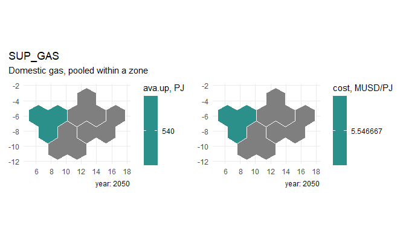

``` r


# Biomass follows the land rather than the geology: the forestry region is
# plentiful and cheap, the arid west and the load centre thin and dear. Three
# steps per region -- the easy quarter, the bulk, and the tail that has to be
# collected from far away.
bio <- tibble::tribble(
  ~region, ~bio_PJ, ~bio_cost,
  "R01",      10,       9.5,
  "R02",      12,       9.0,
  "R03",      18,       8.0,
  "R04",      35,       7.0,
  "R05",      40,       6.5,
  "R06",      35,       7.0,
  "R07",      50,       5.5,
  "R08",      45,       6.0,
  "R09",      65,       4.8,
  "R10",      25,       7.5,
  "R11",      15,       9.0,
  "R12",      20,       8.5
)

bio_steps <- data.frame(
  cluster = c("S1", "S2", "S3"),
  desc = c("residues at the mill", "field collection", "long haul"),
  order = 1:3
)

# `asSupplyCurve()` prices steps in ABSOLUTE terms, which would flatten the
# regional spread above, so the steps are written out: each region keeps its
# own price level and the three steps scale around it.
bio_supply <- bio |>
  tidyr::crossing(bio_steps["cluster"]) |>
  mutate(
    share = c(S1 = 0.25, S2 = 0.45, S3 = 0.30)[cluster],
    mult  = c(S1 = 0.75, S2 = 1.00, S3 = 1.50)[cluster],
    ava.up = bio_PJ * share,
    cost = bio_cost * mult
  ) |>
  select(region, cluster, ava.up, cost) |>
  arrange(match(region, regions), cluster)

knitr::kable(
  head(bio_supply, 6),
  digits = 2,
  caption = "Biomass supply steps, the first two regions"
)
```

| region | cluster | ava.up |  cost |
|:-------|:--------|-------:|------:|
| R01    | S1      |    2.5 |  7.12 |
| R01    | S2      |    4.5 |  9.50 |
| R01    | S3      |    3.0 | 14.25 |
| R02    | S1      |    3.0 |  6.75 |
| R02    | S2      |    5.4 |  9.00 |
| R02    | S3      |    3.6 | 13.50 |

Biomass supply steps, the first two regions {.table}

``` r


SUP_BIO <- newSupply(
  name = "SUP_BIO",
  desc = "Biomass residues, collected locally",
  units = data.frame(
    activity = "PJ",
    costs = "MUSD"
  ),
  commodity = "BIO",
  unit = "PJ",
  region = regions,
  cluster = bio_steps,
  supply = bio_supply
)
autoplot(SUP_BIO, style = "map", map = gs, param = "cost")
```

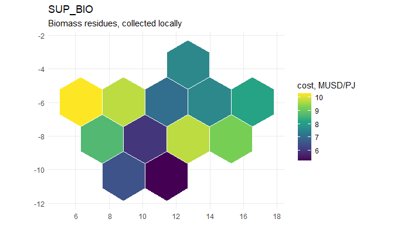

``` r

autoplot(SUP_BIO)
```

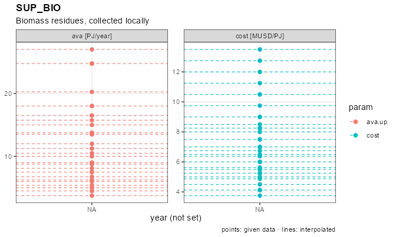

``` r


SUP_NUC <- newSupply(
  name = "SUP_NUC",
  desc = "Nuclear fuel assemblies",
  units = data.frame(
    activity = "PJ",
    costs = "MUSD"
  ),
  commodity = "NUC",
  unit = "PJ",
  region = "R04",
  supply = data.frame(region = "R04", cost = 0.9)
)
autoplot(SUP_NUC, style = "map", map = gs)
```

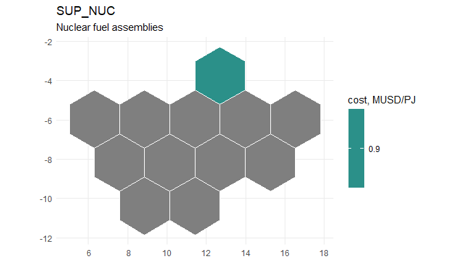

Hydro inflow is available in `R05`, the mountain reservoir, and `R07`,
the run-of-river valley, at zero cost. Solar and wind draw no fuel, but
both occupy land, and a land pool replaces their former build limits.
The pools are separate because the terrain is: `RES_LANDS` is the open
ground a photovoltaic field can take, `RES_LANDW` the exposed terrain a
wind farm needs. Each region’s budget is the land its former cap would
have occupied, at 20 km2 per GW of solar and 100 per GW of wind.

``` r

# Potential, not weather. `topia$grades` carries, for every region and every
# resource grade, the capacity factor of the series and the number of weather
# cells standing behind it -- so the land a region can offer follows the
# geography that produced the series rather than a hand-written ceiling.
#
# The two resources take land differently. A wind farm leaves the ground in
# use and spreads thinly, so it is given a tenth of each cell and needs a lot
# of km2 per GW; a photovoltaic field takes the ground outright, so it gets a
# hundredth of each cell and needs little. The km2-per-GW figures differ by
# grade the way `EWIN`'s own land intensity does: an exposed ridge is spaced
# wider than open inland terrain, so it buys its yield with land.
WIND_KM2_PER_CELL <- 10
SOL_KM2_PER_CELL <- 1
WIND_KM2_PER_GW <- c(HI = 120, MD = 95, LO = 70)   # as `EWIN`'s aeff
SOL_KM2_PER_GW <- 20

grades <- as.data.frame(topia$grades) |>
  filter(region %in% regions)

land_w <- grades |>
  filter(resource == "WWIN") |>
  transmute(region, cluster,
            ava.up = round(avail * WIND_KM2_PER_CELL, 1))

land_s <- grades |>
  filter(resource == "WSOL", cluster == "FL") |>
  transmute(region, ava.up = round(avail * SOL_KM2_PER_CELL, 1))

# what that land is worth in GW, which is the number to sanity-check
siting <- land_w |>
  mutate(GW = round(ava.up / WIND_KM2_PER_GW[cluster], 1)) |>
  select(region, cluster, km2 = ava.up, GW) |>
  arrange(region, cluster)

knitr::kable(
  siting,
  caption = "Wind land by region and grade, and the capacity it supports (GW)"
)
```

| region | cluster |  km2 |   GW |
|:-------|:--------|-----:|-----:|
| R01    | HI      |  200 |  1.7 |
| R01    | MD      |  130 |  1.4 |
| R02    | LO      | 1250 | 17.9 |
| R02    | MD      |   90 |  0.9 |
| R03    | LO      | 2080 | 29.7 |
| R04    | LO      | 2550 | 36.4 |
| R05    | LO      | 1710 | 24.4 |
| R06    | LO      | 1250 | 17.9 |
| R07    | LO      | 1760 | 25.1 |
| R08    | LO      | 1710 | 24.4 |
| R09    | HI      |  200 |  1.7 |
| R09    | LO      | 1460 | 20.9 |
| R10    | HI      |  480 |  4.0 |
| R11    | HI      |  400 |  3.3 |
| R11    | MD      |  880 |  9.3 |
| R12    | HI      |  290 |  2.4 |
| R12    | MD      |  620 |  6.5 |

Wind land by region and grade, and the capacity it supports (GW)
{.table}

A region appears only in the grades its own cells reach: the island and
the north coast have no inland tier at all, the becalmed interior has
nothing but inland terrain, and only the exposed coast carries `HI`.
That is the whole point of grading the land rather than the turbine –
where a region may build is decided before any cost is compared.

``` r

# A cluster carries a `region` column: the grade exists THERE and nowhere
# else. Without it every region would declare all three grades, and the
# two-thirds that have no such ground would reference a wind series that does
# not exist -- which is an error at interpolation, not a silent zero.
win_cl <- tibble::tribble(
  ~cluster,                     ~desc, ~order,
     "HI", "exposed coast and ridge",      1,
     "MD",            "open country",      2,
     "LO",          "inland terrain",      3
) |>
  inner_join(distinct(land_w, cluster, region), by = "cluster") |>
  select(cluster, desc, region, order)

sol_cl <- tibble::tribble(
  ~cluster,                 ~desc, ~order,
     "FL",                   "fixed tilt",      1,
     "TH", "horizontal single-axis track",      2
) |>
  inner_join(
    grades |> filter(resource == "WSOL") |> distinct(cluster, region),
    by = "cluster"
  ) |>
  select(cluster, desc, region, order)

knitr::kable(
  win_cl |> count(cluster, name = "regions"),
  caption = "Regions offering each wind grade"
)
```

| cluster | regions |
|:--------|--------:|
| HI      |       5 |
| LO      |       8 |
| MD      |       4 |

Regions offering each wind grade {.table}

``` r

RES_LANDS <- newSupply(
  name = "RES_LANDS",
  desc = "Land suitable for solar siting",
  units = data.frame(
    activity = "km2",
    costs = "MUSD"
  ),
  commodity = "LANDS",
  unit = "km2",
  region = regions,
  supply = land_s
)
autoplot(RES_LANDS, style = "map", map = gs)
```

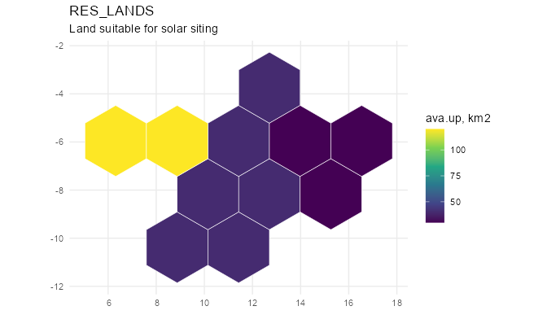

``` r


RES_LANDW <- newSupply(
  name = "RES_LANDW",
  desc = "Land suitable for wind siting",
  units = data.frame(
    activity = "km2",
    costs = "MUSD"
  ),
  commodity = "LANDW",
  unit = "km2",
  region = regions,
  cluster = win_cl,
  # only the grades a region actually reaches: a tier it has no cells for is
  # absent rather than zero, so nothing is declared where it cannot be built
  supply = land_w
)
autoplot(RES_LANDW, style = "map", map = gs)
```

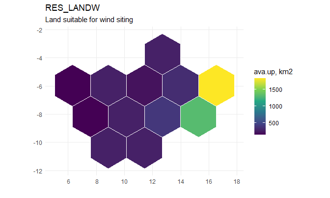

``` r


RES_HYD <- newSupply(
  name = "RES_HYD",
  desc = "River inflow to the reservoirs",
  units = data.frame(
    activity = "GWh",
    costs = "MUSD"
  ),
  commodity = "HYD",
  unit = "GWh",
  region = c("R05", "R07"),
  supply = data.frame(
    region = c("R05", "R07"),
    cost = 0
  )
)
autoplot(RES_HYD, style = "map", map = gs)
```

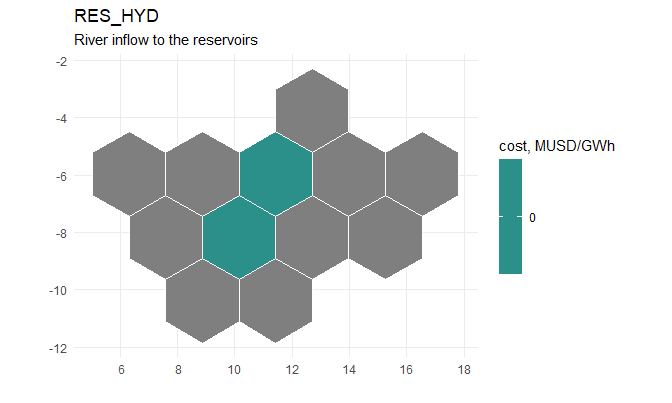

## Rest-of-world trade

Coal and gas can be imported without a quantity limit in each zone at
3.5 and 9.0 MUSD/PJ, respectively. Hydrogen can be sold outward from any
region at 0.09 MUSD/GWh, capped at 38 GWh per region in each timeslice:
the demand that makes electrolysis worth building.

``` r

IMP_COA <- newImport(
  name = "IMP_COA",
  desc = "Coal import from the rest of the world",
  commodity = "COA",
  unit = "PJ",
  region = zones,
  import = data.frame(
    region = zones,
    price = 3.5
  )
)
autoplot(IMP_COA, style = "map", map = gs)
```

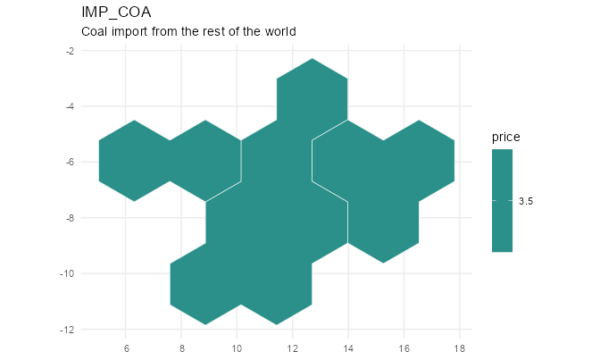

``` r


IMP_GAS <- newImport(
  name = "IMP_GAS",
  desc = "LNG import from the rest of the world",
  commodity = "GAS",
  unit = "PJ",
  region = zones,
  import = data.frame(
    region = zones,
    price = 9.0
  )
)
autoplot(IMP_GAS, style = "map", map = gs)
```

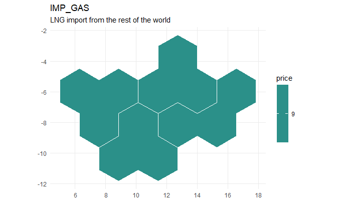

``` r


EXP_H2 <- newExport(
  name = "EXP_H2",
  desc = "Hydrogen export to the rest of the world",
  commodity = "H2",
  unit = "GWh",
  region = regions,
  export = data.frame(
    region = regions,
    price = 0.09,
    exp.up = 38
  )
)
autoplot(EXP_H2, style = "map", map = gs)
```

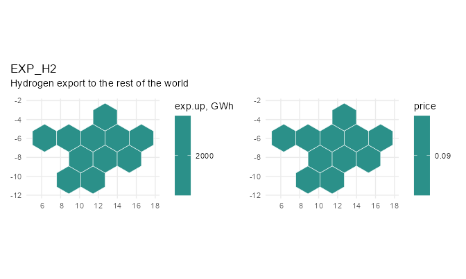

``` r


repo_supply <- newRepository(
  name = "topia_supply",
  SUP_COA, SUP_GAS, SUP_BIO, SUP_NUC,
  RES_LANDS, RES_LANDW, RES_HYD,
  IMP_COA, IMP_GAS
)
```

## Weather

`WSOL`, `WWIN`, and `WHYD` contain hourly capacity factors by region and
timeslice for solar, wind, and hydro.

``` r

# The grades are MEASURED, not derived. Each series is the mean of the
# weather cells whose own annual capacity factor falls in that band, so the
# grades differ in shape as well as in level -- a scaled copy of one series
# would leave them correlated at 1.000, and the model would then see no reason
# to hold more than one.
#
# A region carries only the grades its own ground reaches: the island and the
# north coast have no inland tier, and the becalmed interior has nothing else.
wwin <- prof$weather |>
  filter(resource == "WWIN") |>
  select(region, cluster, timeslice, wval)

# Solar is graded by MOUNTING rather than by site: within a territory the best
# and the median cell differ by a few per cent, while single-axis tracking on
# the same ground is worth about a fifth more energy and moves the peak into
# the morning. Tracking is offered only where the resource repays it.
wsol <- prof$weather |>
  filter(resource == "WSOL") |>
  select(region, cluster, timeslice, wval)

whyd <- prof$weather |>
  filter(resource == "WHYD") |>
  select(region, timeslice, wval)

WSOL <- newWeather(
  name = "WSOL",
  desc = "Solar capacity factor by timeslice, region and mounting",
  timeframe = "HOUR",
  cluster = sol_cl,
  weather = wsol
)

# autoplot(WSOL, region = "R02")

WWIN <- newWeather(
  name = "WWIN",
  desc = "Wind capacity factor by timeslice, region and site grade",
  timeframe = "HOUR",
  cluster = win_cl,
  weather = wwin
)

WHYD <- newWeather(
  name = "WHYD",
  desc = "Hydro inflow factor by timeslice and region",
  timeframe = "HOUR",
  weather = whyd
)

repo_weather <- newRepository(
  name = "topia_weather",
  WSOL, WWIN, WHYD
)
```

Solar capacity factors decline from west to east. Wind profiles
interpolate from weaker daytime wind in the west to stronger nocturnal,
winter-peaking wind in the east.

``` r

cf_summary <- prof$weather |>
  filter(resource %in% c("WSOL", "WWIN")) |>
  summarise(cf = mean(wval), .by = c(resource, region)) |>
  tidyr::pivot_wider(names_from = resource, values_from = cf) |>
  arrange(match(region, regions))

knitr::kable(cf_summary, digits = 3, caption = "Annual mean capacity factor by region")
```

| region |  WSOL |  WWIN |
|:-------|------:|------:|
| R01    | 0.105 | 0.488 |
| R02    | 0.198 | 0.305 |
| R03    | 0.213 | 0.215 |
| R04    | 0.156 | 0.210 |
| R05    | 0.192 | 0.095 |
| R06    | 0.181 | 0.213 |
| R07    | 0.185 | 0.122 |
| R08    | 0.183 | 0.166 |
| R09    | 0.125 | 0.408 |
| R10    | 0.123 | 0.544 |
| R11    | 0.116 | 0.512 |
| R12    | 0.120 | 0.496 |

Annual mean capacity factor by region {.table}

``` r

autoplot(WSOL, calendar = calendar, region = c("R02", "R10"))
```

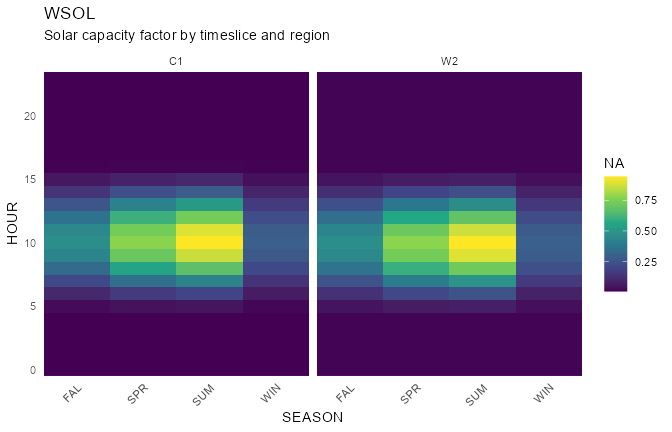

## Demand

`DEM_ELC` defines hourly electricity demand for twelve regions and four
milestone years. The arid west peaks in the evening; the firm and
industrial north-east is flatter. `R11` is the load centre and `R06` the
industrial one, between them a third of the system’s demand; `R01`, the
island, is the smallest, and `R10`, where the wind is, is land-rich and
lightly loaded.

``` r

levels <- tibble::tribble(
  ~region, ~annual_GWh,
  "R01", 10000,
  "R02", 18000,
  "R03", 20000,
  "R04", 32000,
  "R05", 28000,
  "R06", 46000,
  "R07", 26000,
  "R08", 32000,
  "R09", 24000,
  "R10", 16000,
  "R11", 48000,
  "R12", 22000
)

knitr::kable(
  levels,
  caption = "Annual electricity demand in 2025, GWh"
)
```

| region | annual_GWh |
|:-------|-----------:|
| R01    |      10000 |
| R02    |      18000 |
| R03    |      20000 |
| R04    |      32000 |
| R05    |      28000 |
| R06    |      46000 |
| R07    |      26000 |
| R08    |      32000 |
| R09    |      24000 |
| R10    |      16000 |
| R11    |      48000 |
| R12    |      22000 |

Annual electricity demand in 2025, GWh {.table}

Each regional profile is normalized and scaled to its annual demand
level in the base year. The model ships that year and nothing else; the
next section grows it.

``` r

tsl_share <- calendar@timeslice_share |>
  as.data.frame() |>
  select(timeslice, share)

shape <- prof$demand |>
  left_join(tsl_share, by = "timeslice") |>
  mutate(w = load * share) |>
  mutate(w = w / sum(w), .by = region)

# The BASE YEAR alone. One hourly year of demand for twelve regions is
# already 105,120 numbers; carrying a milestone path would multiply that by
# the number of milestones for no new information, since every later year is
# this shape times a scalar. The projection is built below, in three lines,
# and that is the part worth reading anyway.
dem_elc <- shape |>
  left_join(levels, by = "region") |>
  mutate(year = 2025, demand = annual_GWh * w) |>
  select(region, year, timeslice, demand)

DEM_ELC <- newDemand(
  name = "DEM_ELC",
  desc = "Electricity demand",
  commodity = "ELC",
  unit = "GWh",
  demand = dem_elc
)

repo_demand <- newRepository(
  name = "topia_demand",
  DEM_ELC
)
```

### Growing it into a projection

The shipped demand stops at the base year, so the model as it stands
holds 2025 demand in every milestone: `pDemand` is interpolated
`back.inter.forth`, and with a single anchor there is nothing to
interpolate between, so the value is carried forward.

A projection is the base year times a path. Declaring the two ends is
enough whenever the path is a straight line – the rule fills what lies
between, so 1.1 in 2030 and 1.3 in 2040 come out of a table that never
mentions them:

``` r

growth <- tibble::tribble(
  ~year, ~factor,
  2025,     1.0,
  2050,     1.5
)

DEM_ELC_GROWN <- update(
  DEM_ELC,
  demand = dem_elc |>
    select(-year) |>
    tidyr::crossing(growth) |>
    mutate(demand = demand * factor) |>
    select(region, year, timeslice, demand)
)

# swap it in wherever a projection is wanted, leaving the shipped object alone
#   mod <- add(mod, DEM_ELC_GROWN, overwrite = TRUE)
range(DEM_ELC_GROWN@demand$year)
#> [1] 2025 2050
```

A path with a bend needs its corners declared and nothing else: anchor
the years where the slope changes and let the rule draw the straight
pieces. What never needs declaring is the hourly shape, which is the
part that costs 105,120 numbers a year.

The projected demand, interpolated across years, can be displayed as an
`"area"` plot of the annual totals stacked by region over every year
between the first and last milestone. The bands are interpolated, the
points are the milestone years as given, drawn on the edge of their own
band.

``` r

autoplot(DEM_ELC, style = "area")
```

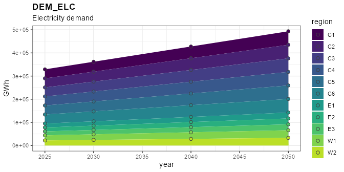

Sub-annual profiles can be displayed by changing the style to `"line"`
or `"heatmap"`, filtered by region and year.

``` r

autoplot(DEM_ELC, calendar = calendar, style = "line", 
         region = c("R06", "R11"), year = 2025)
```

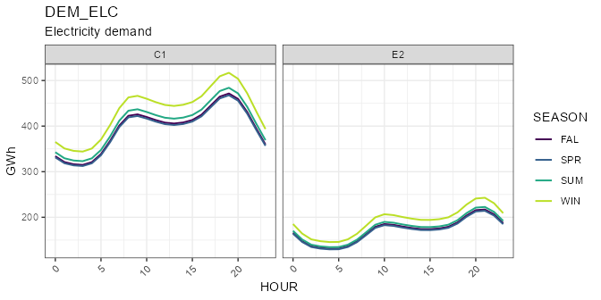

``` r


autoplot(DEM_ELC, calendar = calendar, style = "heatmap", 
         region = c("R11"), year = 2025)
```

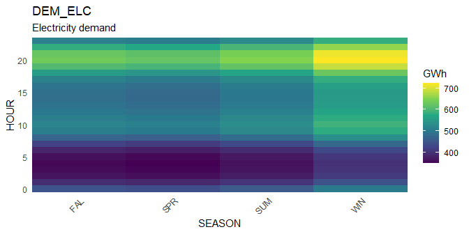

## Technologies

The model includes seven electricity-generation technologies. `cap2act`
converts GW of capacity to annual GWh; fuel-based technologies also
convert PJ of input to GWh of output.

### Coal

`ECOA` is a 35%-efficient subcritical coal plant. The fleet sits on the
lignite basin – `R08` has eight of its gigawatts and neighbouring `R09`
four, against one apiece elsewhere – which is what gives the coal
corridors a direction to carry. It declines to 30% of 2025 capacity by
2050, may retire early, and cannot be built after 2030.

``` r

# Capacity fleat: (arbitrary) assignment by region
coal_fleet <- tibble::tribble(
  ~region, ~GW,
  "R01",     1,
  "R02",     1,
  "R03",     1,
  "R04",     1,
  "R05",     1,
  "R06",     3,
  "R07",     1,
  "R08",     8,
  "R09",     4,
  "R10",     1,
  "R11",     1,
  "R12",     1
)

# Explicit retirement of existing capacity is set by defining the stock by year
coal_cap <- bind_rows(
  coal_fleet |> mutate(year = 2025, stock = GW),
  coal_fleet |> mutate(year = 2050, stock = GW * 0.3)
) |>
  select(region, year, stock)

# Technological process is defined for each type of technology with unique name
ECOA <- newTechnology(
  name = "ECOA",
  desc = "Coal-fired power plant, subcritical",
  units = data.frame(
    capacity = "GW",
    activity = "GWh",
    costs = "MUSD"
  ),
  input = list(
    comm = "COA",
    unit = "PJ",
    combustion = 1
  ),
  output = list(
    comm = "ELC",
    unit = "GWh"
  ),
  ceff = data.frame(
    comm     = c("COA", "ELC"),
    cinp2use = c(0.40, NA), # 40% conversion efficiency
    use2cact = c(NA, convert("PJ", "GWh", 1)) # the PJ -> GWh bridge
  ),
  cap2act = convert("GW*year", "GWh", 1),
  invcost = data.frame(
    invcost = convert("USD/kW", "MUSD/GW", 2000),
    retcost = convert("USD/kW", "MUSD/GW", 25) # paid on early retirement only
  ),
  fixom = 55,
  vintage = data.frame(
    start = 2010L,
    end = 2030L, # no new coal after 2030
    olife = 30L
  ),
  optimizeRetirement = TRUE,
  capacity = coal_cap
)

# A schematic view of the process with key parameters
draw(ECOA)
```

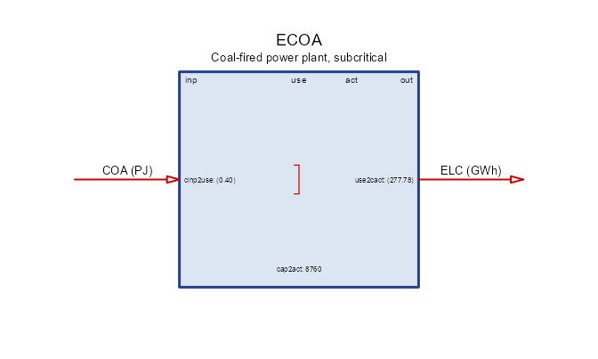

### Gas

`EGAS` is a 58%-efficient combined-cycle gas plant. The fleet follows
the domestic gas: `R03` sits on the field, and `R01` – which has no wire
and must convert its imported fuel itself – carries four gigawatts of
it. The fleet declines to 60% of 2025 capacity by 2050, may retire
early, and remains available for new construction throughout the
horizon.

``` r

# Gas sits where the gas is, plus a peaker at the load centre. The base-year
# solve is what sized this: a plant that runs no hour in 2025 is not a fleet,
# it is an assumption, so the regions whose gas never started -- the lignite
# basin, the forestry belt and the run-of-river valley, which have coal, hydro
# and imports -- carry none. `R06` and `R11` were raised after a base-year run
# on the full hourly year built peaking gas there: the twelve-day sample the
# sizing began from does not contain the hours that call for it.
gas_fleet <- tibble::tribble(
  ~region, ~GW,
  "R01",     4,
  "R02",     2,
  "R03",     6,
  "R04",     1,
  "R05",     1,
  "R06",     2,
  "R11",   1.5,
  "R12",     1
)

gas_cap <- bind_rows(
  gas_fleet |> mutate(year = 2025, stock = GW),
  gas_fleet |> mutate(year = 2050, stock = GW * 0.6)
) |>
  select(region, year, stock)

EGAS <- newTechnology(
  name = "EGAS",
  desc = "Gas-fired combined-cycle plant",
  units = data.frame(
    capacity = "GW",
    activity = "GWh",
    costs = "MUSD"
  ),
  input = list(
    comm = "GAS", 
    unit = "PJ", 
    combustion = 1),
  output = list(
    comm = "ELC", 
    unit = "GWh"),
  ceff = data.frame(
    comm     = c("GAS", "ELC"),
    cinp2use = c(0.58, NA),
    use2cact = c(NA, convert("PJ", "GWh", 1))
  ),
  cap2act = convert("GW*year", "GWh", 1),
  invcost = list(
    invcost = convert("USD/kW", "MUSD/GW", 900)
    ),
  fixom = 25,
  vintage = data.frame(
    start = 2010L,
    olife = 30L
  ),
  optimizeRetirement = TRUE,
  capacity = gas_cap
)
```

### Nuclear

`ENUC` is a 4 GW station in `R04`, the region that inherited the fleet,
with 35% conversion efficiency, a 70% minimum availability factor, a
50-year life, and new builds allowed from 2030.

``` r

ENUC <- newTechnology(
  name = "ENUC",
  desc = "Nuclear power plant",
  units = data.frame(
    capacity = "GW",
    activity = "GWh",
    costs = "MUSD"
  ),
  region = "R04",
  input = list(comm = "NUC", unit = "PJ"),
  output = list(comm = "ELC", unit = "GWh"),
  ceff = data.frame(
    comm     = c("NUC", "ELC"),
    cinp2use = c(0.35, NA),
    use2cact = c(NA, convert("PJ", "GWh", 1))
  ),
  af = data.frame(
    af.lo = 0.7 # lower bound on hourly generation (must work)
  ),
  cap2act = convert("GW*year", "GWh", 1),
  invcost = data.frame(
    invcost = convert("USD/kW", "MUSD/GW", 8000)
  ),
  fixom = 120,
  vintage = data.frame(
    start = 2030L,
    olife = 50L
  ),
  capacity = data.frame(
    region = "R04",
    year = c(2025, 2050),
    stock = c(4, 4)
  )
)

draw(ENUC)
```

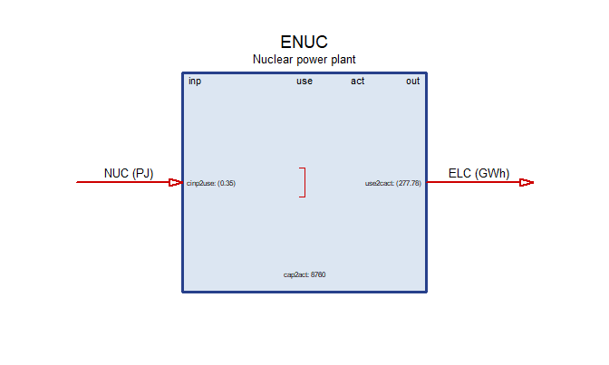

### Solar and wind

`ESOL` and `EWIN` have no fuel: the hourly weather profile bounds their
output directly, and their land pool bounds how much may be built. Each
region starts with 1 GW of legacy solar and wind capacity, declining to
zero by 2050.

`EWIN` carries two site grades as clusters, and the grades reach through
every object the wind chain touches. `WWIN` holds a profile per grade:
`HI` is the exposed ridge and coast as measured, `LO` the open inland
terrain, weaker and steadier. `LANDW` is declared in the same two tiers,
so the commodity becomes one balance per grade and ridgeline cannot be
spent on an inland farm; `RES_LANDW` gives each tier its own budget, the
exposed land being the scarce one. `EWIN` then carries its own cost and
land intensity per grade, and a reference to `WWIN` or `LANDW` resolves
to the matching tier by cluster name.

The grades are not simply better and worse. `HI` yields more energy per
GW and occupies more land per GW, and its land is the scarce kind; `LO`
is weaker but plentiful. Which one a region builds is a question about
its terrain.

``` r

# Everything standing in 2025 is fixed tilt: tracking is new in this horizon
# and has no legacy fleet.
sol_cap <- data.frame(
  vintage = "2015",
  cluster = "FL",
  region = rep(regions, times = 2),
  year = rep(c(2025, 2050), each = length(regions)),
  stock = rep(c(1, 0), each = length(regions))
)

ESOL <- newTechnology(
  name = "ESOL",
  desc = "Solar photovoltaic plant",
  units = data.frame(
    capacity = "GW",
    activity = "GWh",
    costs = "MUSD"
  ),
  output = list(
    comm = "ELC", 
    unit = "GWh"
  ),
  weather = list(
    weather = "WSOL", 
    waf.up = 1
  ),
  cap2act = convert("GW*year", "GWh", 1),
  vintage = data.frame(
    vintage = c("2015", "2030", "2045"),
    start = c(2015L, 2030L, 2045L),
    # The legacy vintage closes to investment BEFORE the base year: 2025 is
    # observed, so what stands in it is stock and not a decision. Left open to
    # 2025 the base-year solve bought legacy turbines at legacy prices, up to
    # the land ceiling.
    end = c(2020L, 2040L, 2050L),
    olife = c(25L, 30L, 30L)
  ),
  # Two mountings on the same ground. Tracking earns about a fifth more
  # energy from the same cells and moves the peak into the morning, and pays
  # for it in capital and in land: the rows must not shade one another, so a
  # tracking field is spread wider.
  cluster = sol_cl,
  invcost = data.frame(
    cluster = rep(c("FL", "TH"), each = 3),
    vintage = rep(c("2015", "2030", "2045"), times = 2),
    invcost = convert("USD/kW", "MUSD/GW",
                      c(650, 450, 350, 780, 540, 420))
  ),
  fixom = data.frame(
    cluster = rep(c("FL", "TH"), each = 3),
    vintage = rep(c("2015", "2030", "2045"), times = 2),
    fixom = c(12, 10, 9, 15, 13, 11)
  ),
  aux = data.frame(
    acomm = "LANDS",
    unit = "km2"
  ),
  aeff = data.frame(
    cluster = rep(c("FL", "TH"), each = 3),
    vintage = rep(c("2015", "2030", "2045"), times = 2),
    acomm = "LANDS",
    cap2ainp = c(20, 16, 14, 28, 23, 20) # km2 of land per GW standing
  ),
  capacity = sol_cap
)

draw(ESOL)
```


``` r


# A clustered technology cannot broadcast one stock across its clusters, so
# each grade is named. Every region inherits 1 GW of inland (`LO`) turbines;
# the three windy regions also inherit a fleet on the exposed ridges and coast,
# which is where turbines were actually built first.
#
# The `HI` fleet has to FIT: `HI` land is 30 km2 per GW of the region's wind
# siting budget and an `HI` farm takes 120 km2 per GW, so the ceiling is a
# quarter of that budget -- 3.5 GW in `R10`, 2.5 in `R12`, 0.75 in `R11`. The
# inherited fleet is set below each ceiling so the later vintages have room to
# build; filling it would leave the exposed grade nowhere to grow.
# The 2025 fleet, by region and grade. What stands in the base year is
# observed, so it is stock rather than a decision, and it retires to nothing
# by 2050 -- the legacy vintage is closed to investment before 2025.
#
# The table is FILTERED to the grades a region actually has: declaring a
# turbine on a tier with no land and no wind series would reach the model as a
# plant that can never run.
win_stock <- tibble::tribble(
  ~region, ~cluster, ~stock,
  "R10",   "HI",       2.5,
  "R11",   "HI",       2.0,
  "R12",   "HI",       1.5,
  "R09",   "HI",       1.0,
  "R01",   "HI",       0.4,
  "R11",   "MD",       0.5,
  "R12",   "MD",       0.4,
  "R02",   "MD",       0.3,
  "R01",   "MD",       0.2,
  "R03",   "LO",       0.8,
  "R04",   "LO",       0.8,
  "R06",   "LO",       0.6,
  "R08",   "LO",       0.6,
  "R07",   "LO",       0.4,
  "R09",   "LO",       0.4,
  "R05",   "LO",       0.2,
  "R02",   "LO",       0.2
) |>
  semi_join(land_w, by = c("region", "cluster"))

win_cap <- bind_rows(
  win_stock |> mutate(vintage = "2015", year = 2025),
  win_stock |> mutate(vintage = "2015", year = 2050, stock = 0)
) |>
  select(vintage, cluster, region, year, stock)

knitr::kable(
  win_stock |> tidyr::pivot_wider(names_from = cluster, values_from = stock),
  caption = "Base-year wind fleet by grade, GW"
)
```

| region |  HI |  MD |  LO |
|:-------|----:|----:|----:|
| R10    | 2.5 |  NA |  NA |
| R11    | 2.0 | 0.5 |  NA |
| R12    | 1.5 | 0.4 |  NA |
| R09    | 1.0 |  NA | 0.4 |
| R01    | 0.4 | 0.2 |  NA |
| R02    |  NA | 0.3 | 0.2 |
| R03    |  NA |  NA | 0.8 |
| R04    |  NA |  NA | 0.8 |
| R06    |  NA |  NA | 0.6 |
| R08    |  NA |  NA | 0.6 |
| R07    |  NA |  NA | 0.4 |
| R05    |  NA |  NA | 0.2 |

Base-year wind fleet by grade, GW {.table}

``` r


EWIN <- newTechnology(
  name = "EWIN",
  desc = "Onshore wind farm",
  units = data.frame(
    capacity = "GW",
    activity = "GWh",
    costs = "MUSD"
  ),
  output = list(comm = "ELC", unit = "GWh"),
  weather = list(weather = "WWIN", waf.up = 1),
  cap2act = convert("GW*year", "GWh", 1),
  vintage = data.frame(
    vintage = c("2015", "2030", "2045"),
    start = c(2015L, 2030L, 2045L),
    # The legacy vintage closes to investment BEFORE the base year: 2025 is
    # observed, so what stands in it is stock and not a decision. Left open to
    # 2025 the base-year solve bought legacy turbines at legacy prices, up to
    # the land ceiling.
    end = c(2020L, 2040L, 2050L),
    olife = c(25L, 30L, 30L)
  ),
  invcost = data.frame(
    vintage = c("2015", "2030", "2045"),
    invcost = convert("USD/kW", "MUSD/GW", c(1300, 1100, 950))
  ),
  fixom = data.frame(
    vintage = c("2015", "2030", "2045"),
    fixom = c(35, 30, 28)
  ),
  cluster = win_cl,
  aux = data.frame(
    acomm = "LANDW",
    unit = "km2"
  ),
  aeff = data.frame(
    cluster = rep(c("HI", "MD", "LO"), each = 3),
    vintage = rep(c("2015", "2030", "2045"), times = 3),
    acomm = "LANDW",
    # the windier grade needs wider spacing, so it buys its yield with land
    cap2ainp = c(120, 114, 108, 95, 90, 86, 70, 66, 63)
  ),
  capacity = win_cap
)
draw(EWIN)
```

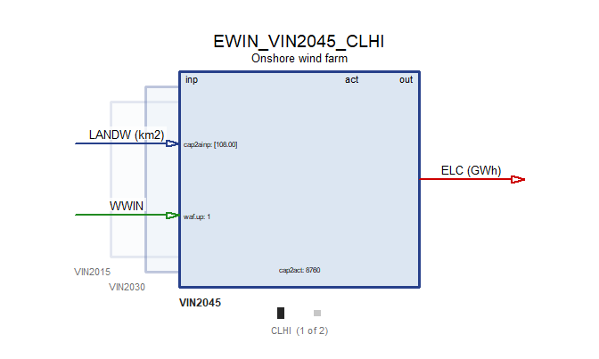

### Hydro

`EHYD` represents fixed reservoir hydropower capacity: 12 GW at the
mountain reservoir in `R05` and 6 GW in the run-of-river valley `R07`.
The inherited plants have a 60-year life and cannot be expanded.

``` r

EHYD <- newTechnology(
  name = "EHYD",
  desc = "Reservoir hydropower plant",
  units = data.frame(
    capacity = "GW",
    activity = "GWh",
    costs = "MUSD"
  ),
  region = c("R05", "R07"),
  input = list(
    comm = "HYD", 
    unit = "GWh"),
  output = list(
    comm = "ELC", 
    unit = "GWh"),
  ceff = data.frame(
    comm = "HYD", 
    cinp2use = 1),
  weather = list(
    weather = "WHYD", 
    comm = "HYD", 
    waf.up = 1),
  cap2act = convert("GW*year", "GWh", 1),
  invcost = list(
    invcost = convert("USD/kW", "MUSD/GW", 3000)
    ),
  fixom = 45,
  vintage = data.frame(
    start = 2010L,
    end = 2010L,
    olife = 60L
  ),
  capacity = data.frame(
    region = rep(c("R05", "R07"), times = 2),
    year = rep(c(2025, 2050), each = 2),
    stock = rep(c(12, 6), times = 2)
  )
)
autoplot(EHYD, map = gs, style = "map")
```

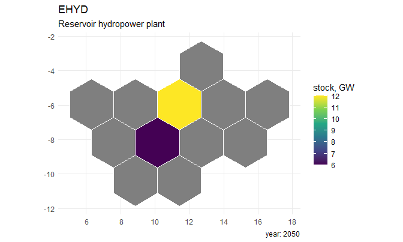

### Biomass

`EBIO` is a dispatchable, carbon-neutral biomass plant available for new
builds from 2030.

``` r

EBIO <- newTechnology(
  name = "EBIO",
  desc = "Biomass power plant, carbon-neutral",
  units = data.frame(
    capacity = "GW",
    activity = "GWh",
    costs = "MUSD"
  ),
  input = list(
    comm = "BIO", 
    unit = "PJ", 
    combustion = 1
  ),
  output = list(
    comm = "ELC", 
    unit = "GWh"),
  ceff = data.frame(
    comm     = c("BIO", "ELC"),
    cinp2use = c(0.35, NA),
    use2cact = c(NA, convert("PJ", "GWh", 1))
  ),
  cap2act = convert("GW*year", "GWh", 1),
  invcost = list(invcost = convert("USD/kW", "MUSD/GW", 1600)),
  fixom = 60,
  vintage = data.frame(
    start = 2030L,
    olife = 30L
  ),
  optimizeRetirement = TRUE
)
draw(EBIO)
```

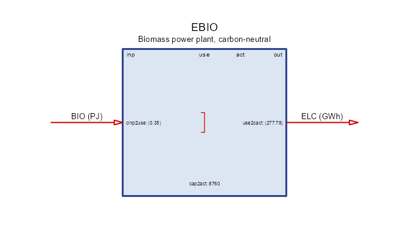

``` r


repo_generators <- newRepository(
  name = "topia_generators",
  ECOA, EGAS, ENUC, ESOL, EWIN, EHYD, EBIO
)
summary(repo_generators)
#> technology 
#>          7
```

### Hydrogen

`H2ELC` is an electrolyser: it consumes electricity and produces
hydrogen. Three vintages become available from 2030, each cheaper and
more efficient than the last. Having an hourly electricity input and an
hourly hydrogen output, it can absorb surplus wind and solar in the
hours when they are abundant, which is what makes `STG_H2` and `EXP_H2`
below worth building.

``` r

H2ELC <- newTechnology(
  name = "H2ELC",
  desc = "Water electrolyser, grid-connected",
  units = data.frame(
    capacity = "GW",
    activity = "GWh",
    costs = "MUSD"
  ),
  input = list(
    comm = "ELC",
    unit = "GWh"
  ),
  output = list(
    comm = "H2",
    unit = "GWh"
  ),
  ceff = data.frame(
    vintage = c("2030", "2040", "2050"),
    comm = "ELC",
    cinp2use = c(0.65, 0.70, 0.74) # GWh of H2 per GWh of electricity
  ),
  cap2act = convert("GW*year", "GWh", 1),
  vintage = data.frame(
    vintage = c("2030", "2040", "2050"),
    start = c(2030L, 2040L, 2050L),
    end = 2050L,
    olife = 25L
  ),
  invcost = data.frame(
    vintage = c("2030", "2040", "2050"),
    invcost = convert("USD/kW", "MUSD/GW", c(1400, 1000, 800))
  ),
  fixom = data.frame(
    vintage = c("2030", "2040", "2050"),
    fixom = c(40, 34, 30)
  )
)
draw(H2ELC)
```

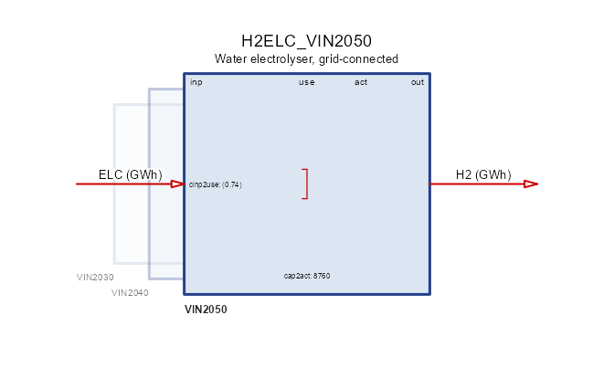

## Storage

`STG_ELC` is a four-hour lithium-ion battery with 95% input and output
efficiencies. `stg.invcost` prices energy capacity in MUSD/GWh;
`out.invcost` prices discharge power in MUSD/GW. Three vintages become
available over the horizon, each cheaper than the last.

``` r

STG_ELC <- newStorage(
  name = "STG_ELC",
  desc = "Lithium-ion battery, four-hour reservoir",
  units = data.frame(
    capacity = "GW",
    activity = "GWh",
    costs = "MUSD"
  ),
  commodity = "ELC",
  cap2act = convert("GW*year", "GWh", 1),
  duration = 4, # GWh per GW = hours
  vintage = data.frame(
    vintage = c("2025", "2035", "2045"),
    start = c(2025L, 2035L, 2045L),
    end = c(2030L, 2040L, 2050L),
    olife = c(20L, 20L, 25L)
  ),
  invcost = data.frame(
    vintage = c("2025", "2035", "2045"),
    stg.invcost = convert("USD/kWh", "MUSD/GWh", c(200, 110, 70)),
    out.invcost = convert("USD/kW", "MUSD/GW", c(150, 120, 95))
  ),
  seff = data.frame(inpeff = 0.95, outeff = 0.95),
  # The windy east already stores: a base-year run on the full hourly year
  # builds 1.9 GW in `R11` and 1.0 GW in `R12` from nothing, which says the
  # fleet standing in 2025 includes batteries there and the kit was not
  # declaring them. Both halves are declared -- the power rating AND the
  # reservoir, four hours of it, because `duration` is a constraint between
  # two stocks and not a way to derive one from the other: a declared power
  # rating with no reservoir behind it makes the base year build the
  # reservoir instead. It halves by 2050, so the projection replaces the
  # fleet rather than inheriting it forever.
  capacity = data.frame(
    vintage = "2025",
    region    = rep(c("R11", "R12"), times = 2),
    year      = rep(c(2025, 2050), each = 2),
    out.stock = c(2.0, 1.10, 1.0, 0.55),
    stg.stock = c(8.0, 4.40, 4.0, 2.20)
  )
)
draw(STG_ELC)
```

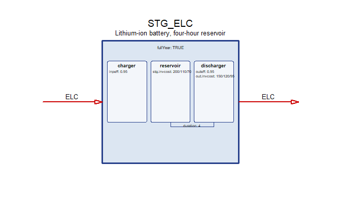

``` r


STG_H2 <- newStorage(
  name = "STG_H2",
  desc = "Hydrogen store, two hundred hours",
  units = data.frame(
    capacity = "GW",
    activity = "GWh",
    costs = "MUSD"
  ),
  commodity = "H2",
  cap2act = convert("GW*year", "GWh", 1),
  duration = 200, # GWh per GW = hours
  vintage = data.frame(olife = 30L),
  invcost = data.frame(
    stg.invcost = convert("USD/kWh", "MUSD/GWh", 2),
    out.invcost = convert("USD/kW", "MUSD/GW", 400)
  ),
  seff = data.frame(inpeff = 0.98, outeff = 0.98)
)
draw(STG_H2)
```

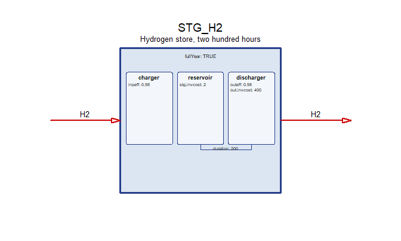

``` r


repo_storage <- newRepository(
  name = "topia_storage",
  STG_ELC
)

# the hydrogen chain is declared across three sections: the electrolyser with
# the technologies, the store here, the export with the rest-of-world trade
repo_hydrogen <- newRepository(
  name = "topia_hydrogen",
  H2ELC, STG_H2, EXP_H2
)
```

## Inter-regional trade

`topia$links` is the transmission network, a symmetric region-by-region
matrix settled with the geometry: two regions are linked when they share
a border on most of the four layouts, and a link never crosses another
on the map it was taken from. `R01` is the exception that is not an
exception – it has no link at all. It is the remote region, and a model
in which it balances locally is the point of it rather than an
oversight.

``` r

links <- topia$links[regions, regions]

knitr::kable(
  ifelse(links, "x", ""),
  caption = "Transmission network: a cross marks a linked pair"
)
```

|     | R01 | R02 | R03 | R04 | R05 | R06 | R07 | R08 | R09 | R10 | R11 | R12 |
|:----|:----|:----|:----|:----|:----|:----|:----|:----|:----|:----|:----|:----|
| R01 |     |     |     |     |     |     |     |     |     |     |     |     |
| R02 |     |     | x   |     | x   |     | x   |     |     |     |     |     |
| R03 |     | x   |     |     |     |     | x   |     |     |     |     |     |
| R04 |     |     |     |     | x   | x   |     |     |     |     |     |     |
| R05 |     | x   |     | x   |     | x   | x   |     |     |     |     |     |
| R06 |     |     |     | x   | x   |     |     |     |     | x   |     |     |
| R07 |     | x   | x   |     | x   |     |     | x   |     |     |     |     |
| R08 |     |     |     |     |     |     | x   |     | x   |     |     |     |
| R09 |     |     |     |     |     |     |     | x   |     | x   |     |     |
| R10 |     |     |     |     |     | x   |     |     | x   |     | x   |     |
| R11 |     |     |     |     |     |     |     |     |     | x   |     | x   |
| R12 |     |     |     |     |     |     |     |     |     |     | x   |     |

Transmission network: a cross marks a linked pair {.table}

Each linked pair becomes one bidirectional corridor carrying `ELC`, with
97% transfer efficiency, 350 MUSD/GW investment cost and a 2 USD/MWh
wheeling cost. `cap2act` converts corridor capacity from GW to GWh. The
upper triangle is enough: a pair is one object, declared in both
directions inside it.

Existing capacity is 3 GW on most corridors and 8 GW where **both**
endpoints carry the `HI` wind grade. The windy east is meshed more
strongly than the rest because that is where the wind is: a grid gets
built out to collect it. The rule is read off the resource data rather
than listed by hand, so it follows the grades wherever a rebuild puts
them. Its practical effect is that the base year installs nothing – at a
flat 3 GW the 2025 run buys 3.1 GW of extra wire between the two
windiest regions, which would make the base year a forecast rather than
an observation of a fleet that exists.

``` r

pairs <- which(links & upper.tri(links), arr.ind = TRUE)

hi_wind <- unique(as.character(
  win_cl$region[win_cl$cluster == "HI"]
))
elc_stock <- function(a, b) if (all(c(a, b) %in% hi_wind)) 8 else 3

repo_transmission <- newRepository("topia_transmission")

for (i in seq_len(nrow(pairs))) {
  a <- regions[pairs[i, 1]]
  b <- regions[pairs[i, 2]]
  trd <- newTrade(
    name = paste0("TBD_ELC_", a, "_", b),
    desc = paste0("Bidirectional transmission line ", a, " - ", b),
    units = data.frame(
      capacity = "GW",
      activity = "GWh",
      costs = "MUSD"
    ),
    commodity = "ELC",
    routes = data.frame(
      src = c(a, b),
      dst = c(b, a)
    ),
    trade = data.frame(
      src = c(a, b),
      dst = c(b, a),
      teff = 0.97
    ),
    cap2act = convert("GW*year", "GWh", 1),
    capacity = data.frame(stock = elc_stock(a, b)),
    invcost = data.frame(
      region = c(a, b),
      invcost = 350
    ),
    varom = data.frame(
      src = c(a, b),
      dst = c(b, a),
      varom = convert("USD/MWh", "MUSD/GWh", 2)
    ),
    vintage = data.frame(olife = 50L)
  )
  repo_transmission <- add(repo_transmission, trd)
}

names(repo_transmission)
#>  [1] "TBD_ELC_R02_R03" "TBD_ELC_R02_R05" "TBD_ELC_R04_R05" "TBD_ELC_R04_R06"
#>  [5] "TBD_ELC_R05_R06" "TBD_ELC_R02_R07" "TBD_ELC_R03_R07" "TBD_ELC_R05_R07"
#>  [9] "TBD_ELC_R07_R08" "TBD_ELC_R08_R09" "TBD_ELC_R06_R10" "TBD_ELC_R09_R10"
#> [13] "TBD_ELC_R10_R11" "TBD_ELC_R11_R12"
```

### Fuel corridors

Coal rail corridors and gas pipelines connect adjacent zones. They are
written out rather than looped because they live at a different
geoframe: `COA` and `GAS` are balanced per zone, so their corridors run
zone to zone and are not in the region matrix.

The two fuels move differently, which is the point of separating them.
Coal leaves the basin in `Z4` on **two** corridors, to `Z3` and to `Z5`,
and runs in **both** directions on each, so a surplus can travel either
way. Gas has **one** pipe and it runs **one way**, `Z2` to `Z3`: a
pipeline is built to deliver from a field to a market, and declaring a
single `routes` row is how that is said – the model then cannot send gas
back, whatever the prices do. Neither fuel reaches `Z1` at all: the
remote zone buys from the rest of the world instead, which is what the
import objects are for. Coal corridors carry 60 PJ/year at 99%
efficiency, the gas pipe 40 PJ/year at 98%. Their capacity unit is
PJ/year, so `cap2act = 1`.

``` r

TBD_COA_Z4_Z3 <- newTrade(
  name = "TBD_COA_Z4_Z3",
  desc = "Coal rail corridor Z4 - Z3",
  units = data.frame(
    capacity = "PJ/year",
    activity = "PJ",
    costs = "MUSD"
  ),
  commodity = "COA",
  routes = data.frame(
    src = c("Z4", "Z3"),
    dst = c("Z3", "Z4")
  ),
  trade = data.frame(
    src = c("Z4", "Z3"),
    dst = c("Z3", "Z4"),
    teff = 0.99
  ),
  cap2act = 1, # capacity in PJ/yr
  capacity = data.frame(stock = 60),
  invcost = data.frame(
    region = c("Z4", "Z3"),
    invcost = 20
  ),
  varom = data.frame(
    src = c("Z4", "Z3"),
    dst = c("Z3", "Z4"),
    varom = 0.3
  ),
  vintage = data.frame(olife = 40L)
)

TBD_COA_Z4_Z5 <- newTrade(
  name = "TBD_COA_Z4_Z5",
  desc = "Coal rail corridor Z4 - Z5",
  units = data.frame(
    capacity = "PJ/year",
    activity = "PJ",
    costs = "MUSD"
  ),
  commodity = "COA",
  routes = data.frame(
    src = c("Z4", "Z5"),
    dst = c("Z5", "Z4")
  ),
  trade = data.frame(
    src = c("Z4", "Z5"),
    dst = c("Z5", "Z4"),
    teff = 0.99
  ),
  cap2act = 1,
  capacity = data.frame(stock = 60),
  invcost = data.frame(
    region = c("Z4", "Z5"),
    invcost = 20
  ),
  varom = data.frame(
    src = c("Z4", "Z5"),
    dst = c("Z5", "Z4"),
    varom = 0.3
  ),
  vintage = data.frame(olife = 40L)
)

TBD_GAS_Z2_Z3 <- newTrade(
  name = "TBD_GAS_Z2_Z3",
  desc = "Gas pipeline Z2 - Z3, one way",
  units = data.frame(
    capacity = "PJ/year",
    activity = "PJ",
    costs = "MUSD"
  ),
  commodity = "GAS",
  # one row, so the pipe runs one way only: gas leaves the producing zone
  routes = data.frame(
    src = "Z2",
    dst = "Z3"
  ),
  trade = data.frame(
    src = "Z2",
    dst = "Z3",
    teff = 0.98
  ),
  cap2act = 1,
  capacity = data.frame(stock = 40),
  invcost = data.frame(
    region = c("Z2", "Z3"),
    invcost = 60
  ),
  varom = data.frame(
    src = "Z2",
    dst = "Z3",
    varom = 0.2
  ),
  vintage = data.frame(olife = 40L)
)

repo_fuel_trade <- newRepository(
  name = "topia_fuel_trade",
  TBD_COA_Z4_Z3, TBD_COA_Z4_Z5,
  TBD_GAS_Z2_Z3
)

names(repo_fuel_trade)
#> [1] "TBD_COA_Z4_Z3" "TBD_COA_Z4_Z5" "TBD_GAS_Z2_Z3"
```

### Drawing the network

Four ready-made views of the same repository.
[`plot_trade_map()`](https://energyRt.org/reference/energyRt-deprecated.md)
draws straight arrows between region centroids;
[`plot_trade_network()`](https://energyRt.org/reference/energyRt-deprecated.md)
curves the edges and scales them by capacity, which separates the links
that are not borders on this particular layout.

``` r

plot_trade_map(repo_transmission, map = gs)
```

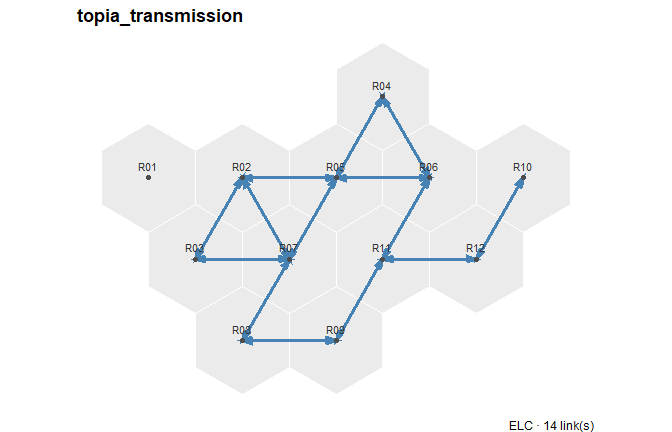

``` r

plot_trade_map(repo_fuel_trade, map = gs, comm = "GAS", level = "zone")
```

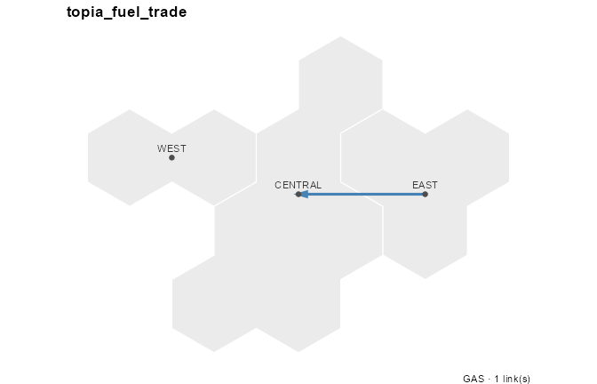

``` r

plot_trade_map(repo_fuel_trade, map = gs, comm = "COA", level = "zone")
```

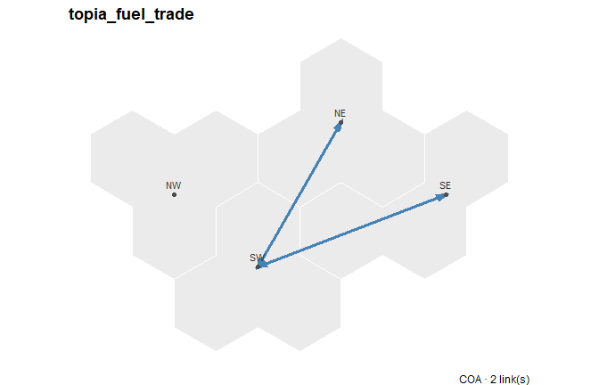

``` r

plot_trade_network(repo_transmission, map = gs)
```

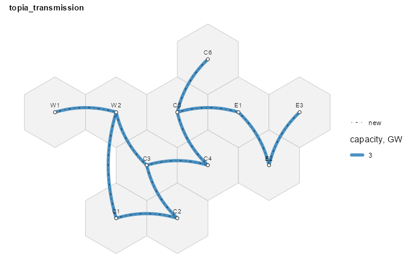

The fuel corridors run zone to zone, so they are absent from a
region-level drawing and need `level =` to appear at all:

``` r

plot_trade_network(repo_transmission, map = gs, level = "zone")
```

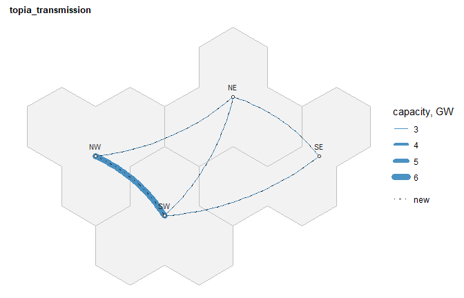

A single corridor draws on its own. `R10`-`R11` is the one worth looking
at: both its endpoints carry the `HI` wind grade, so it is one of the
three built out to 8 GW rather than 3.

``` r

autoplot(getObject(repo_transmission, name = "TBD_ELC_R10_R11", drop = TRUE),
         map = gs)
```

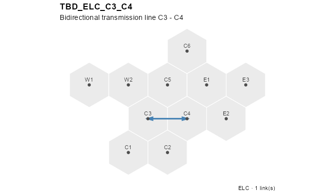

## The repository

Each group of objects was collected into its own repository as it was
built: `repo_commodities`, `repo_supply`, `repo_weather`,
`repo_generators`, `repo_storage`, `repo_hydrogen`, `repo_transmission`,
`repo_fuel_trade` and `repo_demand`. A group can be inspected, drawn or
swapped on its own – `repo_generators` is the fleet, `repo_hydrogen` the
whole hydrogen chain declared across three sections, and
`repo_transmission` the electricity grid kept apart from
`repo_fuel_trade` because the two sit at different geoframes and carry
different units. Combining them gives the model’s repository:

``` r

repo <- newRepository(
  name = "topia",
  repo_commodities,
  repo_supply,
  repo_weather,
  repo_generators,
  repo_storage,
  repo_hydrogen,
  repo_transmission,
  repo_fuel_trade,
  repo_demand
)
repo
#> repository 'topia': 51 objects.
```

## The model

`TOPIA` combines the repository with the region set, calendar, horizon,
5% discount rate, and spatial hierarchy.

``` r

TOPIA <- newModel(
  name = "TOPIA",
  currency = "MUSD",
  region = regions,
  calendar = calendar,
  horizon = horizon,
  discount = 0.05,
  data = repo
) |>
  setGeoscale(gs)

TOPIA
#> Name:  TOPIA
```

## Scenario levers

Three optional scenario levers are defined but not added to the base
repository: an emissions cap, a carbon tax, and early-retirement limits.

``` r

CO2_CAP <- newConstraint(
  name = "CO2_CAP",
  eq = "<=",
  for.each = data.frame(
    year = c(2025, 2030, 2040, 2050),
    comm = "CO2"
  ),
  term1 = list(variable = "vEmsFuelTot"),
  rhs = data.frame(
    year = c(2025, 2050),
    rhs = c(5000, 2500) * length(regions)
  ),
  defVal = Inf
)

CT_CO2 <- newTax(
  name = "CT_CO2",
  comm = "CO2",
  tax = data.frame(
    year = c(2025, 2050),
    bal = c(0.02, 0.08)
  )
)
```

`CT_CO2` raises the carbon price from 20 USD/t in 2025 to 80 USD/t in
2050.

``` r

EARLY_RET <- newConstraint(
  name = "EARLY_RET",
  eq = "<=",
  for.each = expand.grid(
    year = c(2030, 2040, 2050),
    tech = c("ECOA", "EGAS"),
    stringsAsFactors = FALSE
  ),
  term1 = list(variable = "vTechCap"),
  rhs = data.frame(
    tech = rep(c("ECOA", "EGAS"), each = 3),
    year = rep(c(2030, 2040, 2050), times = 2),
    rhs = c(
      12, 10, 8, # coal ceiling, GW per region
      7, 6, 5
    ) # gas ceiling, GW per region
  ),
  defVal = Inf
)
```

`EARLY_RET` sets regional coal and gas capacity ceilings for 2030, 2040,
and 2050.

``` r

GREEN_H2 <- newConstraint(
  name = "GREEN_H2",
  desc = "Electrolysis capped by renewable generation in the same hour",
  eq = "<=",
  for.each = expand.grid(
    region = regions,
    year = c(2030, 2040, 2050),
    timeslice = as.character(calendar@timetable$timeslice),
    stringsAsFactors = FALSE
  ),
  term1 = list(
    variable = "vTechInp",
    for.sum = list(tech = "H2ELC", comm = "ELC")
  ),
  term2 = list(
    variable = "vTechOut",
    for.sum = list(tech = c("ESOL", "EWIN", "EHYD"), comm = "ELC"),
    mult = -1
  ),
  rhs = 0,
  defVal = 0
)
```

`GREEN_H2` requires the electrolyser’s electricity draw to stay within
renewable generation in the same region and the same timeslice. It is an
*hourly matching* rule, of the kind used to certify renewable hydrogen,
rather than a physical separation: the same renewable MWh may back both
grid demand and electrolysis, because the model balances one pooled
electricity commodity and cannot trace individual flows. Hydro counts as
renewable here; biomass does not, matching the attribution used in
*TOPIA II*.

Two consequences are worth anticipating. The rule is binding, so
hydrogen output falls and system cost rises. And the hydrogen it
produces is *not* reported as wholly green by an average attribution:
that convention divides the draw among everything generating in the
hour, and fossil plants are still serving other loads at the time. The
constraint and the attribution answer two different questions, which
*TOPIA II* takes up with the solved results.

## Next steps

**TOPIA II: running scenarios** builds and solves scenarios from this
model.
