# Vintages and clusters

``` r

library(energyRt)
library(geoscales)
library(ggplot2)
```

## One object, many processes

A technology is rarely one thing. A gas plant built in 2025 is not the
plant you build in 2035: it costs more and burns more fuel for the same
electricity. Wind is not one resource but a handful of site grades, the
best ones finite. A transmission corridor is not one line but a stack of
tranches, each with its own losses.

energyRt writes all three with the same mechanism. One object declares a
**family**, and at interpolation it is **expanded** into one ordinary
process per member – so the solver sees plain processes and every
equation stays as it is. The family has two axes:

| axis | slot | what a member is | ordered? |
|----|----|----|----|
| **vintage** | `@vintage` | a build year, with its own costs and efficiency | yes, by year |
| **cluster** | `@cluster` | a parallel part that exists *at the same time* as its siblings | only by convention (`order`) |

The distinction is worth getting right at the start: **vintages are
sequential, clusters are simultaneous**. Vintages differ in *when* they
were built; clusters differ in *what* they are – a grade, a site class,
a tranche, a fleet type.

A member’s name carries its provenance, so solver output, reports and
levies all refer to something you can read:

    PP   + vintage 2035                  -> PP_VIN2035
    EWIN + cluster 01                    -> EWIN_CL01
    ECOA + vintage 2030 + cluster CCS    -> ECOA_VIN2030_CLCCS

The prefixes are model-wide settings (`_VIN` and `_CL` by default),
since they become solver set-member names:

``` r

mod <- newModel(name = "m", variant_prefix = c(cluster = "_T"))  # EWIN_T01
```

**Cluster labels are zero-padded ordinals** (`"01"`, `"02"`, …) for
resource tiers. Two reasons: the same token then ties every object of
one tier together (`WWIN_CL01`, `LAND_CL01`, `RES_LAND_CL01`,
`EWIN_VIN2040_CL01`), and 40 tiers sort `01..40` instead of
`1, 10, 11, 2`. What a tier *means* goes in `desc`, where it cannot be
parsed back out of a name by mistake.

Every example below is a complete model you can paste and run, written
out in full rather than wrapped in a helper, so each one stands alone.
Each carries a deliberately expensive
[`newImport()`](https://energyRt.org/reference/newImport.md) as a
backstop: it is never used in the solutions shown, and it is there so
the examples stay feasible if you change a bound while reading.

``` r

cal <- newCalendar(
  timetable = make_timetable(
    struct = list(ANNUAL = "ANNUAL", SEASON = c("WIN", "SUM"))),
  name = "two_seasons")
```

## Vintages: the same plant, built later

`@vintage` declares the build years a technology comes in, and the other
slots carry a `vintage` column saying which member a row belongs to.
Here the 2035 vintage is cheaper to build *and* more efficient – the
ordinary case for any technology still on a learning curve:

``` r

PP <- newTechnology(
  name = "PP",
  desc = "Gas plant, two build vintages",
  input = data.frame(comm = "GAS", unit = "PJ"),
  output = data.frame(comm = "ELC", unit = "GWh"),
  vintage = data.frame(
    vintage = c("2025", "2035"),
    start   = c(2025, 2035),   # first year this vintage may be BUILT
    end     = 2050,            # last year it may be built
    olife   = 30L              # operational life, once built
  ),
  ceff = data.frame(
    vintage = c("2025", "2035"),
    comm = "ELC",
    cact2cout = c(0.40, 0.55)  # GWh out per GWh of fuel in
  ),
  invcost = data.frame(
    vintage = c("2025", "2035"),
    invcost = c(1200, 900)     # MUSD/GW
  ),
  capacity = data.frame(cap.up = 400),  # GW; no vintage column: both members
  cap2act = 8.76                        # GW -> GWh/year
)
```

[`draw()`](https://energyRt.org/reference/draw.md) sketches what was
just declared, before any model is built:

``` r

draw(PP)
```


One box, because the vintages share a structure: same fuel in, same
commodity out. What differs is the data, which is what
[`autoplot()`](https://ggplot2.tidyverse.org/reference/autoplot.html)
shows – one series per member, over the years each one may be built in:

``` r

autoplot(object = PP)
```


Three things in that declaration are worth naming.

`start`/`end` are an **investment window**, not a lifetime: they say
when the vintage may be *built*, while `olife` says how long it then
runs. The windows may overlap, as they do here – from 2035 both vintages
are buildable and the model chooses.

`capacity` carries **no** `vintage` column, so its row applies to every
member. That is the general rule for every slot: a selector column left
`NA` broadcasts to all variants, so you name a vintage only where the
members actually differ.

Units are stated on both flows and the conversion is explicit:
`cap2act = 8.76` turns a capacity in GW into GWh per year, so `invcost`
reads MUSD/GW and the levelized costs later in this article come out in
USD/MWh.

``` r

GAS <- newCommodity(name = "GAS", timeframe = "ANNUAL", unit = "PJ")
ELC <- newCommodity(name = "ELC", timeframe = "SEASON", unit = "GWh")

SUP_GAS <- newSupply(
  name = "SUP_GAS",
  commodity = "GAS",
  supply = data.frame(cost = 4)   # MUSD/PJ
)
IMP_ELC <- newImport(
  name = "IMP_ELC",
  commodity = "ELC",
  import = data.frame(price = 5000)  # backstop, never economic
)
DEM_GROW <- newDemand(
  name = "DEM_ELC",
  commodity = "ELC",
  demand = data.frame(year = c(2025, 2050), demand = c(18, 30))  # GWh/slice
)

repo_vin <- newRepository(
  name = "repo_vin",
  GAS, ELC, SUP_GAS, IMP_ELC, DEM_GROW, PP
)
mod_vin <- newModel(
  name = "art_vintage",
  repo = repo_vin,
  calendar = cal,
  region = "R1",
  horizon = newHorizon(seq(2025, 2050, by = 5)),
  discount = 0.05
)
scen_vin <- solve_model(
  object = mod_vin,
  name = "art_vintage",
  ondisk = FALSE,
  overwrite = TRUE,
  echo = FALSE
)
getVariants(scen_vin)
#>         name      class base vintage cluster
#> 1 PP_VIN2025 technology   PP    2025    <NA>
#> 2 PP_VIN2035 technology   PP    2035    <NA>
```

[`getVariants()`](https://energyRt.org/reference/getVariants.md) is the
provenance table: every expanded process, its class, the object it came
from, and its coordinates on the two axes. It is the map between what
you declared and what the solver saw.

Now the investment decision itself:

``` r

newcap <- getData(scen_vin, name = "vTechNewCap", merge = TRUE)
newcap <- as.data.frame(newcap)
built <- newcap[newcap$value > 1e-6, c("tech", "year", "value")]
head(built, 8)   # GW
#>         tech year      value
#> 1 PP_VIN2025 2025 10.2739726
#> 2 PP_VIN2025 2026  0.2739726
#> 3 PP_VIN2025 2027  0.2739726
#> 4 PP_VIN2025 2028  0.2739726
#> 5 PP_VIN2025 2029  0.2739726
#> 6 PP_VIN2025 2030  0.2739726
#> 7 PP_VIN2025 2031  0.2739726
#> 8 PP_VIN2025 2032  0.2739726
```

The 2025 vintage builds 90 GW up front and tops up as demand grows; from
2035 every addition is the newer vintage, because it is both cheaper and
more efficient. Nothing retires mid-horizon and the backstop stays idle
– the whole story is “which vintage gets the next increment”.

To report per axis rather than per process,
[`variantSummary()`](https://energyRt.org/reference/variantSummary.md)
folds the members back along the axis you ask for:

``` r

vs <- variantSummary(
  object = scen_vin,
  name = "vTechNewCap",
  by = "vintage"
)
head(as.data.frame(vs), 4)
#>   base vintage region year n      total       mean sd        min        max
#> 1   PP    2025     R1 2025 1 10.2739726 10.2739726 NA 10.2739726 10.2739726
#> 2   PP    2025     R1 2026 1  0.2739726  0.2739726 NA  0.2739726  0.2739726
#> 3   PP    2025     R1 2027 1  0.2739726  0.2739726 NA  0.2739726  0.2739726
#> 4   PP    2025     R1 2028 1  0.2739726  0.2739726 NA  0.2739726  0.2739726
```

It returns `n`, `total`, `mean`, `sd`, `min` and `max` per group rather
than a bare `value`, because a family is a set and “the” value of a set
is a choice you should make explicitly.

## Clusters: parallel parts of one family

A cluster member exists *alongside* its siblings. The canonical case is
a resource in grades: the best wind sites are cheap and few, the poor
ones are plentiful and expensive, and each grade has its own ceiling.

``` r

EWIN <- newTechnology(
  name = "EWIN",
  desc = "Wind, three site grades",
  output = data.frame(comm = "ELC", unit = "GWh"),
  cluster = data.frame(
    cluster = c("01", "02", "03"),
    desc    = c("best sites", "average", "leftovers"),
    region  = NA_character_,   # all three exist everywhere
    order   = 1:3              # reporting order, best first
  ),
  af = data.frame(
    cluster = c("01", "02", "03"),
    af.up = c(0.45, 0.33, 0.22)    # capacity factor by grade
  ),
  capacity = data.frame(
    cluster = c("01", "02", "03"),
    cap.up = c(8, 16, 40)          # GW of potential by grade
  ),
  invcost = data.frame(
    cluster = c("01", "02", "03"),
    invcost = c(600, 900, 1800)    # MUSD/GW
  ),
  fixom = data.frame(
    cluster = c("01", "02", "03"),
    fixom = c(20, 22, 25)          # MUSD/GW/year
  ),
  vintage = data.frame(olife = 25L),
  cap2act = 8.76
)
```

Each grade carries its own availability factor, its own potential
(`cap.up`) and its own cost. Put it next to a gas plant and let the
model choose:

``` r

PP_flat <- newTechnology(
  name = "PP_flat",
  input = data.frame(comm = "GAS", unit = "PJ"),
  output = data.frame(comm = "ELC", unit = "GWh"),
  ceff = data.frame(comm = "ELC", cact2cout = 0.4),
  invcost = data.frame(invcost = 1200),
  capacity = data.frame(cap.up = 400),
  vintage = data.frame(olife = 30L),
  cap2act = 8.76
)
DEM_FLAT <- newDemand(
  name = "DEM_ELC",
  commodity = "ELC",
  demand = data.frame(demand = 18)   # GWh/slice, flat over the horizon
)

repo_clu <- newRepository(
  name = "repo_clu",
  GAS, ELC, SUP_GAS, IMP_ELC, DEM_FLAT, PP_flat, EWIN
)
mod_clu <- newModel(
  name = "art_cluster",
  repo = repo_clu,
  calendar = cal,
  region = "R1",
  horizon = newHorizon(seq(2025, 2040, by = 5)),
  discount = 0.05
)
scen_clu <- solve_model(
  object = mod_clu,
  name = "art_cluster",
  ondisk = FALSE,
  overwrite = TRUE,
  echo = FALSE
)

cap <- getData(scen_clu, name = "vTechCap", merge = TRUE)
cap <- as.data.frame(cap)
cap[cap$year == 2025 & grepl("EWIN", cap$tech), c("tech", "value")]   # GW
#>         tech    value
#> 1  EWIN_CL01 8.000000
#> 17 EWIN_CL02 1.544209
```

The best grade is built to its ceiling (8 GW), the average one likewise
(16 GW), and the poor grade is left in the ground – its 40 GW of
potential are not worth having at 1800 MUSD/GW. That is the point of a
graded resource: a single average cost would have built either too much
or too little.

### Clusters that differ by region

`@cluster`’s `region` column scopes a member, and it is intersected with
the object’s own `region`. This is how a tier set of a *different size*
in each region is expressed – the usual situation for land or wind
resources:

``` r

EWIN_R <- newTechnology(
  name = "EWIN",
  output = data.frame(comm = "ELC", unit = "GWh"),
  cluster = data.frame(
    cluster = c("01", "02"),
    region = c(NA, "R1")    # grade 02 exists in R1 only
  ),
  af = data.frame(cluster = c("01", "02"), af.up = c(0.45, 0.33)),
  capacity = data.frame(cluster = c("01", "02"), cap.up = 10),
  invcost = data.frame(cluster = c("01", "02"), invcost = c(600, 900)),
  vintage = data.frame(olife = 25L),
  cap2act = 8.76
)
DEM_SMALL <- newDemand(
  name = "DEM_ELC",
  commodity = "ELC",
  demand = data.frame(demand = 6)
)

repo_rr <- newRepository(
  name = "repo_rr",
  GAS, ELC, SUP_GAS, IMP_ELC, DEM_SMALL, PP_flat, EWIN_R
)
mod_rr <- newModel(
  name = "art_region",
  repo = repo_rr,
  calendar = cal,
  region = c("R1", "R2"),
  horizon = newHorizon(c(2025, 2030)),
  discount = 0.05
)
scen_rr <- interpolate_model(mod_rr, name = "art_region", ondisk = FALSE)

# any per-process input parameter shows which variants exist where, and
# `getData()` adds the provenance columns
inv <- getData(scen_rr, name = "pTechInvcost", merge = TRUE)
inv <- as.data.frame(inv)
unique(inv[, c("tech", "region", "cluster")])
#>         tech region cluster
#> 1    PP_flat     R1    <NA>
#> 2    PP_flat     R2    <NA>
#> 13 EWIN_CL01     R1      01
#> 14 EWIN_CL01     R2      01
#> 25 EWIN_CL02     R1      02
```

`EWIN_CL01` exists in both regions and `EWIN_CL02` only in R1 – three
`(process, region)` cells from one object, not four. A cluster whose
regions do not overlap the object’s own is an error rather than an empty
process.

A region-scoped declaration carries one row per `(cluster, region)`, so
a member existing in four regions keeps four rows. The **label**
identifies the member; the row count does not.

### Shares: two different levers

Two groups of columns on `@cluster` bound how a family splits, and they
are *not* alternatives:

| column | what it ties | typical use |
|----|----|----|
| `cap.share.fx` | the ratio of members’ **capacities**, every year | loss tranches, where each tranche’s efficiency is calibrated to its place in the stack |
| `act.share.lo/up/fx` | a member’s share of the family’s **throughput** | stopping a family collapsing onto its cheapest member |

Both are optional: a member with neither sizes and runs freely, as the
wind grades above do. Some classes deliberately have **no**
`cap.share.fx` at all – `supply`, `demand`, `import` and `export` have
no capacity variable for it to act on, so the column is absent rather
than present-and-ignored, and the mistake is rejected when you build the
object instead of silently doing nothing.

## Seeing a family

[`draw()`](https://energyRt.org/reference/draw.md) sketches one object’s
flow structure, which for a clustered technology is the structure every
member shares:

``` r

draw(EWIN)
```


[`autoplot()`](https://ggplot2.tidyverse.org/reference/autoplot.html) on
a process plots its declared data rather than its structure, so the
per-grade differences show up directly:

``` r

autoplot(EWIN)
```

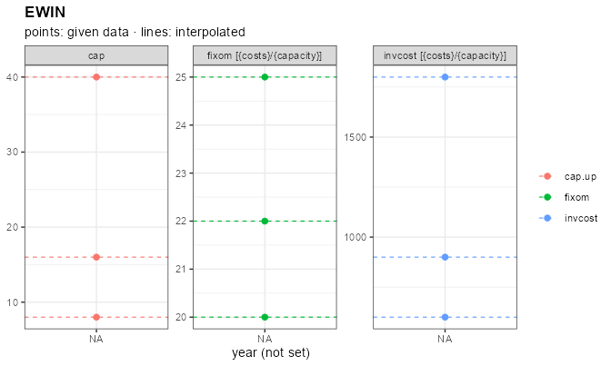

On a solved scenario
[`autoplot()`](https://ggplot2.tidyverse.org/reference/autoplot.html)
takes `by = "cluster"` (or `"vintage"`), which is the reason members
carry a provenance label at all:

``` r

autoplot(
  object = scen_clu,
  type = "capacity",
  comm = "ELC",
  by = "cluster"
)
```

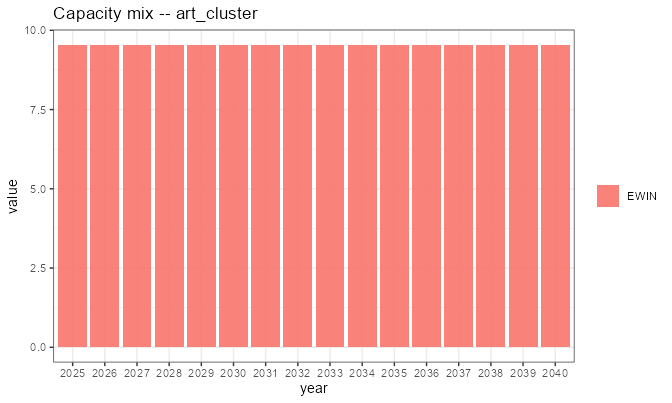

## Levelized cost per member

The build order above – grade 01 to its ceiling, then 02, never 03 – is
an outcome of the solve.
[`levcost()`](https://energyRt.org/reference/levcost.md) shows the
*cause*, and it needs no model at all: a technology plus its own costs
is enough for a closed-form LCOE.

``` r

lc <- levcost(
  object = EWIN,
  by_variant = TRUE
)
lc <- as.data.frame(lc)
lc[lc$year == 2030, c("variant", "cluster", "comm", "levcost")]   # USD/MWh
#>      variant cluster comm  levcost
#> 5  EWIN_CL01      01  ELC 15.87303
#> 30 EWIN_CL02      02  ELC 29.70016
#> 55 EWIN_CL03      03  ELC 79.24161
```

The ordering is the whole explanation: grade 01 is the cheapest
electricity in the model, 02 is worth building once 01 is exhausted, and
03 at roughly five times the cost of 01 never competes with a 1200
MUSD/GW gas plant. The cluster declaration and the solved result are two
views of one ranking.

Without `by_variant` the result keeps its class and plots directly, one
series per member:

``` r

lc_obj <- levcost(object = EWIN)
autoplot(lc_obj)
```

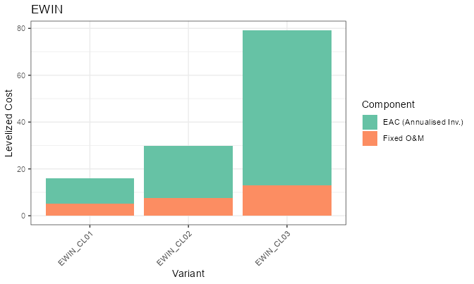

A vintaged technology works the same way, which is how you see a
learning curve before solving anything:

``` r

lc_pp <- levcost(
  object = PP,
  by_variant = TRUE
)
lc_pp <- as.data.frame(lc_pp)
lc_pp[lc_pp$year == 2040, c("variant", "vintage", "comm", "levcost")]
#>       variant vintage comm  levcost
#> 15 PP_VIN2025    2025  ELC 22.27789
#> 45 PP_VIN2035    2035  ELC 12.15158
```

## The two axes together

A technology may carry both, and expansion takes the grid: one process
per `(vintage, cluster)` cell.

``` r

ECOA <- newTechnology(
  name = "ECOA",
  input = data.frame(comm = "COA", unit = "PJ"),
  output = data.frame(comm = "ELC", unit = "GWh"),
  vintage = data.frame(
    vintage = c("2025", "2035"),
    start = c(2025, 2035),
    end = 2050,
    olife = 40L
  ),
  cluster = data.frame(cluster = c("PLAIN", "CCS")),
  # a row may select on either axis; NA broadcasts over that axis
  ceff = data.frame(
    vintage = c(NA, NA, "2035"),
    cluster = c("PLAIN", "CCS", "CCS"),
    comm = "ELC",
    cact2cout = c(0.42, 0.33, 0.36)   # CCS improves in the 2035 vintage
  ),
  invcost = data.frame(invcost = 1500),
  cap2act = 8.76
)
# -> ECOA_VIN2025_CLPLAIN, ECOA_VIN2025_CLCCS,
#    ECOA_VIN2035_CLPLAIN, ECOA_VIN2035_CLCCS
```

Two rules make these tables readable:

- an `NA` in a selector column **broadcasts** to every member on that
  axis, so you write a row once and override it only where a member
  differs;
- a row whose selector is the literal `"TOTAL"` is not a member at all –
  it is a bound on the *family*, which becomes a constraint across the
  expanded processes rather than data on one of them.

A cluster label here is a *kind* (`PLAIN`, `CCS`), not a resource tier,
so the ordinal convention does not apply: nothing else in the model
carries the token.

## Clustered resources: tiers that must not pool

Grades on a *process* get you most of the way, but two things sit
outside the process and need the same treatment.

### Weather tiers

A graded wind resource usually has a different **profile** per grade,
not just a different ceiling. Declare the tiers on the `weather` object
and keep one object for the whole set:

``` r

WWIN <- newWeather(
  name = "WWIN",
  desc = "Wind capacity factor by site grade",
  timeframe = "SEASON",
  unit = "share",
  cluster = data.frame(
    cluster = c("01", "02"),
    desc = c("good sites", "poor sites"),
    region = NA_character_,
    order = 1:2
  ),
  weather = data.frame(
    cluster   = rep(c("01", "02"), each = 2),
    region    = "R1",
    year      = 2025L,
    timeslice = rep(c("WIN", "SUM"), 2),
    wval      = c(0.9, 0.6,   0.45, 0.3)
  )
)

EWIN_W <- newTechnology(
  name = "EWIN",
  output = data.frame(comm = "ELC", unit = "GWh"),
  cluster = data.frame(cluster = c("01", "02"), region = NA_character_),
  capacity = data.frame(cluster = c("01", "02"), cap.up = 10),
  invcost = data.frame(cluster = c("01", "02"), invcost = 600),
  # ONE link row per tier, each naming the same object
  weather = data.frame(
    cluster = c("01", "02"),
    weather = "WWIN",
    waf.up = 1
  ),
  vintage = data.frame(olife = 25L),
  cap2act = 8.76
)

repo_w <- newRepository(
  name = "repo_w",
  GAS, ELC, SUP_GAS, IMP_ELC, DEM_SMALL, PP_flat, WWIN, EWIN_W
)
mod_w <- newModel(
  name = "art_weather",
  repo = repo_w,
  calendar = cal,
  region = "R1",
  horizon = newHorizon(c(2025, 2030)),
  discount = 0.05
)
scen_w <- interpolate_model(mod_w, name = "art_weather", ondisk = FALSE)

pw <- getData(scen_w, name = "pWeather", merge = TRUE)
unique(as.data.frame(pw)$weather)
#> [1] "WWIN_CL01" "WWIN_CL02"
```

Each tier became an ordinary weather object, `WWIN_CL01` and
`WWIN_CL02`, and the process variants read one each:

``` r

link <- getData(scen_w, name = "pTechWeatherAf", merge = TRUE)
link <- as.data.frame(link)
unique(link[, c("tech", "weather", "cluster")])
#>        tech   weather cluster
#> 1 EWIN_CL01 WWIN_CL01      01
#> 2 EWIN_CL02 WWIN_CL02      02
```

The link shows up on the drawing as a weather box against the
technology, and the tiers themselves plot straight from the object –
pass the `calendar` so the timeslices are laid out rather than taken as
labels:

``` r

draw(EWIN_W)
```

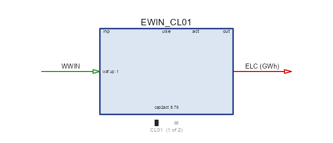

``` r

autoplot(object = WWIN, calendar = cal)
```

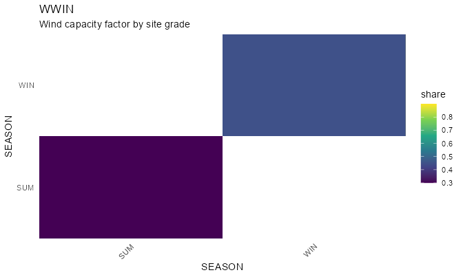

A consumer finds its tier **by cluster name** – the reason the label is
built once and shared. A link row carrying `cluster = "01"` reads the
`01` rows; a link to an *unclustered* weather object is untouched (so a
single shared profile keeps working exactly as before); and a link to a
clustered object with no cluster is an error, because a multiplicative
factor has no “every tier at once” reading. Tiers compose with
`transform`, giving `WWIN_CL01_<transform>`: the cluster picks the
series, the transform derives from it.

### Commodity tiers, and why they are needed

Now the harder half. Suppose each wind grade needs **land**, and land is
finite per grade. The obvious move – one `LAND` commodity, one supply
object with three clusters – does *not* bind per grade:

> The commodity balance is keyed on `(comm, region, year, timeslice)`
> and carries no cluster. Every producer of one commodity *name* writes
> into the same cell, so three supply clusters pour into one pool and
> grade-01 wind can draw grade-03 land.

The commodity name is the only tier-carrying key the balance has, so the
tiers belong on the commodity:

``` r

LAND <- newCommodity(
  name = "LAND",
  timeframe = "ANNUAL",
  unit = "kha",
  cluster = data.frame(cluster = c("01", "02", "03"), order = 1:3)
)
RES_LAND <- newSupply(
  name = "RES_LAND",
  commodity = "LAND",
  cluster = data.frame(
    cluster = c("01", "02", "03"),
    region = NA_character_,
    order = 1:3
  ),
  supply = data.frame(
    cluster = c("01", "02", "03"),
    ava.up = 4,              # kha available per grade
    cost = c(1, 2, 3)        # MUSD/kha
  )
)
EWIN_L <- newTechnology(
  name = "EWIN",
  input = data.frame(comm = "LAND", unit = "kha"),
  output = data.frame(comm = "ELC", unit = "GWh"),
  cluster = data.frame(cluster = c("01", "02", "03"), region = NA_character_),
  ceff = data.frame(
    cluster = c("01", "02", "03"),
    comm = "ELC",
    cact2cout = c(1, 0.8, 0.5)
  ),
  capacity = data.frame(cluster = c("01", "02", "03"), cap.up = 100),
  invcost = data.frame(cluster = c("01", "02", "03"), invcost = 0.1),
  vintage = data.frame(olife = 30L),
  cap2act = 1
)
DEM_LAND <- newDemand(
  name = "DEM_ELC",
  commodity = "ELC",
  demand = data.frame(demand = 3)
)

repo_land <- newRepository(
  name = "repo_land",
  ELC, IMP_ELC, DEM_LAND, LAND, RES_LAND, EWIN_L
)
mod_land <- newModel(
  name = "art_land",
  repo = repo_land,
  calendar = cal,
  region = "R1",
  horizon = newHorizon(c(2025, 2030)),
  discount = 0.05
)
scen_land <- solve_model(
  object = mod_land,
  name = "art_land",
  ondisk = FALSE,
  overwrite = TRUE,
  echo = FALSE
)

# one declaration, three commodities -- and one supply object, three processes
ava <- getData(scen_land, name = "pSupAva", merge = TRUE)
ava <- as.data.frame(ava)
unique(ava[, c("sup", "comm", "cluster")])
#>              sup      comm cluster
#> 1  RES_LAND_CL01 LAND_CL01      01
#> 7  RES_LAND_CL02 LAND_CL02      02
#> 13 RES_LAND_CL03 LAND_CL03      03
```

One declaration became three commodities, each with its own balance. The
supply object likewise became one process per tier, and every tier draws
only its own:

``` r

inp <- getData(scen_land, name = "vTechInp", merge = TRUE)
aggregate(value ~ tech + comm, inp, sum)   # kha
#>        tech      comm value
#> 1 EWIN_CL01 LAND_CL01    24
#> 2 EWIN_CL02 LAND_CL02    15
```

``` r

draw(EWIN_L)
```

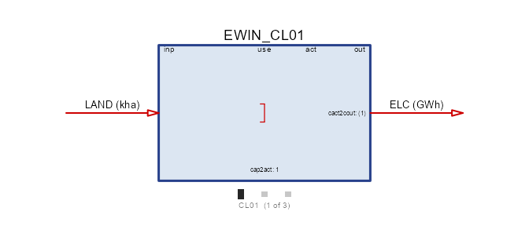

The land input is one arrow on the box, and the tiers that feed it are a
property of the resource, not of the process.
[`autoplot()`](https://ggplot2.tidyverse.org/reference/autoplot.html) on
the supply object shows what each tier has and what it costs:

``` r

autoplot(object = RES_LAND, style = "bar")
```

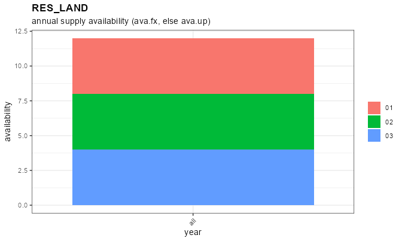

`EWIN_CL01` exhausts `LAND_CL01` and `EWIN_CL02` starts on `LAND_CL02`;
no variant ever touches another tier’s land. The bound bites where you
declared it, from **one** commodity and **one** supply object – which
matters because `supply@commodity` is a single name, so without tiered
commodities a tier set means one supply object per tier.

`ELC` in the same model has no clusters and is therefore shared by every
variant, with no flag anywhere. That is the rule in general: **tiering
is opt-in on the resource**, and a reference to an unclustered object is
left alone.

### Tiers that differ in data, not just in name

Land tiers differ only in how much there is. Fuel grades differ in *what
they are*: anthracite and lignite are the same commodity in a model’s
structure and not at all the same in carbon content. So `@emis`, `@agg`
and `@property` carry a `cluster` column too, with the broadcast rule
you have seen everywhere else – a row with no cluster is shared by every
tier:

``` r

COA <- newCommodity(
  name = "COA",
  timeframe = "ANNUAL",
  unit = "PJ",
  cluster = data.frame(
    cluster = c("01", "02"),
    desc = c("anthracite", "lignite"),
    order = 1:2
  ),
  emis = data.frame(
    cluster = c("01", "02", NA),        # NA: the last row is shared
    comm    = c("CO2", "CO2", "SO2"),
    emis    = c(0.090, 0.110, 0.001)    # kt per PJ; 02 is the dirtier grade
  )
)
CO2 <- newCommodity(
  name = "CO2",
  timeframe = "ANNUAL",
  unit = "kt",
  limtype = "UP"
)
SO2 <- newCommodity(
  name = "SO2",
  timeframe = "ANNUAL",
  unit = "kt",
  limtype = "UP"
)
SUP_COA <- newSupply(
  name = "SUP_COA",
  commodity = "COA",
  cluster = data.frame(cluster = c("01", "02"), region = NA_character_),
  supply = data.frame(
    cluster = c("01", "02"),
    ava.up = 100,
    cost = c(3, 1)        # the dirty grade is the cheap one
  )
)
PP_COA <- newTechnology(
  name = "PP_COA",
  input = data.frame(comm = "COA", unit = "PJ"),
  output = data.frame(comm = "ELC", unit = "GWh"),
  cluster = data.frame(cluster = c("01", "02"), region = NA_character_),
  ceff = data.frame(cluster = c("01", "02"), comm = "ELC", cact2cout = 0.4),
  capacity = data.frame(cluster = c("01", "02"), cap.up = 100),
  invcost = data.frame(cluster = c("01", "02"), invcost = 1),
  vintage = data.frame(olife = 30L),
  cap2act = 1
)

repo_coal <- newRepository(
  name = "repo_coal",
  ELC, CO2, SO2, IMP_ELC, DEM_LAND, COA, SUP_COA, PP_COA
)
mod_coal <- newModel(
  name = "art_coal",
  repo = repo_coal,
  calendar = cal,
  region = "R1",
  horizon = newHorizon(c(2025, 2030)),
  discount = 0.05
)
scen_coal <- interpolate_model(mod_coal, name = "art_coal", ondisk = FALSE)

ef <- getData(scen_coal, name = "pEmissionFactor", merge = TRUE)
ef <- as.data.frame(ef)
ef[, c("comm", "commp", "value")]   # kt per PJ
#>   comm    commp value
#> 1  CO2 COA_CL01 0.090
#> 2  SO2 COA_CL01 0.001
#> 3  CO2 COA_CL02 0.110
#> 4  SO2 COA_CL02 0.001
```

``` r

draw(PP_COA)
```

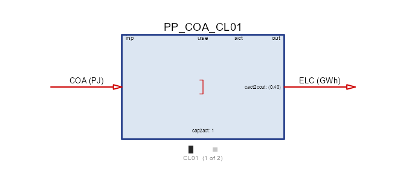

and the commodity itself plots its grades, which is where the difference
between the two fuels actually lives:

``` r

autoplot(object = COA)
```

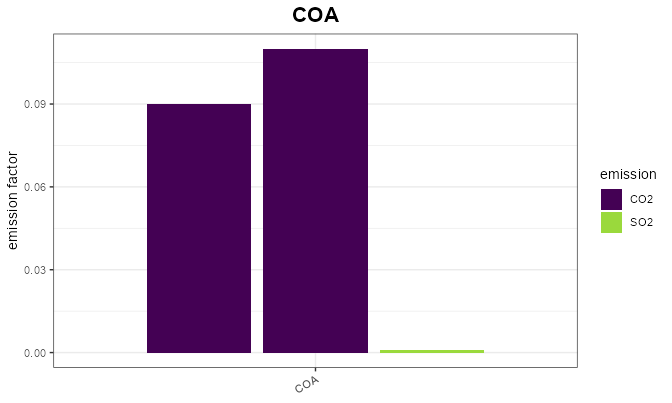

Each grade carries its own CO2 factor and both inherit the one shared
SO2 row. A grade is now a genuinely different fuel: cheap lignite with a
high carbon factor against costlier anthracite, and a CO2 cap decides
which one runs.

Declared labels are authoritative here too, and the declaration is
required: a label that appears in a data slot but not in the `cluster`
roster is a typo and an error, and so is a data slot carrying labels
with no roster at all. The alternative – harvesting the labels – made a
silent extra grade out of one stray row.

### Two tier sets that do not line up

The sections above tiered one thing at a time, and the rosters lined up
by design. A real wind resource rarely obliges. Land comes in grades
that are finite **per region**, because land is where the turbine
stands; the wind regime that drives output is a property of a much
larger area, and the two have nothing to do with each other – the best
land in a country can sit in either regime.

So: a two-level geoscale, land declared at the fine level, wind declared
at the coarse one.

``` r

gs_two <- geoscale_from_leaftable(
  data.frame(
    country = c("CO", "CO"),
    region = c("R1", "R2")
  ),
  geoframes = c("country", "region"),
  key = "region",
  name = "two_level"
)
```

The two regimes are declared **once, at the country level**, and each is
an ordinary unclustered weather object:

``` r

WWIN_COAST <- newWeather(
  name = "WWIN_COAST",
  desc = "Coastal wind regime",
  timeframe = "SEASON",
  unit = "share",
  weather = data.frame(
    region = "CO",
    timeslice = c("WIN", "SUM"),
    wval = c(0.55, 0.25)
  )
)
WWIN_INLAND <- newWeather(
  name = "WWIN_INLAND",
  desc = "Inland wind regime",
  timeframe = "SEASON",
  unit = "share",
  weather = data.frame(
    region = "CO",
    timeslice = c("WIN", "SUM"),
    wval = c(0.20, 0.45)
  )
)
```

Land is a tiered commodity at `geoframe = "region"`, and the potential
of each grade differs by region – `R2` has almost no best-grade land:

``` r

LAND_WIN <- newCommodity(
  name = "LAND_WIN",
  desc = "Developable wind land by site grade",
  timeframe = "ANNUAL",
  geoframe = "region",
  unit = "kha",
  cluster = data.frame(
    cluster = c("01", "02", "03"),
    desc = c("best", "fair", "poor"),
    order = 1:3
  )
)
RES_LAND_WIN <- newSupply(
  name = "RES_LAND_WIN",
  commodity = "LAND_WIN",
  cluster = data.frame(
    cluster = c("01", "02", "03"),
    region = NA_character_,
    order = 1:3
  ),
  supply = data.frame(
    cluster = rep(c("01", "02", "03"), each = 2),
    region = rep(c("R1", "R2"), times = 3),
    ava.up = c(20, 3,   30, 40,   100, 100),   # kha, by grade and region
    cost = 0
  )
)
```

Now the technology. Its clusters are the **land** grades, because that
is the axis its own capacity is limited on. The regime comes in through
the `weather` table, one row per cluster, each naming whichever
country-level object applies:

``` r

EWIN_SITE <- newTechnology(
  name = "EWIN_SITE",
  desc = "Wind, one variant per site grade",
  output = data.frame(comm = "ELC", unit = "GWh"),
  aux = data.frame(acomm = "LAND_WIN", unit = "kha"),
  cluster = data.frame(
    cluster = c("01", "02", "03"),
    desc = c("best sites", "fair sites", "poor sites"),
    region = NA_character_,
    order = 1:3
  ),
  vintage = data.frame(olife = 25L),
  invcost = data.frame(
    cluster = c("01", "02", "03"),
    invcost = c(900, 1000, 1300)    # MUSD/GW
  ),
  aeff = data.frame(
    cluster = c("01", "02", "03"),
    acomm = "LAND_WIN",
    ncap2ainp = c(2, 3, 5)          # kha of land per GW built
  ),
  # the second axis: grades 01 and 03 are coastal, 02 is inland
  weather = data.frame(
    cluster = c("01", "02", "03"),
    weather = c("WWIN_COAST", "WWIN_INLAND", "WWIN_COAST"),
    waf.up = 1
  ),
  cap2act = 8.76                    # GW -> GWh/year
)
```

Two flows and one regime per member, which is what the drawing says:
electricity out, land in as an auxiliary flow charged against new
capacity.

``` r

draw(EWIN_SITE)
```

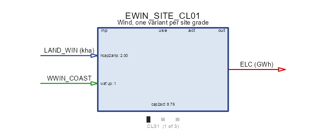

The regimes are ordinary series, and plotting them side by side is the
clearest statement that they are not orderable the way grades are – one
peaks in winter, the other in summer:

``` r

autoplot(object = WWIN_COAST, calendar = cal)
```

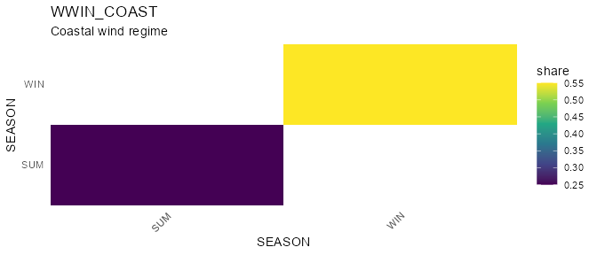

``` r

autoplot(object = WWIN_INLAND, calendar = cal)
```

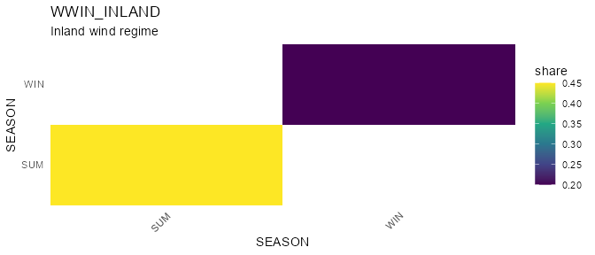

That `weather` table is the whole trick, and it works because **a link
to an unclustered weather object is left alone**: the cluster label
picks the *row*, and the row names the object. The regimes therefore
need no relationship to the land grades – two of the three grades share
one regime here.

``` r

DEM_WIND <- newDemand(
  name = "DEM_WIND",
  commodity = "ELC",
  demand = data.frame(
    region = c("R1", "R1", "R2", "R2"),
    timeslice = c("WIN", "SUM", "WIN", "SUM"),
    demand = 8                      # GWh per slice
  )
)

repo_site <- newRepository(
  name = "repo_site",
  ELC, IMP_ELC, DEM_WIND, LAND_WIN, RES_LAND_WIN,
  WWIN_COAST, WWIN_INLAND, EWIN_SITE
)
mod_site <- newModel(
  name = "art_sites",
  repo = repo_site,
  calendar = cal,
  region = c("R1", "R2"),
  geoscale = gs_two,
  horizon = newHorizon(2025),
  discount = 0.05
)
scen_site <- solve_model(
  object = mod_site,
  name = "art_sites",
  ondisk = FALSE,
  overwrite = TRUE,
  echo = FALSE
)
getVariants(scen_site)
#>                name      class         base vintage cluster
#> 1 RES_LAND_WIN_CL01     supply RES_LAND_WIN    <NA>      01
#> 2 RES_LAND_WIN_CL02     supply RES_LAND_WIN    <NA>      02
#> 3 RES_LAND_WIN_CL03     supply RES_LAND_WIN    <NA>      03
#> 4    EWIN_SITE_CL01 technology    EWIN_SITE    <NA>      01
#> 5    EWIN_SITE_CL02 technology    EWIN_SITE    <NA>      02
#> 6    EWIN_SITE_CL03 technology    EWIN_SITE    <NA>      03
```

Each regime is stored once, at the country level, however many regions
read it:

``` r

pw <- getData(scen_site, name = "pWeather", merge = TRUE)
unique(as.data.frame(pw)[, c("weather", "region")])
#>       weather region
#> 1  WWIN_COAST     CO
#> 3 WWIN_INLAND     CO
```

and each grade reads the one its link row names:

``` r

link <- getData(scen_site, name = "pTechWeatherAf", merge = TRUE)
link <- as.data.frame(link)
unique(link[, c("tech", "weather", "cluster")])
#>             tech     weather cluster
#> 1 EWIN_SITE_CL01  WWIN_COAST      01
#> 2 EWIN_SITE_CL02 WWIN_INLAND      02
#> 3 EWIN_SITE_CL03  WWIN_COAST      03
```

The solution shows both axes at work at once:

``` r

cap <- getData(scen_site, name = "vTechNewCap", merge = TRUE)
aggregate(value ~ tech + region, as.data.frame(cap), sum)      # GW
#>             tech region     value
#> 1 EWIN_SITE_CL01     R1 2.3120051
#> 2 EWIN_SITE_CL02     R1 2.7744061
#> 3 EWIN_SITE_CL01     R2 1.5000000
#> 4 EWIN_SITE_CL02     R2 2.7744061
#> 5 EWIN_SITE_CL03     R2 0.8120051

land <- getData(scen_site, name = "vTechAInp", merge = TRUE)
aggregate(value ~ tech + comm + region, as.data.frame(land), sum)   # kha
#>             tech          comm region    value
#> 1 EWIN_SITE_CL01 LAND_WIN_CL01     R1 4.624010
#> 2 EWIN_SITE_CL02 LAND_WIN_CL02     R1 8.323218
#> 3 EWIN_SITE_CL01 LAND_WIN_CL01     R2 3.000000
#> 4 EWIN_SITE_CL02 LAND_WIN_CL02     R2 8.323218
#> 5 EWIN_SITE_CL03 LAND_WIN_CL03     R2 4.060025

out <- getData(scen_site, name = "vTechOut", merge = TRUE)
aggregate(value ~ tech + timeslice, as.data.frame(out), sum)   # GWh
#>             tech timeslice      value
#> 1 EWIN_SITE_CL01       SUM  4.1741456
#> 2 EWIN_SITE_CL02       SUM 10.9367089
#> 3 EWIN_SITE_CL03       SUM  0.8891456
#> 4 EWIN_SITE_CL01       WIN  9.1831203
#> 5 EWIN_SITE_CL02       WIN  4.8607595
#> 6 EWIN_SITE_CL03       WIN  1.9561203
```

The same two tables as figures. The resource first – `style = "regions"`
is the view that matters here, because the whole point is that a grade’s
ceiling is a different number in each region:

``` r

autoplot(object = RES_LAND_WIN, style = "regions")
```

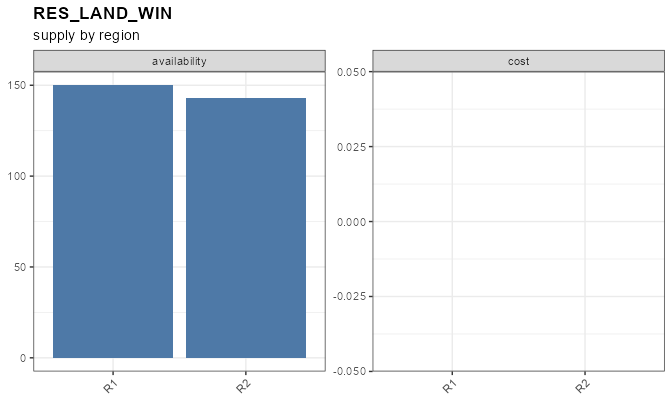

and then what was built, folded on the cluster axis:

``` r

autoplot(
  object = scen_site,
  type = "new_capacity",
  comm = "ELC",
  by = "cluster"
)
```

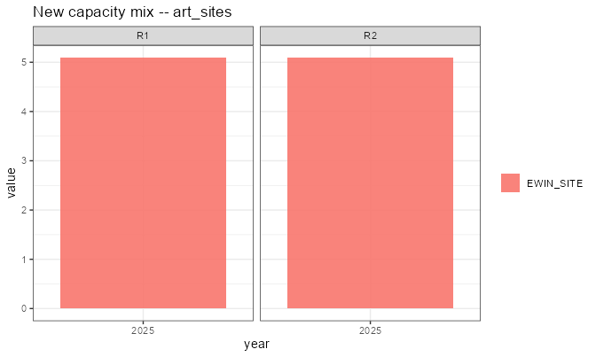

``` r

autoplot(
  object = scen_site,
  type = "generation",
  comm = "ELC",
  by = "cluster"
)
```

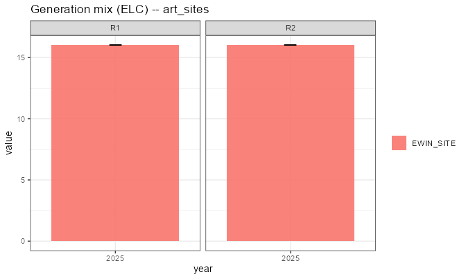

Read the land table first: `R2` takes `3.000` kha of grade `01`, which
is exactly what it has, and then falls back to grade `03` – while `R1`,
with 20 kha of the same grade, never gets near its limit. The tier bound
bit **per region**, which is why land had to be a regional commodity.

Then the generation table: winter output comes mostly from grades `01`
and `03` and summer output mostly from `02`. That is the regime
assignment, not the land quality – the model is holding a seasonally
complementary portfolio because the second axis cuts across the first.

Two notes on the alternative. If the regimes *do* coincide with the
grades, a clustered weather object is tidier: give it the same labels
and one link row, exactly as in [Weather tiers](#weather-tiers) above.
And if they do not coincide but you cluster the weather anyway, the
rosters must still match label for label, or interpolation refuses the
model:

    technology "EWIN_SITE_CL01" references weather "WWIN" with cluster "01", which
    that weather does not declare (it has "COAST", "INLAND"). The consumer decides
    which clusters exist, so the weather must cover every one it is asked for.

That is the right error: a multiplicative factor has no “pick one for
me” reading. The fix is either to align the labels or, as here, to let
the regimes be plain objects and name them per row.

## Reading a family back

Four calls, in increasing order of aggregation:

``` r

getVariants(scen)                                  # the provenance table
getVariants(scen, class = "technology")             # one class
getData(scen, name = "vTechCap", variants = TRUE)   # results + provenance
variantSummary(scen, name = "vTechCap", by = "cluster")  # folded on one axis
```

The same call takes a **model**, which answers the question a constraint
or a levy asks before anything is solved – what will the members be
called?

``` r

getVariants(mod_site)
#>                name      class         base vintage cluster
#> 1 RES_LAND_WIN_CL01     supply RES_LAND_WIN    <NA>      01
#> 2 RES_LAND_WIN_CL02     supply RES_LAND_WIN    <NA>      02
#> 3 RES_LAND_WIN_CL03     supply RES_LAND_WIN    <NA>      03
#> 4    EWIN_SITE_CL01 technology    EWIN_SITE    <NA>      01
#> 5    EWIN_SITE_CL02 technology    EWIN_SITE    <NA>      02
#> 6    EWIN_SITE_CL03 technology    EWIN_SITE    <NA>      03
```

Those names are minted from the model’s own `variant_prefix` and
recorded in the scenario, and
[`validate_scenario_parameters()`](https://energyRt.org/reference/validate_scenario_parameters.md)
re-derives every one of them from its `(base, vintage, cluster)` cell: a
provenance table that disagrees with the process names is refused rather
than read. The table is the one place to look – never the name itself.

`getData(..., variants = TRUE)` adds the provenance columns to the
results, which is usually what you want for plotting: group by `base` to
draw the family, by `cluster` to compare grades.

## Pitfalls

**The roster is required, on both axes.** A `cluster` or `vintage` label
used in any data slot must appear in `@cluster` / `@vintage`, or the
object is refused – the error names the labels, the slots they came
from, and the declaration to paste. The roster is the authoritative set,
so a misspelling is a typo rather than an extra member built with
defaults for everything it does not carry (no investment cost, no
capacity bound: free and unlimited). It is also the only place `region`
and `order` can be stated.

**A tier roster must cover what the processes ask for.** The consumer
decides which tiers exist; a process asking a clustered weather or
commodity for a tier it does not declare is an error naming both sides.
The reverse is allowed: a declared tier nobody references is still
materialized, so its data stays inspectable rather than vanishing.

**“Cluster” means something else in region aggregation.** In
`aggregate_model_regions(clusters = )` a cluster is a *group of regions*
being merged – see the multi-level region article. The two never
interact; the collision is only in the English word.

**Names are data.** A member’s name is a solver set member, so renaming
`variant_prefix` mid-project changes every result label, every levy
target and every golden. Pick it once per model.
